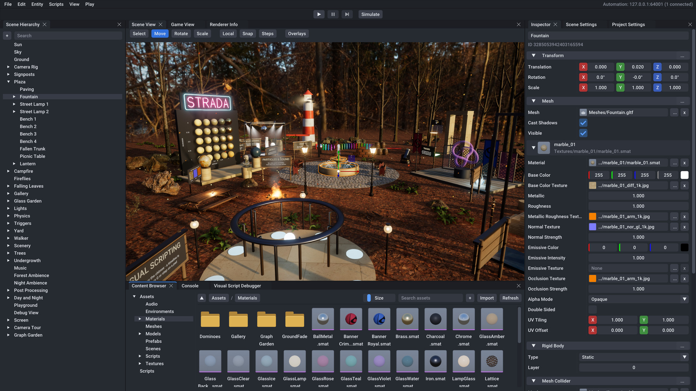

# Editor manual

The Strada Editor (`StradaEditor`) is where you build a game: you arrange scenes of entities and components, manage a
project's assets, write and attach C# scripts and visual scripts, play the game inside the editor and export it as a
standalone game. This manual describes every panel, menu, mouse binding and shortcut of the editor.

[GettingStarted.md](GettingStarted.md) walks you through a first game, [Components.md](Components.md) lists every
component and field, [Scripting.md](Scripting.md) and [VisualScripting.md](VisualScripting.md) cover scripts, and
[Agents.md](Agents.md) explains how AI agents drive the editor. [README.md](README.md) lists all the documentation.

Contents:

- [Starting the editor](#starting-the-editor)
- [The editor window](#the-editor-window)
- [Scene View](#scene-view)
- [Scene Hierarchy](#scene-hierarchy)
- [Inspector](#inspector)
- [Content Browser](#content-browser)
- [Asset types](#asset-types)
- [Scene Settings](#scene-settings)
- [Project Settings](#project-settings)
- [Play mode](#play-mode)
- [Scripts](#scripts)
- [Building the game](#building-the-game)
- [Undo, redo and saving](#undo-redo-and-saving)
- [Keyboard shortcuts](#keyboard-shortcuts)
- [Automation status and agents](#automation-status-and-agents)

On macOS, press Cmd wherever this manual says Ctrl, including Ctrl+click and holding Ctrl while you drag. Alt is the
Option key. The editor's own menus write their shortcuts with Ctrl on every platform.

## Starting the editor

### Command line

Run `StradaEditor` from the build's `bin` folder (for example `build/windows-debug/bin/StradaEditor.exe`). Without
options it opens a window of 1600 x 900 pixels with a sample scene and no project. `StradaEditor --help` prints the
options:

| Option | What it does |
|--------|--------------|
| `--help` | Shows the options and exits |
| `--project <path>` | Opens this project file (`.sproj`) at startup |
| `--scene <path>` | Opens this scene file at startup, after the project; a scene that cannot be opened keeps the project's start scene |
| `--maximized` | Opens the editor window maximized |
| `--window-size <WxH>` | The editor window's size in pixels, such as `1920x1080` (default 1600x900) |
| `--no-vsync` | Presents without waiting for vertical sync |
| `--gpu <index>` | Uses the GPU with this adapter index |
| `--validation`, `--no-validation` | Turns Vulkan and NVRHI validation on or off (on by default in Debug builds, off otherwise) |
| `--frames <count>` | Exits after the given number of frames |
| `--screenshot <path>` | Saves a PNG of the editor window (on the last frame with `--frames`, otherwise once the UI has settled) |
| `--headless` | Runs without a window or UI, for automation and offscreen use; a GPU is optional |
| `--automation-port <port>` | The port of the automation server on 127.0.0.1 (default: any free port) |
| `--no-automation` | Does not start the automation server |
| `--parent-process <id>` | Closes the editor, discarding unsaved changes, once the process with this ID has exited |

An unknown option or a missing value prints the error and the help text, and a wrong `--window-size`,
`--automation-port` or `--parent-process` value prints the error; both exit with code 2.

### Projects

A project is a folder with a project file. Most of the editor's features (the content browser, scripts, prefabs,
building the game) need an open project; without one the editor still edits loose scene files.

| Path in the project folder | What it holds |
|----------------------------|---------------|
| `<Name>.sproj` | The project file: the [project settings](#project-settings) as versioned JSON |
| `Assets/` | The asset directory: every scene, model, texture, material, sound, font, prefab and visual script |
| `Assets/AssetRegistry.sreg` | The registry that gives every asset file a persistent ID |
| `Assets/Scenes/Main.sscene` | The start scene a new project is created with |
| `Scripts/` | The C# project (`<Module>.csproj`, `Strada.props`, `.gitignore`), created with the first C# script |
| `Scripts/Source/` | Where the editor creates and imports C# scripts |
| `Scripts/Binaries/Game.dll` | The compiled game scripts (the project's script module) |
| `Build/` | Where File > Build Game exports the game unless you choose another folder |

File menu commands for projects:

- New Project... opens a dialog with the project's Name (`New Game` at first) and Location (at first the folder that
  holds your most recent project's folder; Browse... picks another). The dialog shows the folder it creates, named
  after the project with only characters that are valid in file names everywhere. Create makes the folder, the
  project file and `Assets/Scenes/Main.sscene` (the sample scene described below) and opens the project. The folder
  must be new or empty.
- Open Project... picks a `.sproj` file with the system's file dialog. The project's start scene opens; when it
  cannot be opened, the console says why and you get an empty scene.
- Recent Projects lists the last 10 projects you opened or created (hover one to see its path); Clear Recent
  Projects empties the list. A project whose file no longer exists is removed from the list when you try to open it.
- Close Project closes the project and leaves an empty scene named "Untitled".

Opening, creating or closing a project, like opening or creating a scene, first asks to save unsaved changes (see
[Unsaved changes](#unsaved-changes)) and stops play mode.

### The sample scene

Without a project (or when the project and the scene given on the command line cannot be opened), the editor starts
with a sample scene named "Untitled" made of built-in assets: a Main Camera, a Sun (directional light), a Sky (sky
light with the built-in default sky), a Floor plane and a Cube, a Sphere and a Capsule. New projects start with the
same scene as `Assets/Scenes/Main.sscene`.

## The editor window

### Menu bar and toolbar

| Menu | Items |
|------|-------|
| File | New Project..., Open Project..., Recent Projects, Close Project, New Scene (Ctrl+N), Open Scene... (Ctrl+O), Save Scene (Ctrl+S), Save Scene As... (Ctrl+Shift+S), Build Game..., Set Up for Coding Agents..., Exit |
| Edit | Undo and Redo (named after the step they apply), Duplicate (Ctrl+D), Delete (Delete), Select All (Ctrl+A), Deselect All; while a graph window is the target, its own editing items instead |
| Entity | Create Empty, then the submenus 3D Object, 2D Object, Rendering, Effects, Physics, Audio and UI of [ready-made entities](#creating-entities) |
| Scripts | New Script..., Build Scripts (Ctrl+B) |
| View | One item per panel (check to show, uncheck to close), Visual Script Debugger, Visual Scripts (the open graph windows), Game View Beside, Reset Layout, ImGui Demo |
| Play | Play or Stop (Ctrl+P), Simulate, Pause (Ctrl+Shift+P), Step (Ctrl+Alt+P) |

The right end of the menu bar shows the [automation status](#automation-status-and-agents), and before it the state of
a script build or a game export when there is one.

Below the menu bar, the toolbar holds the play controls in its middle: Play/Stop, Pause and Step buttons, the
visual-script debugging buttons while the game plays, and Simulate. [Play mode](#play-mode) describes them.

### Panels and the default layout

| Panel | What it is for |
|-------|----------------|
| Scene View | The scene through the editor camera: navigate, select, move, rotate and scale entities, drop assets |
| Game View | The scene through its primary camera, as the game sees it; where the game plays |
| Renderer Info | The GPU device, frame times and what each view's renderer drew |
| Scene Hierarchy | The tree of the scene's entities: create, select, rename, parent, duplicate and delete them |
| Inspector | The selected entities' components, or the asset selected in the content browser |
| Scene Settings | The scene's name, gravity and renderer settings |
| Project Settings | The project's name, start scene, game window and physics settings |
| Content Browser | The project's assets and C# scripts as folders and tiles |
| Console | The log: info, warnings and errors of the engine, the editor and your scripts |
| Visual Script Debugger | Where visual scripts are stopped at breakpoints, their call stacks and values |
| Graph windows | One window per open visual script ([VisualScripting.md](VisualScripting.md#editing-visual-scripts)) |

The default layout puts the Scene Hierarchy on the left, the Inspector, Scene Settings and Project Settings as tabs on
the right, the Scene View, Game View and Renderer Info as tabs in the middle, and the Content Browser, Console and
Visual Script Debugger as tabs below the middle. The Scene View, the Inspector and the Content Browser are the tabs in
front. Graph windows open as tabs beside the Scene View.

### Arranging panels

Drag a panel by its tab to dock it elsewhere: onto another panel's tab bar to join it, or onto the arrows that appear
over a panel to split the space. Drag a tab out of the main window to give the panel a window of its own, which you can
move to another monitor (on Linux under Wayland panels stay inside the main window; set `STRADA_GLFW_PLATFORM=x11` to
use X11 instead). Close a panel with the cross on its tab and bring it back from the View menu.

View > Reset Layout reopens every panel and rebuilds the default layout. The editor remembers the arrangement between
sessions (in `imgui.ini`, see [User data](#user-data)); every panel is open again when the editor starts.

### Window title

The title shows the scene's name, a `*` while the scene has unsaved changes, `(Playing)` or `(Simulating)` in play
mode, and the project's name: `Main* - My Game - Strada Editor`.

### User data

The editor keeps your own settings outside the project, in the user data folder: `%APPDATA%\Strada` on Windows,
`~/Library/Application Support/Strada` on macOS, and `$XDG_DATA_HOME/strada` or `~/.local/share/strada` on Linux.

| File or folder | What it holds |
|----------------|---------------|
| `Editor/imgui.ini` | The panel layout and window sizes |
| `Editor/RecentProjects.json` | The Recent Projects list |
| `Editor/VisualScriptViews.json` | Your views of graph windows and your breakpoints, per project |
| `Editor/Instances/` | One file per running editor for automation clients (see [Automation.md](Automation.md)) |
| `Logs/StradaEditor.log` | The editor's log |
| `Crashes/` | Crash reports |

Delete `Editor/imgui.ini` while the editor is closed to start over with the default layout.

## Scene View

The Scene View shows the scene through the editor camera. When the editor opens a scene, the view starts where the
scene's primary camera looks; a scene without a camera is framed so that its meshes, sprites and text are in view.
Opening the scene that is already shown keeps the view. Particle systems play in the view while you edit.

### Moving the camera

The camera keys and buttons work while the mouse is over the view, and a drag that starts in the view keeps moving the
camera until you release the button.

| Input | What it does |
|-------|--------------|
| Right mouse button, held | Look around from where the camera is |
| W, A, S, D while holding the right button | Fly forward, left, back and right |
| E, Q while holding the right button | Fly up and down |
| Shift while flying | Fly three times as fast |
| Middle mouse button, drag | Pan |
| Alt + left mouse button, drag | Orbit around the focal point |
| Mouse wheel | Move toward or away from the focal point (15% of the distance per step) |
| F | Frame the selection |
| Double-click a row in the Scene Hierarchy | Frame that entity |

Flying and panning get faster the farther the camera is from its focal point, so scroll toward what you work on to
move precisely and away from it to cover ground. Framing (F, or Frame in Viewport in the hierarchy's context menu)
moves the focal point to the middle of the selection and backs off until it fits.

### Tools and gizmos

The Scene View's toolbar picks the tool and how it works. The tool keys work while the mouse is over the view and you
are not flying.

| Control | Key | What it does |
|---------|-----|--------------|
| Select | Q | Selects without a gizmo |
| Move | W | Moves the selection with the translation gizmo (the default tool) |
| Rotate | E | Rotates the selection |
| Scale | R | Scales the selection |
| Local / World | X | Aligns the gizmo with the entity's own axes or the world's; scaling always uses the entity's axes |
| Snap | | Snaps moving, rotating and scaling to the steps; hold Ctrl while dragging to do the opposite of the button |
| Steps | | Sets the steps: Move (m), default 0.5; Rotate (degrees), default 15; Scale, default 0.1 |
| Overlays | G toggles the grid | Chooses what the view draws over the scene (below) |

A gizmo drag moves, rotates or scales every selected entity whose ancestors are not selected too, around the primary
selection (the entity selected last), and is one undo step. UI elements, which their UI Rect places on the screen, get
no gizmo.

### Selecting

Click an entity to select it. Ctrl+click toggles an entity in the selection and Shift+click adds one. Clicking empty
space clears the selection (unless you hold Ctrl or Shift). With the Light and camera gizmos overlay on, cameras and
lights show round icons that you can click too. A press that turns into a drag, a click on the gizmo and Alt+click
(orbiting) select nothing.

### Overlays

The Overlays button opens a menu of what the view draws over the scene. Everything is on by default, and the shapes are
drawn for the selected entities until you pick All.

| Overlay | What it draws |
|---------|---------------|
| Grid (G) | The ground grid |
| Selection outline | An outline around the selected entities |
| Light and camera gizmos | Icons of cameras and lights; click one to select its entity |
| Camera frustums | What cameras see, up to a few meters |
| Light shapes | Directional light rays, point light ranges and spot light cones |
| Colliders and characters | Collider outlines (triggers in blue) and the capsules of character controllers |
| Joints | Joint anchors, hinge and slider axes, and what they connect to |
| Post-process volumes | Boxes of local post-process volumes and where their blending ends |
| Debug drawing (scripts) | Lines scripts draw with `Debug.DrawLine` and its relatives |
| UI canvases | Each canvas's UI in its entity's plane, faint until the canvas or one of its elements is selected |

Each of the five shape overlays has a Selected and an All choice. Overlay lines are dimmed where surfaces hide them,
except joints, directional lights, post-process volumes, the capsules of selected characters and canvas outlines,
which are drawn over everything. Screen-space UI would cover the scene, so the UI canvases overlay draws each canvas
standing in its entity's XY plane instead.

### Dropping into the view

Drag these from the Content Browser into the Scene View:

| What you drop | What happens |
|---------------|--------------|
| Mesh (model) | A new entity with a Mesh component, named after the file, on the ground under the cursor |
| Prefab | An instance of the prefab on the ground under the cursor |
| Material | The entity under the cursor uses the material on every submesh |
| HDR environment | The scene's first sky light shows it, or a new "Sky Light" entity when there is none |
| Scene | Opens the scene (asking to save changes first) |
| C# script | The entity under the cursor runs the script's class |
| Visual script | The entity under the cursor runs the graph |

Each drop that changes the scene is one undo step and selects what it created. "On the ground" is the point of the
ground plane (height 0) under the cursor, or a point in front of the camera when the ground is far away or out of view.
A script, a visual script or a material dropped onto empty space does nothing (scripts say so in the console).

### While playing

During [play mode](#play-mode) the Scene View shows the running copy of the scene, framed in blue for Play and in green
for Simulate, and you can keep navigating and editing it. Without a GPU the view says "Rendering is unavailable (no
GPU)."

## Scene Hierarchy

The Scene Hierarchy lists the scene's entities as a tree. Prefab instances are drawn in blue.

### Creating entities

The "+" button at the top, a right-click on the empty space below the rows, and the Entity menu offer the same entities.
A row's context menu has them under Create Child, which makes the new entity a child of that row's entity. New root
entities are placed at the Scene View camera's focal point; children start at their parent's origin. The new entity is
selected, and each creation is one undo step.

| Category | Entities |
|----------|----------|
| (top level) | Create Empty (an entity named "Entity" with a Transform only) |
| 3D Object | Cube, Sphere, Plane, Cylinder, Capsule, Cone, Quad (built-in meshes), 3D Text (text in the world) |
| 2D Object | Sprite |
| Rendering | Camera, Directional Light, Point Light, Spot Light, Sky Light (with the default sky), Post Process Volume |
| Effects | Particle System, Fire, Smoke, Sparks |
| Physics | Character Controller (an entity named "Character" with a capsule mesh and a character controller) |
| Audio | Audio Source, Audio Listener |
| UI | Canvas, Panel, Image, Text, Button |

Directional and spot lights are tilted toward the ground, particle effects point up, and the Post Process Volume is
global with a 10 m box for when you make it local. UI elements (Panel, Image, Text and Button) only show inside a
canvas. Created under a canvas or one of its elements, they go there; created under another entity, they go into a new
canvas under it; created at the root, they go into the scene's first canvas, or into a new one when there is none.

### Selecting and renaming

- Click a row to select its entity; Ctrl+click toggles a row, Shift+click selects the rows between the last clicked
  row and this one (Ctrl+Shift+click adds them). Right-clicking a row that is not selected selects it.
- Click the empty space below the rows to clear the selection.
- Double-click a row to frame its entity in the Scene View.
- Press F2 (with the hierarchy focused) or choose Rename in the context menu to rename the entity in place. Enter or a
  click elsewhere keeps the name, Escape cancels.

Selecting an entity elsewhere (in the Scene View, or by an agent) opens its ancestors in the tree and scrolls to it.

### Parenting and reordering

Drag rows to rearrange the scene: dropping onto the middle of a row makes the dragged entities its children, and
dropping onto its upper or lower edge places them before or after it. A line or a frame shows where they will go.
Dropping onto the empty space below the rows makes them root entities. Dragging a selected row moves the whole
selection. Entities keep their place in the world when their parent changes. Each move is one undo step.

Dropping assets onto the hierarchy also works: a mesh or a prefab dropped onto a row becomes a child of that entity,
and dropped onto the empty space a root entity. A C# script or a visual script dropped onto a row makes that entity run
it.

### Context menu

| Item | What it does |
|------|--------------|
| Create Child | Creates a ready-made entity under this one |
| Rename (F2) | Renames the entity |
| Duplicate (Ctrl+D) | Copies the entities with their children; each copy goes right after its original and is selected |
| Delete (Delete) | Deletes the entities with their children |
| Create Prefab | Saves each entity with its children as a prefab in `Assets/Prefabs/` |
| Frame in Viewport | Frames the entity in the Scene View |

Duplicate, Delete and Create Prefab act on every selected entity when the row is part of the selection, otherwise on
that row's entity alone.

### Search

Type in the Search field at the top to list the entities whose names contain the text (letter case does not matter),
as a flat list. Clear the field to see the tree again.

## Inspector

The Inspector shows the components of the selected entities. Without selected entities it shows the asset selected in
the Content Browser ([Inspecting assets](#inspecting-assets)), and otherwise "Select an entity or an asset to inspect
it."

### The header

The top of the Inspector holds the entity's name, which you can edit, and below it the entity's ID (right-click it for
Copy ID). With several entities selected it says how many, and the name field shows "Multiple names" when they differ;
typing a name renames them all. A prefab instance shows "Prefab:" and the prefab's name.

### Components

Every component has a header that folds and unfolds its fields; hover a header to read what the component does. The
"..." button at the right end of the header, or a right-click on the header, opens the component's menu:

| Item | What it does |
|------|--------------|
| Reset | Gives every field its default value |
| Copy Values | Copies the component's fields to the clipboard as JSON |
| Paste Values | Sets the fields from JSON on the clipboard (only fields the JSON names change) |
| Remove Component | Removes the component; not available for Transform, which every entity has |

The Transform of a UI element starts folded and read-only, with the note "placed by its UI Rect": the element's UI Rect
places it on the screen, so its Transform is not used.

### Add Component

The Add Component button at the bottom opens a menu with a search field above one submenu per category (Rendering,
Physics, Audio, Scripting and UI). Hover a component to read what it does. Typing in the search field lists the
matching components instead, with their categories; Enter adds the first one. The menu lists only components that at
least one selected entity does not have yet, and adds the chosen one to every selected entity that lacks it.

### Editing fields

Each component's fields are a table of names and values. Hover a name to read what the field means and its range; drag
the border between the columns to give the names more room.

| Kind of field | How you edit it |
|---------------|-----------------|
| Number | Drag left or right; double-click or Ctrl+click to type a value. Values stay within the field's range |
| Check box | Click |
| Vector | One number per axis; the colored X, Y, Z (and W) buttons reset that axis to its default |
| Rotation | Euler angles in degrees, one per axis |
| Color | Channel values and a swatch; click the swatch for a color picker. Colors are shown and picked as the screen shows them (sRGB) and stored linear |
| Choice (enum) | A drop-down list; lists of more than 12 values get a search field |
| Flags | A drop-down list of check boxes |
| Text | A text field; some fields have several lines |
| List | One row per element with "-" to remove it, "+" (or Add Element while empty) to add one |
| Group | A tree node with the group's fields under it |
| Asset | A box with the asset, "..." and "x" ([below](#asset-fields)) |
| Entity | A button with the entity's name ([below](#entity-fields)) |

Some fields only show when they matter, such as a material's alpha cutoff in the Mask mode or the perspective or
orthographic settings of a camera. A field that a switch turns on (a post-process volume's overrides) has a check box in
front of its name, and its value is disabled while the switch is off. One interaction with a widget (a drag, typing
into a field) is one undo step.

### Asset fields

An asset field shows the asset's path in the asset directory (`builtin://<Name>` for built-in assets, `None` when
empty), after a small image of it for textures, materials, meshes, prefabs, environments and fonts. Long paths are
shortened; hover the box to see the whole path and a larger image.

- Click the box or "..." to open a picker of the assets of the field's type. Type to filter it, move with Up and Down,
  and press Enter or click to choose.
- Drag an asset of the right type from the Content Browser onto the box.
- Click "x" to clear the field.

A path in red means the asset's file is missing or the asset is unknown.

### Entity fields

An entity field shows the referenced entity's name (`None` when empty, "Missing entity" when it no longer exists). Drag
an entity from the Scene Hierarchy onto the button to set it, and right-click it for Clear.

### Several entities

With several entities selected, the Inspector shows the components they all have, with the values of the primary
selection (the entity selected last). Fields whose values differ are marked: their names are highlighted, check boxes
show a mixed state and choices show `--`. Editing a field sets that value, or that axis of a vector, on every selected
entity and leaves their other values alone.

### Materials of a mesh

Below the fields of a Mesh component, each material slot of its mesh gets a section with a header: the material on a
sphere, its name, the slot number (for meshes with several) and where the material comes from. Its Material field
picks the material the slot renders with; "x" gives the slot the mesh's own material back. Drop a material from the
Content Browser onto a section's header to use it in that slot. The section then shows every parameter of the
material ([Materials](#materials)).

Editing these parameters changes the material file itself, and with it every entity that uses the material. Built-in
materials and materials imported with a model are read-only (the header says "Read-only"): their Create Material button
writes an editable copy to `Assets/Materials` and gives it to the slot, as one undo step.

### Scripts and visual scripts on entities

- A Script component has a Class field listing None and every class of the built scripts; below it come the class's
  fields ([C# scripts in the Inspector](#script-components)).
- A VisualScript component has a Graph field. Without a graph, Create Visual Script writes a new visual script named
  after the entity to `Assets/Scripts`, runs it on the selected entities and opens it. With one, Open Visual Script
  opens its graph window, and the graph's public variables follow under Variables, edited like other fields when every
  selected entity runs the same graph.
- Drag a C# script or a visual script from the Content Browser onto the Inspector to make the inspected entities run it.

While the game plays, script fields and graph variables show the values the running scripts hold, and an edit reaches
them at once.

### Inspecting assets

Click an asset in the Content Browser to inspect it (this clears the entity selection; selecting an entity again
replaces the asset). The Inspector shows its name, its type and its reference (right-click it for Copy Reference and
Copy ID), says when it is built into the engine or was imported with a model, and then:

| Asset | What the Inspector shows |
|-------|--------------------------|
| Material | A preview on a sphere and every parameter, editable for material files; Create Material copies built-in and imported ones |
| Mesh | Vertices, triangles, submeshes and size, and its materials (click one to inspect it, drag one to use it) |
| Texture | Its size and a preview |
| Environment | Its size |
| Audio clip | Its format and file size |
| Font | Its file size |
| Scene | A hint to double-click it in the Content Browser to open it |
| Visual script | An Open button, its description, numbers of nodes and links, the events it uses, which scripts use it, its variables and its functions |

An asset whose file is missing says so. Inspecting an asset never writes its file.

## Content Browser

The Content Browser shows the open project's files. Without a project it says "No project is open."

### Layout

The left column is a folder tree with two roots: Assets, the project's asset directory, and Scripts, the project's C#
scripts (`Scripts/Source`). Click a folder to show it. The right column shows the displayed folder's contents as tiles
under a toolbar:

| Control | What it does |
|---------|--------------|
| Up arrow | Shows the parent folder |
| Breadcrumbs | The root and each folder of the path; click one to go there |
| Size | Changes the size of the tiles |
| Search | Lists the files of the whole root (Assets or Scripts) whose paths contain the text, ignoring letter case |
| "+" | Creates a folder, a material, a visual script, a visual script library or a C# script in the displayed folder |
| Import | Copies files you pick into the displayed folder (C# scripts go to the scripts) |
| Refresh | Finds new, missing and modified files |

Tiles list folders first, then assets (or scripts), then files that are not assets, such as a glTF model's buffers.

### Tiles and previews

Textures show small copies of themselves, materials are shown on a sphere, meshes, prefabs and environments show
rendered previews, fonts write "Aa" in their own letters and audio clips show their waveform and length. Until its
preview is ready, and for files without one (scenes, visual scripts, C# scripts, other files), a tile is a card with a
band naming its type (SCENE, PREFAB, MESH, MATERIAL, TEXTURE, HDR SKY, AUDIO, FONT, VISUAL SCRIPT, C# SCRIPT, or the
file's extension). Previews are made in the background, a few at a time, and are made again when their file changes.

A red badge and a red name mark an asset whose file is missing; an amber badge marks a file that cannot be read. Hover
a tile to see its path, its type and, for problems, why.

### Selecting and opening

Click a tile to select it; the Inspector shows a selected asset. Selecting entities replaces the selected asset, and
clicking the empty space after the tiles clears the selection. Double-click to open:

| Item | Double-click |
|------|--------------|
| Folder | Shows the folder |
| Scene | Opens the scene, asking to save changes first |
| Visual script | Opens it in its graph window |
| C# script | Opens it in the desktop's application for `.cs` files |
| A file that is not an asset | Opens it in the desktop's application for it |

A tile's context menu has Open (folders, scenes and visual scripts), Open in Editor (C# scripts), Open with Default App
(other files), Rename (F2), Delete (Delete), Copy Reference (assets: `asset://<path>`), Copy Path (the absolute path)
and Show in File Manager. The context menu of the empty space has New Folder, New Material, New Visual Script, New
Visual Script Library, New C# Script..., Import..., Refresh and Show in File Manager.

### Creating assets

The "+" button and the context menus create, in the displayed folder:

| Item | What it creates |
|------|-----------------|
| Folder | `New Folder` |
| Material | `New Material.smat` with default parameters |
| Visual Script | `New Visual Script.sgraph` with an `Event.Create` and an `Event.Update` node |
| Visual Script Library | `New Visual Script Library.sgraph`: functions other visual scripts call; it runs on no entity |
| C# Script... | The New Script dialog ([Creating C# scripts](#creating-c-scripts)) |

A taken name gets a number (`New Material 1.smat`). The new item is selected with its name ready to edit. Materials and
visual scripts can only be created under Assets; folders under both roots. A C# script created while the Assets root
is shown goes to `Scripts/Source`. Scenes are made by saving them inside `Assets/` (File > Save Scene As), and prefabs
from entities ([Prefabs](#prefabs)).

### Renaming, moving and deleting

- F2 (with the Content Browser focused) or Rename edits the selected item's name in place; the extension stays. Enter or
  a click elsewhere renames, Escape cancels.
- Drag assets, other files and folders onto a folder tile, a folder of the tree or a breadcrumb to move them. Assets
  keep their IDs, so scenes and materials that use them keep working. A model moved to another folder takes the files
  it reads (glTF buffers and textures, OBJ material libraries) along. Drag C# scripts and script folders onto script
  folders.
- Delete (or Ctrl+Backspace) with the Content Browser focused, or Delete in the context menu, asks for confirmation and
  then deletes the file or the folder with everything inside from disk. Deleting a visual script that other scripts use
  names them first.

Creating, renaming, moving, deleting and importing files cannot be undone.

### Importing

There are three ways to bring files into a project:

- Import (toolbar) or Import... (context menu) opens a file dialog where you pick several files at once.
- Drag files and folders from the desktop's file manager onto any editor window, a floating panel's included. They go
  into the folder under the cursor when it is a folder tile, a tree node or a breadcrumb, otherwise into the displayed
  folders.
- Copy files into the asset directory with another application: the editor finds them when it gets the focus back.

What happens to each kind of file:

- Assets (the formats of [Asset types](#asset-types)) are copied into the asset folder; a taken name gets a number. A
  model comes with the files it reads, at the same paths relative to it; when one of those names is taken, the model
  and its files go into a new folder named after the model.
- C# sources (`.cs`) go to the script folder (the C# project is created when the project has none). A source whose
  file name or a type it declares is already taken in the scripts is refused, since the C# project would no longer
  build.
- A dropped folder comes whole, without hidden files, links and C# build output: its C# sources go to the scripts and
  the rest to the assets (all of it to the scripts when it holds C# sources and no assets). Folders of more than 10,000
  files are refused.
- Other files come only with a model (a license, for instance); on their own they are skipped.

What came in is selected. When something did not, a notice under the toolbar says what and why, with a Show Console
button; it goes away after 20 seconds (it stays while the mouse is over it) or when you dismiss it.

### Files changed outside the editor

When the editor gets the focus back (its main window or a floating panel), it rescans the asset directory: new files are
registered, changed ones reloaded and their previews made again, and deleted ones marked missing (they keep their IDs,
so restoring the file repairs every reference). The console reports how many files were new or modified. Refresh does
the same at any time, and the displayed folder is listed again every second.

## Asset types

The asset directory registers these file types:

| Type | Extensions | Made by |
|------|------------|---------|
| Scene | `.sscene` | File > Save Scene As |
| Prefab | `.sprefab` | Create Prefab, or dragging entities onto the Content Browser |
| Mesh (model) | `.gltf`, `.glb`, `.fbx`, `.obj` | Importing |
| Material | `.smat` | "+" > Material, Create Material |
| Texture | `.png`, `.jpg`, `.jpeg`, `.tga`, `.bmp` | Importing |
| Environment (HDR sky) | `.hdr` | Importing |
| Audio clip | `.wav`, `.mp3`, `.flac`, `.ogg` | Importing |
| Font | `.ttf`, `.otf` | Importing |
| Visual script | `.sgraph` | "+" > Visual Script, Create Visual Script |

Built-in assets need no files: the meshes Cube, Sphere, Plane, Cylinder, Capsule, Cone and Quad, the DefaultMaterial,
the textures White, Black, FlatNormal and Particle, the DefaultFont and the procedural DefaultSky. Pickers list them as
`builtin://<Name>`.

### Models

A model file becomes one mesh asset. Its materials, and the images embedded in it, become read-only sub-assets that
exist while the model is loaded (the Inspector says "Imported with" the model); images the model references inside the
asset directory are the project's own texture assets. Node transforms are baked into the mesh (Y up, meters), and
missing normals and tangents are generated. In glTF files, skinned meshes come in their bind pose, morph targets are
ignored and point or line primitives are skipped, with warnings in the console.

Drop a model onto the Scene View or the hierarchy to make an entity that draws it. To change one of its materials,
use Create Material on the slot ([Materials of a mesh](#materials-of-a-mesh)).

### Textures

Textures are used by materials, sprites, particles, UI images and the game window's icon. Whether a texture is read
as color (sRGB) or as data (linear) depends on where it is used: base color and emissive maps are color, normal,
metallic-roughness and occlusion maps are data.

### HDR environments and the sky

An `.hdr` file (an equirectangular Radiance HDR image) lights the scene through a SkyLight component and is drawn as
the sky. Drop one onto the Scene View to give it to the scene's sky light, or pick it in a SkyLight's Environment field.
The SkyLight's Intensity, Rotation, DrawSkybox and SkyboxBlur fields control how it looks.

### Materials

Materials use the metallic-roughness model. Select a `.smat` file to edit it in the Inspector, or edit it in the
section of a mesh's slot. Edits are written to the file at once and show in the views and previews right away.

| Field | What it does |
|-------|--------------|
| `BaseColor` | Albedo and opacity |
| `BaseColorTexture` | Colors (sRGB), opacity in alpha |
| `Metallic` | 0 for nonmetals (plastic, wood, stone), 1 for bare metal |
| `Roughness` | 0 is mirror-smooth, 1 is fully rough |
| `MetallicRoughnessTexture` | glTF packing: roughness in green, metallic in blue; multiplied with the factors |
| `NormalTexture` | Tangent-space normal map (+Y up) |
| `NormalStrength` | Scales the bumps of the normal map |
| `EmissiveColor` | Emitted light color |
| `EmissiveIntensity` | Multiplier of the emitted light |
| `EmissiveTexture` | Emitted color (sRGB), multiplied with `EmissiveColor` and `EmissiveIntensity` |
| `OcclusionTexture` | Ambient occlusion in red |
| `OcclusionStrength` | How much the occlusion map darkens indirect light |
| `AlphaMode` | Opaque ignores alpha, Mask discards pixels below `AlphaCutoff`, Blend is transparent |
| `AlphaCutoff` | Mask mode only: pixels with less opacity are discarded |
| `DoubleSided` | Renders back faces too |
| `UVTiling`, `UVOffset` | Texture coordinate scale and offset |

### Audio clips

Audio clips play through AudioSource components. A clip is loaded whole before it plays unless the source's `Stream`
field is on: then it is read from its file while it plays, which suits music and long ambience. The Content Browser
shows a clip's waveform and length, and its tooltip the sample rate and channels.

### Fonts

Fonts with TrueType outlines (`.ttf`, `.otf`; the first font of a collection) are used by Text and UI Text
components. Fonts with other outlines are refused.

### Prefabs

A prefab is an entity with its children saved as a file, to place many times.

- Create one with Create Prefab in the hierarchy's context menu (it goes to `Assets/Prefabs/`, named after the entity),
  or drag entities from the hierarchy onto a folder in the Content Browser. Neither changes the scene, and a taken name
  gets a number.
- Place one by dragging it into the Scene View (on the ground under the cursor) or onto the hierarchy (as a child of a
  row's entity, or as a root entity). Each placement is one undo step and gives the new entities new IDs.

Every entity of an instance records the prefab and the entity of the prefab it came from: the hierarchy draws it in
blue and the Inspector shows the prefab's name. Changing the prefab file does not change instances already placed.

### Scenes

A scene is a file of entities with their components and the [scene settings](#scene-settings). Scenes saved inside the
asset directory are registered as assets, so the project can name its start scene and scripts can load them.

### Visual scripts

Visual scripts (`.sgraph`) are graphs of nodes that VisualScript components run. They have no previews.
[Visual scripts](#visual-scripts) summarizes the editor's graph windows.

## Scene Settings

The Scene Settings panel edits the open scene's Name and its settings, which are saved with the scene. Every change is
undoable. Reset Renderer Settings gives every renderer setting its default value.

| Setting | What it does |
|---------|--------------|
| `Physics.Gravity` | Acceleration of dynamic bodies in meters per second squared (default 0, -9.81, 0) |
| `Renderer.EV100` | Exposure value at ISO 100; higher values darken the image |
| `Renderer.Tonemapper` | Maps HDR colors to the display range: ACES, AgX, PBRNeutral, Reinhard or None |
| `Renderer.Dithering` | Adds subtle noise against banding in gradients |
| `Renderer.Shadows` | Shadows on or off |
| `Renderer.SoftShadows` | Contact-hardening shadows sized by the directional light's LightSize; off uses a fixed filter |
| `Renderer.ShadowDistance` | View distance in meters covered by the directional light's shadows |
| `Renderer.CascadeCount` | Number of directional shadow cascades (1 to 4) |
| `Renderer.CascadeSplitLambda` | Blends uniform (0) and logarithmic (1) cascade distribution |
| `Renderer.ShadowMapSize` | Texels per side of each cascade (rounded down to a power of two) |
| `Renderer.LocalShadowMapSize` | Texels per side of each spot and point light shadow map |
| `Renderer.AmbientOcclusion` | Darkens indirect light in creases and corners |
| `Renderer.AmbientOcclusionRadius` | World-space search radius of ambient occlusion in meters |
| `Renderer.AmbientOcclusionIntensity` | Contrast exponent of ambient occlusion |
| `Renderer.Bloom`, `Renderer.BloomIntensity` | Glow around bright areas, and the fraction of the blurred image mixed in |
| `Renderer.FXAA` | Fast approximate anti-aliasing |
| `Renderer.Contrast`, `Renderer.Saturation` | Color grading: contrast around middle gray, and color intensity |
| `Renderer.Temperature`, `Renderer.Tint` | White balance: cool to warm, and green to magenta |
| `Renderer.ColorFilter` | Multiplies every color |
| `Renderer.ChromaticAberration` | Lens color fringes that grow toward the edges of the image |
| `Renderer.Vignette`, `Renderer.VignetteSmoothness` | Darkens the corners of the image, and how gradually it fades in |
| `Renderer.FilmGrain` | Animated film grain |

PostProcess components override these settings in parts of the scene or everywhere ([Components.md](Components.md)).

## Project Settings

The Project Settings panel shows the project file and the asset directory and edits the project's settings. Changes
apply at once and are saved to the project file when an edit ends. They are not part of the undo history.

| Setting | What it does |
|---------|--------------|
| `Name` | The game's name |
| `ScriptModule` | The compiled C# game assembly, relative to the project folder (default `Scripts/Binaries/Game.dll`) |
| `StartScene` | The scene exported games start with, and the one the editor opens with the project |
| `Window.Title` | The exported game's window title; empty uses the project name |
| `Window.Width`, `Window.Height` | The game window's initial size in pixels (64 to 16384) |
| `Window.Fullscreen` | Starts in fullscreen on the primary monitor |
| `Window.VSync` | Waits for vertical sync when presenting |
| `Window.Resizable` | Lets players resize the window |
| `Window.Icon` | The game window's icon (a square texture such as 256 x 256); none keeps the Strada icon |
| `Physics.FixedTimestep` | Seconds per physics step (0.001 to 0.1, default 1/60); scripts' `OnFixedUpdate` runs once per step |
| `Physics.Layers` | Names of the physics layers (1 to 16); a RigidBody's `Layer` indexes them |

Under Layer Collisions, a matrix of check boxes says which layers collide: clear the box of two layers so that their
bodies pass through each other. Removing a layer also removes the pairs that named it.

## Play mode

### Play, Simulate, Pause and Step

| Control | Toolbar | Menu and key | What it does |
|---------|---------|--------------|--------------|
| Play | Play button | Play > Play, Ctrl+P | Builds changed scripts, then runs a copy of the scene with scripts, physics and audio in the Game View |
| Stop | The same button while playing | Play > Stop, Ctrl+P | Stops and returns to the scene as it was before playing |
| Simulate | Simulate button | Play > Simulate | Runs physics only, without scripts or sound, seen in the Scene View; click Simulate again to stop |
| Pause | Pause button | Play > Pause, Ctrl+Shift+P | Holds the running scene and its sounds, or resumes it |
| Step | Step button | Play > Step, Ctrl+Alt+P | Advances a paused scene by one frame |

Play does not start when the scripts fail to build; the console lists the errors. Play brings the Game View to the
front and gives the game the keyboard and mouse; stopping brings the Scene View back to the front. A script that calls
`Application.Quit()` stops play mode, and one that loads another scene replaces the running copy. While the game plays,
the toolbar also shows the visual-script debugging buttons (Continue, Step Over, Step Into, Step Out and Break), which
work while a graph is stopped at a breakpoint ([Debugging a graph](VisualScripting.md#debugging-a-graph)); then Pause
continues the stopped graphs and Step says why it cannot run.

### Editing while playing

While playing, every panel shows and edits the running copy: you can select and move entities, change components and
tune script fields as the game runs. These edits have an undo history of their own and are discarded when you stop
(the Stop button's tooltip says so); the selection keeps what still exists. Edits of asset files, such as materials and
visual scripts, are written to their files and stay, and remain undoable after you stop. Opening or creating a scene or
a project stops playing first, and saving the scene while playing is refused: stop, then save.

### The Game View

The Game View shows the scene through its primary camera, as the game sees it. In edit mode it is a preview; while
playing it is the game. A scene without a primary camera shows its screen-space UI over black, and a scene with neither
shows "No camera renders the game: give an entity a Camera component marked Primary."

The drop-down list in its toolbar sets the size the game renders at, letterboxed in the view:

| Choice | Size |
|--------|------|
| Free Aspect | The view's size (the default) |
| 16:9, 16:10, 4:3, 21:9 | The largest image of that aspect ratio that fits the view |
| Project Window | The project's `Window.Width` and `Window.Height` (1280 x 720 without a project), scaled down to fit |
| 1920 x 1080, 1280 x 720 | That size, scaled down to fit when the view is smaller |

The toolbar also shows the size in pixels and who has the input. This size is what scripts read as the window size,
and the size Play starts with. The Beside button appears while a graph window shares the Game View's dock node: it
places the two side by side.

### Giving the game the input

While the game has the keyboard and mouse, a blue frame surrounds the Game View and its toolbar says "The game has the
input - Shift+Esc releases it". Every key, and every click and scroll over the view, then goes to the game alone,
including Escape, Tab and the editor's shortcuts, except:

- Shift+Esc gives the input back to the editor.
- Ctrl+P, Ctrl+Shift+P and Ctrl+Alt+P stay the editor's, so you can stop, pause and step.
- A click anywhere outside the Game View (another panel, a menu, a floating window) gives the input back and goes to the
  editor.

The input also goes back when the Game View is hidden behind another tab or loses the focus, and when playing stops.
While playing, click the Game View to give the game the input again ("Click the view to give the game the input"); the
click reaches the game too. Gamepads always reach the game. A game that hides the cursor hides it over the Game View
only; a game that locks the cursor (for mouse look) locks it to the window showing the Game View and hides it over the
editor's other windows until the input goes back.

### The Console

The Console shows the log of the engine, the editor and your scripts, colored by level, in a fixed-width font: build
errors with their files and lines, exceptions of scripts with their stack traces, and what scripts write with
`Log.Info`, `Log.Warn` and `Log.Error`. Its toolbar has Clear, Auto-scroll (follow new lines), a check box per level
(Trace, Info, Warn, Error, Critical) and a Filter field that keeps the lines containing its text (letter case does not
matter). It keeps the last 5000 lines; the full log is in the user data's `Logs` folder.

### Renderer Info

Renderer Info shows the GPU device (adapter, type, Vulkan version, driver, GPU timing support, validation and the number
of validation errors), the frame (average and slowest frame time with a graph of the last 240 frames, the frame count
and the back buffer), and, side by side for the Scene View and the Game View, what their renderers drew in the last
frame: GPU time, draw calls, shadow draws, triangles, culled submeshes, lights, dropped shadows, and sprite, text and
UI quads.

### Test runs

A scene whose scripts report checks with `Strada.Testing` is a test: press Play to watch it, or have an agent run it
with the `test.run` automation command, which plays it until the scripts finish and reports every check. Breakpoints
never stop a test run. [Scripting.md](Scripting.md#testing-a-game) explains how to write tests.

## Scripts

### Creating C# scripts

Scripts > New Script... (or "+" > C# Script... in the Content Browser) asks for a class name: letters, digits and
underscores, starting with a letter (`NewScript` at first). The dialog shows the file it creates,
`Scripts/Source/<folder>/<Class>.cs`, and the class's full name in the project's namespace; the folder is the script
folder the Content Browser shows, otherwise `Scripts/Source` itself. Enter or Create writes the class from a template
and shows it in the Content Browser. A name that a file or a class of the scripts already has is refused. The first
script of a project also creates its C# project. New Script needs an open project.

Double-click a script in the Content Browser to edit it in the desktop's C# editor. The C# project references the
engine's scripting API, so code completion and documentation work in Visual Studio, Rider or VS Code.

### Building and hot reload

The editor builds the scripts with the .NET SDK in the background:

- by itself when a C# source of the project changed (it checks every second),
- with Scripts > Build Scripts (Ctrl+B),
- before Play, when sources changed since the last build.

Errors and warnings go to the console with their files and lines, and the menu bar shows "Scripts: building..." during
a build and "Scripts: N errors" (or "Scripts: build failed") after a failed one. Each successful build is loaded at once
(hot reload); a build that finishes while the game plays is loaded when play mode stops.

### Script components

To run a script on an entity, drag the script from the Content Browser onto the entity in the hierarchy, onto the
Inspector or onto the entity in the Scene View, or add a Script component in the Inspector and pick the class. Dropping
needs a successful build first; otherwise the console says the scripts are not built yet.

Below the Class field the Inspector shows the script's fields, edited like component fields: typed asset pickers,
choices, flags, colors and Euler angles, one undo step per interaction. The Inspector says when a script cannot show
its fields: "The game's scripts are not built yet.", "There is no script class ...: its stored field values are kept."
(the component keeps the values it stores), "Scripting is unavailable: the .NET 10 runtime was not found.", or "The
script has no fields to edit." Exceptions that scripts throw while playing are logged with their stack traces and do
not stop the game. [Scripting.md](Scripting.md) is the guide to writing scripts.

### Visual scripts

Visual scripts are edited in graph windows, one per open graph, docked as tabs beside the Scene View. Double-click a
visual script in the Content Browser, use the Open button of the Inspector that shows it, or Open Visual Script on a
VisualScript component to open it. Each window has the canvas of nodes, My Script (the script's graphs, variables and
events) and Details (what is selected). Edits are written to the file at once and are undoable from any window with
Ctrl+Z. While a graph window is the window you focused last, the Edit menu and the editing keys act on its graph. F1
in a graph window lists every key and mouse gesture.

The View menu lists the open graph windows under Visual Scripts (uncheck one to close it, or Close All), opens the
Visual Script Debugger (its Call Stack, Values, Breakpoints and Instances tabs) and has Game View Beside, which docks
the Game View beside the graph window so that both stay in view while the game plays. Graphs run without a C#
project, and their windows light up as the game runs them. [VisualScripting.md](VisualScripting.md) is the complete
guide, from a first graph to breakpoints and stepping.

## Building the game

### The Build Game dialog

File > Build Game... (with a project open) exports the game for the platform the editor runs on. The dialog has:

- Game: the project's Name, StartScene and Window settings, edited as in Project Settings (and saved to the project).
- Output: the folder to export to (the project's `Build` folder at first; relative paths are relative to the project
  folder) with Browse.... It must be new, empty, or an earlier export, which the new one replaces.
- Run a smoke test (on by default): runs the exported game headless for a few frames and checks that it exits cleanly.

Build exports the game from the saved files, so save the scene first; the dialog warns when the scene has unsaved
changes. Build is disabled while playing. During the export a progress bar shows the current step, with Cancel Export,
and the menu bar shows "Exporting: ...". A failed or cancelled export, or scripts that do not compile, leave an earlier
export untouched.

When the export succeeds, the dialog shows how long it took, the number of files and their size, the executable's path
and the smoke test's result, with Open Folder and Run Game (Stop Game while it runs). When it fails, it says why and
lists up to eight script errors (the console has them all). Close or Escape closes the dialog.

### What the export contains

| Path | What it is |
|------|------------|
| `<Name>` (`<Name>.exe` on Windows) | The game player, named after the game |
| `Game.sgame` | The game's configuration: the project settings |
| `Assets/` | The project's asset directory with its registry |
| `Scripts/` | The scripts built in Release and the scripting API (only for games with C# scripts or visual scripts) |
| `ThirdPartyNotices.md` | The licenses of the engine's third-party code |

Before exporting, the editor refreshes the asset directory, so the game's registry lists every asset.

### Platform notes

- Windows: the Microsoft C++ runtime DLLs go next to the executable. Editors built in Debug have no redistributable
  runtime, so their exports run only where Visual Studio is installed: export from a Release build to ship a game.
- macOS: the export is `<Name>.app`, with the player in `Contents/MacOS`, the files above in `Contents/Resources`, and
  the Vulkan loader and MoltenVK in `Contents/Frameworks`. Signing the bundle for distribution is up to you.
- Linux: the player uses the system's Vulkan loader and drivers.
- Games with C# scripts or visual scripts need the .NET 10 runtime: installed on the player's machine, or shipped by you
  in a `dotnet` folder next to the executable.

## Undo, redo and saving

### Undo and redo

Edit > Undo (Ctrl+Z) and Edit > Redo (Ctrl+Y or Ctrl+Shift+Z) step through the history; the menu items name the step,
and the keys repeat while held. In a text field that you are typing in, Ctrl+Z undoes the typing instead. While a dialog
is open, undo and the editing keys do nothing.

| Undoable | Not undoable |
|----------|--------------|
| Creating, duplicating, deleting, renaming, parenting and reordering entities | Creating, renaming, moving, deleting and importing files and folders |
| Adding, removing, resetting, pasting and editing components | Creating prefabs |
| Gizmo moves, rotations and scales | Project settings (also those of the Build Game dialog) |
| Placing prefabs and dropping assets and scripts onto entities | Selection and the camera |
| The scene's name and settings | The layout and overlays |
| Edits of materials and visual scripts (which change their files) | Setting the project up for coding agents |

A continuous interaction (a drag, typing into a field) is one step. The history keeps up to 256 steps. Opening another
scene of the project keeps the steps that edited asset files and drops the rest; opening another project starts a new
history. Edits made while playing have their own history ([Editing while playing](#editing-while-playing)).

### Saving

File > Save Scene (Ctrl+S) writes the scene to its file; a scene that was never saved asks for a file, as File > Save
Scene As... (Ctrl+Shift+S) does. The dialog starts in the scene's folder or the project's `Assets` folder, with a file
named after the scene, and adds `.sscene` when you leave it out. Save scenes inside `Assets/` so that the project can
use them.

Other edits need no saving: material and visual script edits are written to their files at once, and project settings
when an edit ends.

### Unsaved changes

The `*` in the window title marks a scene with unsaved changes. New Scene, Open Scene, opening a scene from the Content
Browser or the Scene View, New Project, Open Project, Close Project, Exit and closing the window ask first: "Save the
changes to '...'?" (naming the scene) with Save, Don't Save and Cancel (or Escape). A Save that you cancel in the
file dialog cancels the action too.

## Keyboard shortcuts

On macOS, Cmd replaces Ctrl in every shortcut below.

### Everywhere

These work in every panel, also while you type in a text field.

| Shortcut | What it does |
|----------|--------------|
| Ctrl+N | New Scene |
| Ctrl+O | Open Scene |
| Ctrl+S | Save Scene |
| Ctrl+Shift+S | Save Scene As |
| Ctrl+B | Build Scripts |
| Ctrl+P | Play, or Stop while playing |
| Ctrl+Shift+P | Pause or resume while playing |
| Ctrl+Alt+P | Step one frame while paused |

### Editing

These act on the Edit menu's target: the scene's selection, or the graph of the graph window you focused last. They do
nothing while you type in a text field (where Ctrl+Z, Ctrl+C and the like edit the text) or while a dialog is open.

| Shortcut | What it does |
|----------|--------------|
| Ctrl+Z | Undo |
| Ctrl+Y, Ctrl+Shift+Z | Redo |
| Ctrl+D | Duplicate the selected entities (the graph's selection in a graph window) |
| Delete, Ctrl+Backspace | Delete the selected entities (the graph's selection in a graph window) |
| Ctrl+A | Select all entities (all nodes in a graph window) |
| Ctrl+X, Ctrl+C, Ctrl+V | Cut, copy and paste in a graph window (the scene has no clipboard) |

### Scene View

These work while the mouse is over the view.

| Shortcut | What it does |
|----------|--------------|
| Q, W, E, R | Select, Move, Rotate and Scale tools |
| X | Local or world gizmo orientation |
| G | Grid on or off |
| F | Frame the selection |
| Ctrl while dragging a gizmo | Snap the opposite of the Snap button |
| W, A, S, D, Q, E while holding the right mouse button | Fly; Shift flies faster |

### Panels

| Panel | Shortcut | What it does |
|-------|----------|--------------|
| Scene Hierarchy | F2 | Rename the primary selected entity |
| Content Browser | F2 | Rename the selected item |
| Content Browser | Delete, Ctrl+Backspace | Delete the selected item (after confirmation) |
| Game View | Shift+Esc | Give the input back to the editor |
| Dialogs | Escape | Cancel |

### Visual script debugging

These work while the game plays with a graph stopped at a breakpoint
([VisualScripting.md](VisualScripting.md#debugging-a-graph)).

| Shortcut | What it does |
|----------|--------------|
| F5 | Continue |
| F10 | Step Over |
| F11, Ctrl+F11 | Step Into (Ctrl+F11 for macOS, where F11 shows the desktop) |
| Shift+F11 | Step Out |

Graph windows have many more keys of their own; press F1 in one to list them.

## Automation status and agents

The editor runs an automation server so that programs and AI agents can control it: every command goes through the
same operations and undo history as the UI. The right end of the menu bar shows its state:
`Automation: 127.0.0.1:<port> (<n> connected)`, or `Automation: off` when the editor was started with `--no-automation`
or the server could not start. The server listens on the local machine only and needs the secret token from the
editor's instance file.

[Agents.md](Agents.md) explains how to let an agent build a game with the editor, and [Automation.md](Automation.md)
is the reference of the protocol and of every command.

### Setting a project up for coding agents

File > Set Up for Coding Agents... (with a project open) writes into the project what coding agents such as Claude Code
need to make the game through the editor: an `AGENTS.md` block that tells them how to work, the line `@AGENTS.md` in
`CLAUDE.md`, the `strada` server in `.mcp.json`, the game-making skill under `.claude/skills/`, and the guides under
`.strada/docs/` ([Agents.md](Agents.md#projects-set-up-for-coding-agents) lists every file). The dialog lists each file
with what the setup does to it:

| Action | Meaning |
|--------|---------|
| Create, Update | The setup writes the file, or Strada's part of it (the block of `AGENTS.md`, the line of `CLAUDE.md`, the `strada` entry of `.mcp.json`); the rest of the file is kept |
| Up to date | The file already holds what the setup writes |
| Keep: changed by you | A file Strada wrote whole (the skill) that was changed since: the setup keeps that version |
| Keep: cannot be read | The file is not what it should be (unbalanced markers in `AGENTS.md`, a `.mcp.json` that is not a JSON object, a folder): the setup never rewrites it |

Select a file to see the diff of Strada's part of it. Apply writes the files and shows the result, or the file that could
not be written (the files before it stay written); Cancel or Escape writes nothing, and Apply is disabled when every
file is up to date. The setup is not an undo step. Warnings below the list say what to know, such as `.mcp.json` naming
the `strada` next to this editor by its path when the `strada` on `PATH` is another. Set the project up again after
updating the engine to refresh the files.
