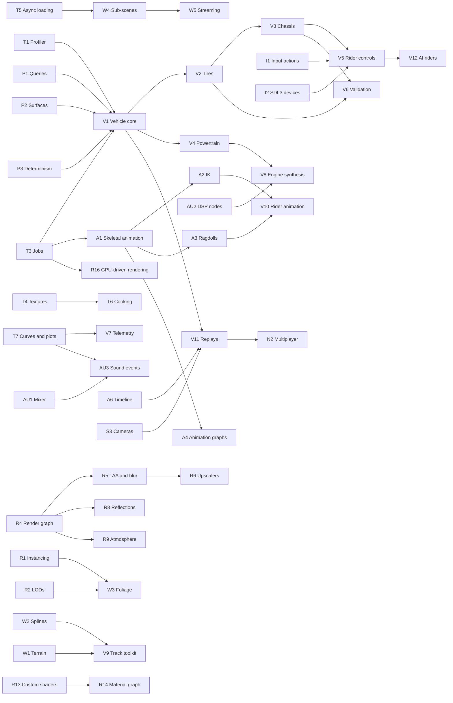

# Strada roadmap

Planning document, October 2026. It builds on the research in [EngineComparison.md](EngineComparison.md), which
compares Strada with Unreal Engine, Unity, Godot and O3DE and studies what a realistic motorcycle game needs. Nothing
here changes the architectural contract: each item lands the usual way ([AGENTS.md](../AGENTS.md)), with its design
added to [Architecture.md](Architecture.md) first, then code, tests, docs and review, on all three platforms.

## 1. Goals

1. **A professional engine.** A small studio can ship a commercial 3D game on Strada without writing engine systems of
   its own: roughly the 3D breadth of Godot 4, at Strada's quality bar (tests, fuzzing, golden images, CI on three
   platforms) and with the whole editor driven by AI agents.
2. **Strada Moto.** A realistic motorcycle game, superbikes such as the Ducati Panigale V4 S and MotoGP prototypes,
   whose handling and sound come out of simulation, the way BeamNG.drive's handling and Ange Yaghi's engine-sim's sound
   do.

**Strategy: let the game drive the engine.** Unreal grew up with Unreal Tournament and Frostbite with Battlefield: a
demanding game decides which engine features matter and proves them. Strada Moto plays that role. Everything the bike
needs is built as a general engine feature (curves, telemetry, high-rate simulation, DSP nodes, splines, terrain,
animation, input actions, replays), except the bike model itself, which becomes a module of its own (§5).

**Not a goal: matching Unreal feature for feature.** Nanite, Lumen, MetaHumans, World Partition at continent scale
and a marketplace took thousands of engineer-years. Strada's niche is to be the best small engine for vehicle
simulation and the best engine for AI agents to build games with; in the second it already leads (EngineComparison.md
§2.3).

## 2. How items are rated

| Rating | Meaning |
|---|---|
| **E** (engine value, 1-5) | How much a general 3D game needs it; 5 = nearly every shipped 3D game |
| **M** (moto value, 1-5) | How much Strada Moto needs it |
| **Size** | S ≤ 2 engineer-weeks, M = 3-6, L = 2-4 months, XL = 6+ months, at this repository's bar (tests, fuzz tests for new formats and commands, docs, three platforms, review) |
| **D** (difficulty, 1-5) | Technical risk and unknowns; 5 = research-grade |
| **Score** | 10 × (E + M) / (size points + D), with S = 1, M = 2, L = 4, XL = 8 size points |

The score is value per unit of cost and risk: it orders items within a phase. Dependencies decide the phases, so a
foundation with a modest score (a render graph) can come before a high scorer that needs nothing (Steam integration,
which only matters at release). Estimates assume engineers working with AI agents the way this repository is developed;
re-estimate after Phase 0 from the velocity actually measured.

## 3. Backlog

Item IDs are referenced by the phases (§4) and the dependency graph (§6).

### 3.1 Tooling and pipeline

| ID | Item | E | M | Size | D | Score | Phase |
|---|---|---|---|---|---|---|---|
| T1 | CPU and GPU profiler: Tracy zones in every subsystem, GPU zones, an editor Profiler panel, captures through automation (`profiler.*`) | 5 | 4 | S | 1 | 45 | 0 |
| T2 | RenderDoc in-application captures and GPU debug markers per pass | 3 | 2 | S | 1 | 25 | 0 |
| T3 | Job system (task graph on worker threads): parallel culling, skinning, vehicle steps, asset decoding | 5 | 4 | M | 3 | 18 | 0 |
| T4 | Texture pipeline: import settings per texture, offline BC1/BC4/BC5/BC7 (BC6H for HDR) compression with precomputed mips in KTX2, an import cache | 5 | 4 | M | 2 | 23 | 0 |
| T5 | Asynchronous asset loading: decoding and uploads on workers (copy queue), loading screens, dependency-ordered loads | 5 | 4 | M | 3 | 18 | 0 |
| T6 | Cooked builds: packages (zstd or lz4 archives), editor-only data stripped, cooking per platform in the exporter | 4 | 3 | M | 3 | 14 | 2 |
| T7 | Curve assets and editor (torque maps, damping and tire curves, response curves) and plots (ImPlot) | 4 | 5 | S | 2 | 30 | 0 |
| T8 | Native C++ game modules (a stable plugin API for code that must not run in C#) | 4 | 3 | M | 3 | 14 | 3 |
| T9 | Mod support: mounting packages over a game, overriding assets, loading mod scripts | 3 | 4 | M | 3 | 14 | 3 |
| T10 | Crash reports from shipped games: uploads (sentry-native) with symbols, opt-in, beside the local reports the engine writes today | 3 | 2 | S | 2 | 17 | 3 |

### 3.2 Rendering

| ID | Item | E | M | Size | D | Score | Phase |
|---|---|---|---|---|---|---|---|
| R1 | Instancing: one draw per mesh and material for every instance (an instance buffer), static batching | 5 | 4 | S | 2 | 30 | 0 |
| R2 | Mesh LODs: simplification at import (meshoptimizer), screen-size selection, dithered cross-fades | 5 | 4 | M | 2 | 23 | 2 |
| R3 | Clustered forward lighting: a froxel light grid instead of every light per pixel; decals and probes in it later | 4 | 2 | S | 2 | 20 | 2 |
| R4 | Render graph: passes declare what they read and write; barriers, transient targets and pass toggles derived from that | 4 | 3 | M | 3 | 14 | 1 |
| R5 | Motion vectors, TAA (with upsampling), camera and per-object motion blur | 5 | 5 | M | 3 | 20 | 1 |
| R6 | Upscalers: AMD FSR 3.1 (its Vulkan back end; FSR 4 is Direct3D 12 only), NVIDIA DLSS through Streamline on Windows, Intel XeSS once its binary license is reviewed | 4 | 3 | M | 3 | 14 | 2 |
| R7 | Material model v2: clear coat, anisotropy, sheen, transmission (visors, thin glass), vertex colors, a second UV set, detail maps; glTF's `KHR_materials_*` extensions on import | 4 | 5 | M | 2 | 23 | 1 |
| R8 | Reflection probes (baked and real-time cubemaps, box projection, blending) and screen-space reflections | 4 | 4 | M | 3 | 16 | 2 |
| R9 | Physically based sky and atmosphere, aerial perspective, height and volumetric fog, time of day with a sky light captured from the atmosphere | 4 | 4 | L | 3 | 11 | 2 |
| R10 | Volumetric clouds | 3 | 3 | M | 3 | 12 | 3 |
| R11 | Projected decals (tire marks, track markings, dirt) | 4 | 4 | M | 2 | 20 | 2 |
| R12 | Render targets: cameras rendering into textures (mirrors, in-world screens, a bike's TFT dashboard), world-space UI | 4 | 4 | S | 2 | 27 | 1 |
| R13 | Custom shaders: surface-shader templates with user HLSL, hot reload, material instances (parameters over a shader) | 5 | 3 | L | 3 | 11 | 3 |
| R14 | Node-based material editor on top of R13 | 4 | 2 | L | 4 | 8 | Later |
| R15 | Particles v2 on the GPU: lit and soft particles, flipbooks, trails and ribbons (tire smoke, exhaust), mesh particles, collisions, curves over life | 4 | 4 | L | 3 | 11 | 3 |
| R16 | GPU-driven rendering: Hi-Z occlusion culling, indirect draws, bindless resources | 4 | 3 | L | 4 | 9 | 3 |
| R17 | Shadows at range: cached static cascades, more cascades or virtual shadow maps, contact shadows | 4 | 4 | M | 3 | 16 | 2 |
| R18 | Camera and speed effects: depth of field, lens flares, sun shafts, heat haze (refraction) | 3 | 4 | M | 2 | 18 | 3 |
| R19 | HDR display output (HDR10, scRGB) | 2 | 3 | S | 2 | 17 | 3 |
| R20 | Weather: wet surfaces and puddles, rain, spray behind wheels | 3 | 4 | L | 4 | 9 | Later |
| R21 | Dynamic global illumination (probe-based, DDGI-style) | 4 | 2 | XL | 5 | 5 | Later |
| R22 | Hardware ray tracing (shadows, reflections; not available on MoltenVK) | 3 | 2 | L | 4 | 6 | Later |

### 3.3 World building

| ID | Item | E | M | Size | D | Score | Phase |
|---|---|---|---|---|---|---|---|
| W1 | Terrain: heightfield component with LODs, splat material layers, sculpt and paint tools, Jolt height-field collision, heightmap and elevation-model import | 5 | 4 | L | 3 | 13 | 2 |
| W2 | Splines: a component with editor handles, meshes extruded along splines (roads with camber and banking, kerbs, walls, fences), placement along splines | 4 | 5 | M | 3 | 18 | 2 |
| W3 | Foliage and scattering: painted and rule-based instances, impostors, wind | 4 | 4 | L | 3 | 11 | 2 |
| W4 | Sub-scenes: additive and asynchronous scene loading, level instances | 4 | 3 | M | 3 | 14 | 3 |
| W5 | World streaming: grid cells loaded around the camera, hierarchical LODs | 4 | 2 | L | 4 | 8 | Later |
| W6 | Large worlds: camera-relative rendering and Jolt's double precision (or a floating origin), for road courses such as the 60 km Snaefell Mountain Course | 3 | 3 | M | 3 | 12 | 3 |
| W7 | Prefab variants, nested prefabs and overrides that follow changes to the prefab | 4 | 3 | M | 4 | 12 | 3 |

### 3.4 Animation

| ID | Item | E | M | Size | D | Score | Phase |
|---|---|---|---|---|---|---|---|
| A1 | Skeletal animation: skins and joints from glTF and FBX, GPU skinning, clips, playback, crossfades and blending, masks and layers, events; script API | 5 | 5 | L | 4 | 13 | 1 |
| A2 | Inverse kinematics: two-bone, aim and look-at, FABRIK or CCD chains (hands on grips, feet on pegs) | 4 | 5 | M | 3 | 18 | 2 |
| A3 | Ragdolls: Jolt ragdolls made from skeletons, blending into and out of animation | 4 | 5 | M | 3 | 18 | 2 |
| A4 | Animation graphs: state machines, blend spaces, root motion, a graph editor | 5 | 3 | L | 4 | 10 | 3 |
| A5 | Morph targets (blend shapes) | 3 | 2 | S | 2 | 17 | 3 |
| A6 | Timeline: keyframed properties of any component (doors, lights, UI), camera cuts, events and audio tracks; cinematics and replay direction | 4 | 4 | L | 3 | 11 | 2 |

### 3.5 Physics

| ID | Item | E | M | Size | D | Score | Phase |
|---|---|---|---|---|---|---|---|
| P1 | Queries and contacts: shape casts, overlaps, contact points, normals and impulses for scripts; Jolt's six-DOF, cone, swing-twist, gear, rack-and-pinion and path constraints; constraint springs; breakable joints | 5 | 4 | M | 2 | 23 | 0 |
| P2 | Physics materials: surface types as assets (friction, rolling resistance, sounds, particles), per-triangle materials on mesh and height-field colliders | 4 | 5 | S | 2 | 30 | 0 |
| P3 | Step control and determinism: higher step rates without the 8-step cap, sub-steps, Jolt's cross-platform deterministic build, state snapshots | 3 | 5 | S | 2 | 27 | 0 |
| P4 | Soft bodies and cloth (Jolt soft bodies) | 3 | 2 | M | 3 | 10 | Later |

### 3.6 Audio

| ID | Item | E | M | Size | D | Score | Phase |
|---|---|---|---|---|---|---|---|
| AU1 | Mixer: buses (music, effects, vehicles, UI, voice), snapshots, ducking; filters, EQ, reverb zones, compressor and limiter; doppler; distance curves | 5 | 5 | M | 2 | 25 | 0 |
| AU2 | Procedural audio: native generator and effect nodes on the audio thread, parameter streams from simulation threads, sample-accurate scheduling | 3 | 5 | S | 3 | 20 | 1 |
| AU3 | Sound events: random, sequence and blend containers; parameters driving pitch, volume and crossfades through curves (RPM and load layers) | 4 | 5 | M | 2 | 23 | 1 |
| AU4 | Spatial audio: HRTF, occlusion and reflections (Steam Audio) | 3 | 3 | M | 3 | 12 | Later |

### 3.7 Input, UI and gameplay

| ID | Item | E | M | Size | D | Score | Phase |
|---|---|---|---|---|---|---|---|
| I1 | Input actions: action maps, bindings and composites, dead zones and response curves, rebinding at runtime with saved profiles; an asset, its editor and script API | 5 | 5 | M | 2 | 25 | 0 |
| I2 | Devices through SDL3 beside GLFW: more gamepads, rumble and trigger rumble, gyro, joysticks, wheels and handlebar controllers, force feedback | 4 | 5 | M | 3 | 18 | 1 |
| U1 | UI widgets and layout: layout groups, scroll views, sliders, toggles, dropdowns, text input, nine-slice images, masks, tweens, gamepad and keyboard navigation | 5 | 4 | L | 2 | 15 | 2 |
| U2 | Localization: string tables, fallback fonts, text shaping (HarfBuzz), right-to-left text, plurals and number formats | 4 | 2 | M | 3 | 12 | 3 |
| U3 | UI authoring in the editor: canvas editing in place, anchor handles, styles | 4 | 3 | M | 2 | 18 | 3 |
| S1 | Script conveniences: coroutines and `async` helpers, timers, events between scripts | 4 | 2 | S | 2 | 20 | 2 |
| S2 | Saves and settings: versioned save slots with atomic writes, player settings (graphics quality presets, audio volumes, controls) and their menus | 5 | 4 | S | 1 | 45 | 0 |
| S3 | Camera system: follow, orbit and look-at rigs with damping and collision, blends between cameras, shake, rails | 4 | 5 | M | 2 | 23 | 1 |
| S4 | Script debugging: attaching VS Code and Rider to the hosted runtime, documented and tested; script time in the profiler | 4 | 3 | S | 2 | 23 | 2 |
| S5 | Navigation: navmeshes (Recast and Detour), crowds, behavior or state trees | 5 | 1 | L | 3 | 9 | Later |

### 3.8 Online and platforms

| ID | Item | E | M | Size | D | Score | Phase |
|---|---|---|---|---|---|---|---|
| N1 | Platform services: Steamworks (achievements, leaderboards, cloud saves, overlay, Steam Input) | 3 | 4 | S | 2 | 23 | 3 |
| N2 | Multiplayer: transport, replication, client prediction and interpolation, lobbies | 5 | 4 | XL | 5 | 7 | 3 |
| X1 | VR through OpenXR: stereo rendering, tracking, comfort options | 3 | 4 | L | 4 | 9 | 3 |
| X2 | Steam Deck and controller-first play: verified on the Deck, every screen usable without a mouse | 3 | 3 | S | 1 | 30 | 2 |

### 3.9 Vehicles and Strada Moto

| ID | Item | E | M | Size | D | Score | Phase |
|---|---|---|---|---|---|---|---|
| V0 | Jolt vehicles as components: wheeled vehicles and Jolt's motorcycle controller (a lean spring: arcade bikes and traffic, not a simulation) with script API; the first bike of the test circuit | 4 | 3 | S | 2 | 23 | 0 |
| V1 | Vehicle simulation core: a 1-2 kHz fixed-step loop on worker threads, a reduced-coordinate multibody solver, tire contact against Jolt geometry, coupling with Jolt, determinism, state for scripts, audio and telemetry | 3 | 5 | L | 4 | 10 | 1 |
| V2 | Motorcycle tire model: Magic Formula with large camber, toroidal contact, relaxation lengths, combined slip, load and pressure; later temperature and wear; MF-Tyre `.tir` import | 2 | 5 | L | 5 | 8 | 1 |
| V3 | Chassis model: steering geometry (rake, trail, offset), fork, swingarm and shock linkage, chain pull (anti-squat), steering damper, gyroscopic effects, aerodynamics, brakes | 2 | 5 | M | 4 | 12 | 1 |
| V4 | Powertrain and electronics: torque map, crank inertia, engine braking, clutch and slipper clutch, sequential gearbox, quickshifter and blipper; traction, wheelie, slide, engine-brake and launch control, cornering ABS | 2 | 5 | M | 3 | 14 | 1 |
| V5 | Rider model and controls: rider bodies (lean, hang-off, tuck), steer-torque control, assists that turn gamepad input into lean targets, a direct "pro" mode | 1 | 5 | L | 5 | 7 | 1 |
| V6 | Validation suite: modal analysis (capsize, weave, wobble against speed), steady cornering, braking and wheelie limits, golden telemetry traces, determinism across frame rates and platforms | 2 | 5 | M | 3 | 14 | 1 |
| V7 | Telemetry: channel recorder, plots in the editor, CSV export for analysis tools, UDP output for dashboards and motion rigs | 3 | 5 | S | 2 | 27 | 0 |
| V8 | Engine sound synthesis (firing pulses, intake and exhaust waveguides, convolution) and the other sounds of a bike (gear whine, chain, tire scrub, wind in the helmet) | 2 | 5 | L | 5 | 8 | 2 |
| V9 | Track toolkit: track surfaces from splines with camber, kerbs with real profiles, gravel and grass run-off, grip maps, timing lines and sectors, pit lane, track limits | 2 | 5 | L | 3 | 10 | 2 |
| V10 | Rider animation: a procedural rider (IK to grips and pegs, head and body lean, knee and elbow down, tuck), crash ragdoll and getting up | 2 | 5 | L | 4 | 9 | 2 |
| V11 | Replays and ghosts: input and state recording, scrubbing, TV cameras, photo mode | 3 | 5 | M | 3 | 16 | 2 |
| V12 | AI riders: racing lines, the same physics and rider controller as the player, overtaking, difficulty levels | 2 | 5 | L | 4 | 9 | 3 |
| V13 | Breakable parts: fairings, levers, mirrors and footpegs that bend or come off in crashes | 2 | 3 | M | 3 | 10 | 3 |
| V14 | Race weekend: sessions, grids, flags, penalties, results, a career | 1 | 4 | L | 2 | 8 | 3 |

### 3.10 What the items build on

Libraries recommended by the survey in EngineComparison.md §7: permissively licensed and built from source unless
noted.

| Items | Libraries |
|---|---|
| T1, T2 | Tracy, RenderDoc's in-application API |
| T3 | enkiTS (also behind Jolt's job system) |
| T4, T6 | KTX-Software, Basis Universal, bc7enc_rdo; zstd and lz4 for packages |
| T7, V7 | ImPlot |
| T10 | sentry-native, cpptrace |
| R2, R16 | meshoptimizer |
| R4, R13 | SPIRV-Reflect |
| R6 | AMD FidelityFX SDK (FSR 3.1); NVIDIA Streamline (optional) |
| A1, A2 | ozz-animation |
| A4, R14 | imgui-node-editor |
| I2 | SDL3 |
| AU1, AU2, AU4 | miniaudio's node graph, Signalsmith DSP; Steam Audio |
| U2 | HarfBuzz, FreeType, msdfgen |
| S4 | netcoredbg, Visual Studio Code and Rider debuggers |
| S5 | recastnavigation |
| N1, N2 | Steamworks SDK (proprietary, optional); yojimbo or GameNetworkingSockets |
| X1 | OpenXR SDK, Monado for tests |
| V1-V8 | None: the solver, tires and engine sound are written from the published methods |

## 4. Phases

Each phase ends with a milestone: a build of Strada Moto that shows the phase's work, and tests that keep it working.
Effort sums the phase's items at S = 1.5, M = 4.5, L = 12 and XL = 30 engineer-weeks. Two engineers means one on the
engine and one on vehicles (the vehicle items form a chain that one person works through, V1 → V2 → V3 → V5, which
sets Phase 1's length); four engineers split each track in two. Both assume AI agents doing much of the implementation,
and an artist from Phase 1 on: bikes, a rider and circuits are a large content effort of their own (§8).

| Phase | Theme | Effort | 2 engineers | 4 engineers | Milestone |
|---|---|---|---|---|---|
| 0 | Foundations | ≈ 40 engineer-weeks | 4-5 months | 2-3 months | M1, First ride |
| 1 | The simulated superbike | ≈ 92 | 10-12 months | 6-7 months | M2, Handles like a superbike |
| 2 | A real circuit | ≈ 147 | 15-18 months | 8-10 months | M3, A real circuit |
| 3 | Race weekend | ≈ 165 | 17-20 months | 9-11 months | M4, Race weekend |
| Later | High-end options | ≈ 99 | as needed | as needed | |

The whole backlog is about 540 engineer-weeks, close to twelve engineer-years: a rideable, validated superbike on a
test circuit (M2) is a year to a year and a half away for two engineers, a complete racing game (M4) about four years
for two and a bit over two years for four. That is the honest size of "a professional engine plus a simulation game",
and why the phases are ordered by what the game needs next. If Phase 0 goes faster than estimated, which this
repository's pace with AI agents suggests is possible, scale the later phases by the measured ratio.

### Phase 0: Foundations

What everything else is built and measured with.

- Tooling: T1 profiler, T2 RenderDoc, T3 job system, T4 texture pipeline, T5 asynchronous loading, T7 curves and plots.
- Rendering: R1 instancing.
- Physics: P1 queries and constraints, P2 physics materials, P3 step control and determinism.
- Audio, input and gameplay: AU1 mixer, effects and doppler; I1 input actions; S2 saves and settings.
- Vehicles: V0 Jolt vehicles, V7 telemetry.

**Milestone M1, "First ride":** a bike made with Jolt's motorcycle controller (V0) laps a flat test circuit on a
gamepad through input actions, its channels plotted live in the editor, with an engine sound that a script crossfades
from RPM layers and that changes pitch with doppler as it passes a trackside camera, inside a profiled frame budget.
Exit criteria: the profiler shows frame, physics and audio time per subsystem; textures load compressed and
asynchronously; a scene of 10,000 instanced props renders at 60 fps on mid-range hardware; the physics determinism
test gives identical states at 30, 60 and 144 fps.

### Phase 1: The simulated superbike

The bike simulation, and the rendering, animation and audio features that a current game cannot do without.

- Vehicles: V1 simulation core, V2 tires, V3 chassis, V4 powertrain and electronics, V5 rider controls, V6 validation.
- Rendering: R4 render graph (before the passes that follow), R5 TAA and motion blur, R7 material model v2,
  R12 render targets.
- Animation: A1 skeletal animation, the largest gap of the engine.
- Audio, input and gameplay: AU2 procedural audio nodes, AU3 sound events, I2 SDL3 devices, S3 camera system.

**Milestone M2, "Handles like a superbike":** the simulated bike replaces the Jolt one on the test circuit. It
counter-steers, trail-brakes, wheelies and slides; it weaves when unsettled and its steering damper matters; traction
control and the quickshifter work; on a gamepad with rumble, assists make it rideable, while the pro mode gives steer
torque and body lean directly. Chase and onboard cameras with motion blur, a clear-coated paint and a working TFT
dashboard on a render target. Exit criteria: the validation suite (V6) passes, including modal frequencies within
tolerance of the literature for a sports bike and steady-cornering lean angles within a degree of theory.

### Phase 2: A real circuit

What a full circuit and a full game need, and the bike's rider, sound and replays.

- World: W1 terrain, W2 splines, W3 foliage.
- Rendering: R2 LODs, R3 clustered lighting, R6 upscalers, R8 reflections, R9 sky and atmosphere, R11 decals,
  R17 shadows at range.
- Animation: A2 IK, A3 ragdolls, A6 timeline.
- Pipeline, UI and gameplay: T6 cooked builds, U1 UI widgets, S1 coroutines, S4 script debugging, X2 Steam Deck.
- Vehicles: V8 engine sound synthesis, V9 track toolkit, V10 rider animation, V11 replays.

**Milestone M3, "A real circuit":** a complete circuit (a spline-built surface with kerbs and run-off, terrain, trees,
grandstands, a time of day) ridden with a synthesized V4 sound and an animated rider who crashes as a ragdoll, with
timing, sectors, menus and replays with TV cameras. Exit criteria: the circuit loads from a cooked package within the
loading-time budget; replays are identical to the runs they recorded.

### Phase 3: Race weekend

What makes a racing game complete, and the engine features that a second game would ask for.

- Vehicles: V12 AI riders, V13 breakable parts, V14 race weekend.
- Online and platforms: N1 Steamworks, N2 multiplayer, X1 VR.
- Engine: T8 native modules, T9 mod support, T10 crash reports, R10 clouds, R13 custom shaders, R15 GPU particles,
  R16 GPU-driven rendering, R18 camera effects, R19 HDR output, W4 sub-scenes, W6 large worlds, W7 prefab variants,
  A4 animation graphs, A5 morph targets, U2 localization, U3 UI authoring.

**Milestone M4, "Race weekend":** practice, qualifying and a race against a full grid of AI riders, with settings,
saves and Steam integration; online races or VR, whichever playtests favor.

### Later

R14 material graph, R20 weather, R21 dynamic GI, R22 ray tracing, AU4 spatial audio, P4 soft bodies, S5 navigation and
W5 world streaming: valuable, and each the subject of its own decision when a game needs it.

## 5. Strada Moto: technical plan

This section is a proposal, refined into Architecture.md sections as its items start. The research behind it, and the
reference data for the Panigale V4 S and MotoGP bikes, are in EngineComparison.md §6. Like everything in this
repository it is built from published methods (papers, books, specifications), not from other projects' code.

### 5.1 A vehicle module

A new engine module, `Strada/Source/Strada/Vehicle/`, sits between the runtimes and scripting:

```
Core ← Math ← Serialization ← Platform ← RHI ← Asset ← Renderer ← Physics, Audio ← Vehicle ← Script ← Scene ← Project
```

- `VehicleWorld` simulates the vehicles of one running scene, independent of the ECS (keyed by entity UUID) like
  `PhysicsScene` and `AudioScene`, so it is tested on its own.
- Assets with versioned JSON formats (and fuzz tests, as for every format users write): `BikeDefinition` (`.sbike`:
  bodies, masses and inertias, geometry, suspension, brakes, aerodynamics, powertrain, electronics), `TireDefinition`
  (`.stire`: Magic Formula coefficients, the crown radius, relaxation and thermal parameters; MF-Tyre `.tir` property
  files import into it) and curves (T7) for torque maps, damper, spring and linkage curves. Bikes are built from parts,
  as BeamNG's JBeam builds cars, so a tire, an exhaust or an electronics map can be swapped.
- Components: `Motorcycle` (definition, controller kind, assist levels, starting state) and, later, `Car`; the
  inspector, automation and the scripting API come from the component registry as for every component.
- Scripts read the state (speed, RPM, gear, lean, slips, temperatures, electronics) and set the controls once a frame
  through blittable buffers; they never run inside the high-rate loops.

### 5.2 The simulation loop

- **Rate.** The bike is stepped at 1 kHz by default (2 kHz selectable), independent of the frame rate and of Jolt's
  step, as BeamNG steps at 2 kHz: stiff tires and suspension and the 4-10 Hz wobble mode need it. The bike has about
  a dozen degrees of freedom, so a step costs microseconds. Target: under 20 µs per bike per step, so a 22-bike grid at
  1 kHz takes about half a core, spread over the job system (T3).
- **Solver.** A reduced-coordinate multibody model (Featherstone's articulated-body algorithm or an equivalent
  Lagrangian or Kane formulation): the rear frame, the front frame (steering head and fork), the swingarm, two wheels
  and the rider's torso on a hip joint, plus the tires' lag states. Joints are exact, so nothing drifts apart under
  the forces of a 300 km/h stoppie, and the model linearizes for the modal tests (V6). Semi-implicit integration at the
  fixed step, in double precision whatever precision Jolt is built with: 4 km from the origin a float resolves only
  0.5 mm, against the 4 cm a bike at 300 km/h covers in a 2 kHz step. The rendered pose is interpolated between steps.
- **Contact.** Tires meet the ground through Jolt's collision queries (P1): at each physics step the triangles near
  each wheel are gathered, and every vehicle step intersects the tire's torus with them, so kerbs, bumps and camber
  changes reach the tire at the high rate without broad-phase queries. Circuits get a physics surface with 1-2 cm
  spacing on the racing line, apart from the render mesh. Surface types (P2) give grip, rolling resistance, bump
  texture, sound and particles.
- **Coupling with Jolt.** The bike is a kinematic body in the Jolt world, moved along the simulated path, so props,
  other bikes and riders collide with it; collisions the tire model does not cover (fairing against a wall, bike
  against bike) come back as impulses at the physics step. A crash hands the bodies to Jolt as dynamic bodies, with the
  rider as a ragdoll (A3) that separates from the bike.
- **Determinism.** Fixed steps, inputs sampled per step and filtered, no frame-rate dependence and no allocations in the
  loop: the same inputs give the same states. Replays and ghosts (V11) store inputs and periodic snapshots, and network
  play (N2) builds on it. Jolt itself is deterministic only for the same binary and call order, so the bike's solver is
  deterministic by construction, across platforms too: no floating-point contraction left to the compiler and math
  functions of its own, as Jolt's cross-platform build does.

### 5.3 Tires

The tire decides how a bike feels, and motorcycle tires differ from car tires: they run at more than 50° of camber,
where camber thrust gives most of the lateral force, and their round cross-section moves the contact point across the
tread as the bike leans.

- Magic Formula 6.1/6.2 forces and moments (longitudinal and lateral forces; aligning, overturning and rolling
  moments) with large camber, turn slip, combined slip, load sensitivity and pressure, written from Pacejka's equations
  (no maintained permissive library implements them).
- Toroidal contact geometry: the contact point and the rolling radius follow the lean angle and crown radius.
- Relaxation: first-order lags of the slip forces, which shape weave and wobble; camber thrust acts without lag, as
  measurements show.
- Then: a real-time thermal model of a few layers (surface, bulk, inflation gas) in the manner of the
  published thermoRIDE model, wear, and grip that depends on them and on the surface.
- Data: the parameter sets published with motorcycle dynamics research (Sharp, Evangelou and Limebeer), `.tir` files
  where available, and a fitting tool in the editor (T7 plots) to adjust coefficients against target curves.

### 5.4 Chassis and rider

- Geometry from the definition: wheelbase, rake, trail and fork offset, center-of-mass heights, swingarm length and
  pivot, sprocket sizes; the chain force acts along the chain's upper run between the sprockets (anti-squat), not as a
  torque on the swingarm.
- Suspension: fork and shock springs with preload and progression, damping curves for compression and rebound (low and
  high speed), linkage ratio curves, bump stops; semi-active damping and the electronic steering damper as electronics
  features. Then: frame, swingarm and fork flex as torsional springs (feel at full lean, and the 17-22 Hz chatter of
  racing bikes under braking, which also needs tire carcass compliance).
- Gyroscopic effects of the wheels, crank and gearbox, aerodynamic drag and lift with the rider tucked or upright,
  brakes with pressures from lever inputs and ABS.
- Rider: torso lean, hang-off and fore-aft position as joints driven toward target poses, so the rider's weight (about
  30% of the total) moves the bike as a real rider's does; the animation system (V10) shows the same pose.

### 5.5 Powertrain and electronics

Engine torque from a map over RPM and throttle (through the ECU's power modes) with friction and pumping losses for
engine braking; crank and gearbox inertias (the counter-rotating crank of Ducati's V4s changes how the bike turns,
wheelies and stoppies); a wet clutch with stuck and slipping states, a slipper and a self-servo ramp; primary and chain
drives; a six-speed sequential gearbox with dog engagement times, a quickshifter (ignition cuts of up to about 50 ms)
and an auto-blipper; a rev limiter. The ECU runs at 100-1,000 Hz inside the loop and sees what a real ECU sees, through
a modeled six-axis IMU with noise and bias and the wheel speeds: traction, wheelie, slide and engine-brake control,
launch control and cornering ABS, each with levels grouped into riding modes like the Panigale's.

### 5.6 Controls and assists

A bike is steered by torque on the bars and by the rider's body, and counter-steering makes direct steering-angle
control unrideable. Three layers, chosen per player and blendable:

- **Pro:** steer torque and body lean on the sticks, as GP Bikes offers, for sim riders and handlebar controllers.
- **Assisted (default):** the stick asks for a lean angle and the rider's body follows it, as MotoGP 26's
  rider-based handling does; cascaded controllers (lean target → roll rate → steer torque), scheduled with speed from
  the linearized model, find the steer torque, so counter-steering happens by itself. Throttle and brake assists can be
  added for newcomers.
- **AI:** the same cascade under a path-following controller with preview (model-predictive control, which the
  research uses for virtual riders) on a racing line (V12), so AI riders obey the same physics as the player.

Devices (I2): gamepads with rumble and trigger rumble for traction and ABS, and handlebar controllers (the 2026 Moza
MotoGP handlebar has direct-lean and counter-steering modes) with force feedback where SDL3 exposes it.

### 5.7 Sound

- **First (Phases 0 and 1):** RPM and load layers in on-load and off-load banks, crossfaded by AU3's sound events,
  with doppler and distance filtering from AU1. This is what most racing games ship.
- **Then (V8):** an engine sound simulation on a thread of its own at 10-20 kHz (the rate engine-sim runs at, which
  resolves 4.5-9° of crank angle at 15,000 rpm), fed with the engine state by the vehicle loop (crank angle, RPM,
  throttle, load, gear, ignition cuts). Combustion pulses per cylinder in the crank-angle domain follow the firing order
  (the Panigale's Twin Pulse V4 fires at 0°, 90°, 290° and 380°), through intake and exhaust waveguides (delay lines
  with reflections at junctions and open ends) and a convolution with impulse responses of the silencer and the
  listener's position, as the published methods (engine-sim's approach, pulse-train resonators) describe. A ring
  buffer carries the result to a miniaudio node (AU2) that resamples it to 48 kHz with at most about 20 ms of latency.
- **The rest:** intake roar, pops and crackles on overrun (randomized), gear and primary whine, the quickshifter's bark,
  chain slap, tire scrub, kerb rumble, and wind and helmet noise (95-106 dB at 100 km/h, masking the engine for the
  rider above about 150 km/h), so the onboard mix filters and ducks the engine with speed. Recorded impulse responses
  and short samples of a real bike calibrate it.

### 5.8 Tracks

Spline-built surfaces (W2, V9) with camber and banking from real circuits, a physics surface at 1-2 cm resolution on
the racing line, kerbs with real profiles, grass and gravel run-off with grip, drag and sinkage, terrain (W1) and
foliage (W3) around them, a sky and atmosphere (R9) for the time of day, and timing gates whose crossing times are
interpolated between physics steps. Laser-scanned tracks, when licensed, import as meshes with their surfaces. Road
courses such as the Isle of Man's 60.7 km need W6 (large worlds) and streaming.

### 5.9 Validation

The repository's habit of proving behavior with tests fits vehicle simulation well:

- Tire model: outputs against reference values of the published parameter sets; relaxation responses with time
  constants of relaxation length over speed; camber thrust without lag.
- Multibody solver: the benchmark bicycle of Meijaard et al. (2007), whose published eigenvalues across speeds the
  linearized model must reproduce; energy kept in free motion without damping; a spinning wheel's precession against
  the analytic value; joint residuals at zero.
- Bike: steady-state lean angles against `atan(v² / (g R))` corrected for tire width; capsize, weave and wobble across
  speeds within tolerance of the literature for a sports bike; the deceleration at which the rear wheel lifts against
  the geometry; counter-steering in the right direction.
- Golden telemetry traces for scripted maneuvers (lane change at 100 km/h, braking from 300 km/h, a lap), compared with
  tolerances like golden images and updated only deliberately.
- Determinism: identical states at 30, 60 and 144 fps and on all three platforms; a CPU budget test per bike.

## 6. Dependencies



## 7. Not planned

| Feature | Why not |
|---|---|
| Virtualized geometry (Nanite-like) | Years of work for one team; LODs, instancing and GPU culling (R1, R2, R16) cover circuits and their surroundings |
| Fully dynamic GI at Lumen's level | Same; probes and a time-of-day sky (R8, R9) light an outdoor circuit well, and R21 is the step after |
| Soft-body (node-beam) vehicles as in BeamNG.drive | BeamNG's strength is crash deformation of cars; for a bike the handling comes from the tires, geometry and rider, which a multibody model captures more accurately and cheaply. Breakable parts (V13) cover crash damage |
| Visual scripting | C# with hot reload plus AI agents that write and test scripts through the editor serves the same users; a graph language is a large, permanent cost |
| Consoles | Need publisher-backed development kits and platform NDAs; NVRHI's Direct3D 12 back end keeps Xbox reachable when a publisher is there |
| Mobile and web | Not where sim racing players are; the renderer targets desktop GPUs |
| Destruction and fracture systems | Not needed by the target game |

## 8. Risks

| Risk | Mitigation |
|---|---|
| Scope: chasing every engine feature and finishing none | Phases end in playable milestones; the score and the game decide what comes next |
| The bike is unrideable on a gamepad | Assists (§5.6) from the first simulated ride; playtests at every milestone; the pro mode stays a separate layer |
| Tire and bike data are hard to get | Published coefficient sets and specifications first; fitting tools; sensitivity tests that show which parameters matter |
| CPU cost of a full grid at 1 kHz | A per-bike budget enforced by a benchmark test; the job system; fixed-step work only, nothing allocated in the loop |
| Content: bikes, rider, tracks and recordings are a studio's work | Plan an artist from Phase 1; photogrammetry and laser-scan partners; procedural track tools (V9) to lower the cost |
| Licensing: manufacturers, the championship, circuits and riders are licensed brands (Milestone has held the MotoGP license for years) | Fictional bikes, teams and circuits modeled on public specifications, or licenses negotiated before release; facts and physics data are not protected, names, logos and designs are; take legal advice before release |
| macOS (MoltenVK) lacks ray tracing and mesh shaders | Keep every feature with a raster path; ray tracing stays optional (R22); test LunarG's KosmicKrisp (Vulkan 1.4 on Metal, conformant on Apple Silicon) in CI next to MoltenVK |
| engine-sim's successor will not be open source, and the original is unmaintained | Strada's engine sound follows the published methods (§5.7) and depends on neither |
| The quality bar slows features | It is also why the engine is stable: keep it, and invest in tests that make each item cheaper (fixtures, golden traces) |
| Strada has no license file | Choose one (proprietary, source-available or open source) before inviting contributors, modders or partners |

## 9. First steps

The start of Phase 0, about 21 engineer-weeks (ten weeks for two engineers), in this order:

1. T1: Tracy in every subsystem and a Profiler panel, so every later item is measured.
2. P3 and P1: step control (no 8-step cap, sub-steps), Jolt's deterministic build, shape casts and contact data.
3. I1: input actions on the devices GLFW reads today (SDL3 follows in Phase 1, behind the same actions).
4. AU1: mixer buses, doppler and filters on miniaudio's node graph.
5. T7 and V7: curve assets, ImPlot, the telemetry recorder.
6. V0: Jolt's vehicles as components, a test circuit in a new `Projects/Moto` project, and the Architecture.md section
   for the vehicle module (§5) written and reviewed before V1's code starts.
