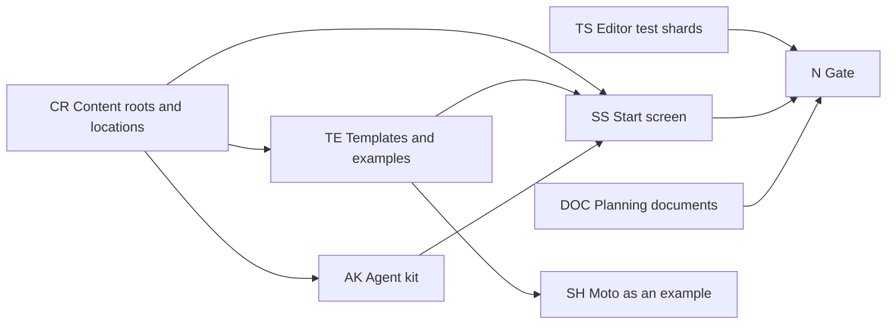
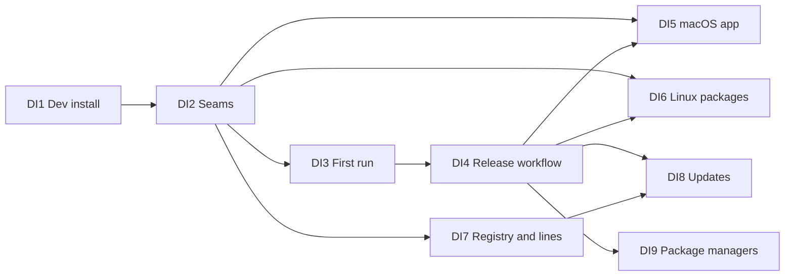
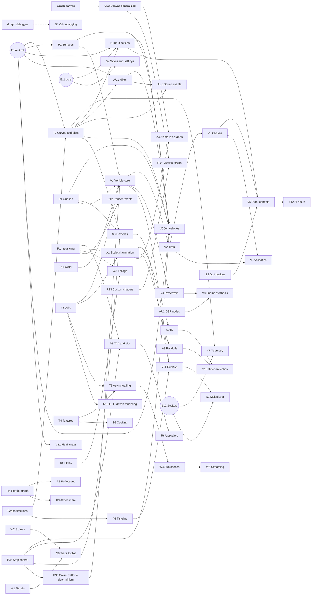

# Strada roadmap

Planning document, October 2026, revised November 2026. The first version was written against commit `fc3d877`
(2026-10-13). Since then Strada gained visual scripting (2026-10-21 to 2026-11-04), which the maintainer (the
repository's owner, who makes the decisions of §9) asked for before anything else and which the first version had listed
as "Not planned", and Front Door (from 2026-11-12): a start screen, project templates, examples that open as copies and
projects set up for coding agents, and the documentation set (the guides, the generated component and scripting-API
references that tests check, and a home page, `Docs/README.md`; EngineComparison.md §2.1 lists it). "The user" means
anyone who uses Strada. This revision re-bases the plan on the tree as Front Door leaves it and on the maintainer's
decisions of 2026-11-10 and 2026-11-12 (§9). It records what visual scripting built and what it now costs every later
item, scales the plan by the velocity visual scripting measured, and plans the next four efforts. The distribution of
the engine itself (an installer, signing, side-by-side versions) was designed in full and then cut, except for the four
pieces Front Door built; what is left is in the backlog, not scheduled (§3.10). Code citations (`file:line`) point into
`d130bc1`, where the audits read the code, and were checked on the current tree: the files they name are unchanged
since, and the few that Front Door edited are cited by symbol. The plan builds on the research in
[EngineComparison.md](EngineComparison.md), which compares Strada with Unreal Engine, Unity, Godot and O3DE and studies
what a realistic motorcycle game needs. Nothing here changes the architectural contract: each item lands the usual way
([AGENTS.md](../AGENTS.md)), with its design added to [Architecture.md](Architecture.md) first, then code, tests, docs
and review, on all three platforms.

## 1. Goals

1. **A professional engine.** A small studio can ship a commercial 3D game on Strada without writing engine systems of
   its own: roughly the 3D breadth of Godot 4, at Strada's quality bar (tests, fuzzing, golden images, CI on three
   platforms), with the whole editor driven by AI agents, and a first run that works: a start screen, templates,
   examples that open as copies, and new projects that agents can drive from the first minute. Installing it like a
   product, with a per-user installer and versioned lines side by side, is designed and waits in the backlog (§3.10).
2. **Strada Moto.** A realistic motorcycle game, superbikes such as the Ducati Panigale V4 S and MotoGP prototypes,
   whose handling and sound come out of simulation, the way BeamNG.drive's handling and Ange Yaghi's engine-sim's sound
   do.

**Strategy: let the game drive the engine.** Unreal grew up with Unreal Tournament and Frostbite with Battlefield: a
demanding game decides which engine features matter and proves them. Strada Moto plays that role. Everything the bike
needs is built as a general engine feature (curves, telemetry, high-rate simulation, DSP nodes, splines, terrain,
animation, input actions, replays), except the bike model itself, which becomes a module of its own (§5).

**Ship what exists, then grow it.** Strada is MIT-licensed (since `ea34866`) but has no installer, release or signed
build, and its editor runs from the build folder; a copy of the editor in a build folder can fall behind the source
(`strada` picks the newest `build/*/bin`), which is the trap of that arrangement. The maintainer weighed making Strada
installable first and decided on 2026-11-10 that signing and installing are not worth their time now, and that the rest
of the plan's three distribution steps (D0 to D2, §3.10) waits (§9). Effort 1, Front Door (§4.3), keeps the part of that
plan a person meets first, the editor's start screen, templates, examples and agent-ready projects, on a small set of
seams that an installer could use later without code changes. First Ride follows it.

**Not a goal: matching Unreal feature for feature.** Nanite, Lumen, MetaHumans, World Partition at continent scale and a
marketplace took thousands of engineer-years. Strada's niche is to be the best small engine for vehicle simulation and
the best engine for AI agents to build games with. In the second it already leads, and visual scripting widened the
lead: agents author, arrange, debug and live-fix graphs through MCP, and Prism Break is a game whose graphs were all
authored that way (EngineComparison.md §2.3).

## 2. How items are rated

| Rating | Meaning |
|---|---|
| **E** (engine value, 1-5) | How much a general 3D game needs it; 5 = nearly every shipped 3D game |
| **M** (moto value, 1-5) | How much Strada Moto needs it |
| **Size** | S ≤ 2 engineer-weeks, M = 3-6, L = 2-4 months, XL = 6+ months, at this repository's bar (tests, fuzz tests for new formats and commands, docs, three platforms, review) |
| **D** (difficulty, 1-5) | Technical risk and unknowns; 5 = research-grade |
| **Score** | 10 × (E + M) / (size points + D), with S = 1, M = 2, L = 4, XL = 8 size points |

The score is value per unit of cost and risk: it orders items within a phase. Dependencies decide the phases, so a
foundation with a modest score (a render graph) can come before a high scorer that needs nothing (Steam integration,
which only matters at release). Four conventions:

- Sizes are engineer-weeks at this repository's bar: the work a human team would need. Calendar time comes from the
  velocity measured on visual scripting (§4.1), not from a head count.
- For sums (the phase totals and the backlog total of §4.2), S = 1.5, M = 4.5, L = 12 and XL = 30 engineer-weeks.
  These are not the score's size points. The effort sizes of §4.3 are estimated per track where a spec exists.
- Where a re-estimate gives a range of difficulty (§3.12), the table shows the range and the score uses its upper value.
  Sizes such as "M (lower)" score as their letter.
- For distribution items (§3.10), E rates how much a team making a game with Strada needs the item, and M how much
  Strada Moto needs it: an installed build, an example on the start screen, an exported game with its own identity.

### 2.1 What every item pays

The repository's rules make each kind of change cost a known amount of extra work. Visual scripting added the largest
new share: every public scripting-API member becomes a graph node by reflection, so it must work as a node too.

| Change | What the rules require |
|---|---|
| A public scripting-API member | Bound by name on both sides (`ScriptBindings*.cpp` and `InternalCalls.cs`); XML docs; value checks; used by the FeatureTest scripts. As a node it must analyze and run in `VisualScriptNodeCoverageTests.cpp`, or get a `Recipe`, a `MemberTypeRecipes` entry or a checked exclusion (about 5% of nodes need one). A query gets `[PureNode]` and joins `NodeLibraryTests.ExactlyTheListedQueriesAreMarkedPure`. A rename gets a `NodeRedirect`. A member in `Tests/Data/VisualScripting/Editor/Library.json` needs the fixture regenerated |
| A callback scripts override | A new built-in event node kind: `NodeDefinition.cs` and `BuiltinNodes.cs` (inside the right enum range), `ProgramCompiler`'s table and `VisualScriptRuntime.Invoke`'s range, `VisualScriptEngine::InvokeOn<Name>` and the scene call after the C# callback, the `Documents/Events.json` fixture, `build_features` in `Projects/FeatureTest/Tools/AuthorGraphs.py` and the pinned `FeaturesChecks`, the titles mirror test, the doc tables |
| A component | A field table with hints, the registry list and tests, entity-reference remapping, add and remove while running, a managed class, an entity in FeatureTest's `Main.sscene` |
| An asset type | About 20 files today (content browser, inspector, thumbnails, drops, automation, bindings, a typed managed class); E3's data-asset template (§3.13) reduces a field-table asset to one registration |
| A file format users write | A versioned header, a migration on every change, and a `Testing::DocumentMutator` fuzz test |
| An editor operation | Undoable through the command history; an automation command with a JSON schema and an `Automation.md` row; fuzzed by `AutomationFuzzTests` |
| A visual-script editing operation | A `graph.edit` operation, entries in both fuzz generators, an `Automation.md` row |
| A GPU feature | A golden image; GPU tests with validation on lavapipe; macOS CI skips GPU tests; each CI job has 60 minutes |
| A dependency | Pinned by SHA256 in `cmake/StradaDependencies.cmake` and listed in `ThirdPartyNotices.md` |
| A sample change | Pinned check counts in StradaRuntimeTests; sample graphs in titled, arranged comment boxes (`SampleGraphsTests.cpp`) |
| A template or an example | A `template.json` or a `catalog.json` entry (versioned formats with fuzz tests), a thumbnail from the player's `--screenshot`, pinned check counts in StradaRuntimeTests, and graphs in titled, arranged comment boxes (`SampleGraphsTests.cpp`). An example is copied before it opens, so its project must survive the copy filter |
| A test file of StradaEditorTests | It lands in the Core shard unless its name matches another shard's pattern (`Tests/StradaEditorTests/Shards.cmake`); `StradaEditorTests.Partition` keeps the shards a partition, and a ctest entry that passes 450 s on CI's Windows MSVC Debug job is split by source-file patterns (AGENTS.md) |

**The visual-scripting obligations, in numbers** (an estimate from the checklist, not measured): about 5-10% of an
item's API work when its API is methods and properties; 10-25% for a typical API-heavy item (about 15% central); up to
40% for an event-heavy one, since each new callback costs 0.5-1.5 engineer-days; nothing for engine-internal items. Over
the whole backlog that is about +5-10%. I1, for example, pays about 3-10 engineer-days on 4.5 engineer-weeks, mostly for
its events. Failing tests enforce every obligation, so they are found, not forgotten. Sizes in §3 are the items' own;
effort estimates in §4.3 include the obligations.

## 3. Backlog

Item IDs are referenced by the phases and efforts (§4) and the dependency graphs (§6). The **Status** column gives each
item's state on the tree Front Door leaves (Not started, Partly done or Done): nothing in the backlog has started,
except four items that visual scripting partly built (T7, A6, S1, S4) and two distribution items that Front Door partly
built (DI2, DI3). Visual scripting itself, which the October backlog did not contain, is done (EngineComparison.md §2.1,
§4.7.1), and so is Front Door (§3.10, §4.3). The **Effort** column names the effort that carries an item (§4.3); "–"
means not yet scheduled. Slice gates update both columns (§4.5). Values that changed in November 2026 are explained in
§3.12.

### 3.1 Tooling and pipeline

| ID | Item | E | M | Size | D | Score | Phase | Effort | Status |
|---|---|---|---|---|---|---|---|---|---|
| T1 | CPU and GPU profiler: a thread-safe recorder with zones in every subsystem (the graph VM included), GPU pass timers, an editor Profiler panel, captures through automation (`profiler.*`) and Chrome trace export | 5 | 4 | S | 2 | 30 | 0 | 2 | Not started |
| T2 | RenderDoc in-application captures and GPU debug markers per pass | 3 | 2 | S | 1 | 25 | 0 | 2 (markers, inside T1) | Not started |
| T3 | Job system (task graph on worker threads, with Jolt on it): parallel culling, skinning, vehicle steps, asset decoding | 5 | 4 | M | 3 | 18 | 1 | 3 | Not started |
| T4 | Texture pipeline: import settings per texture, offline BC1/BC4/BC5/BC7 (BC6H for HDR) compression with precomputed mips in KTX2, an import cache that exports ship | 5 | 4 | M | 3 | 18 | 1 | 3 | Not started |
| T5 | Asynchronous asset loading: a thread-safe AssetManager, decoding and uploads on workers (copy queue), loading screens, dependency-ordered loads | 5 | 4 | L | 4 | 11 | 1 | 3 | Not started |
| T6 | Cooked builds: packages (zstd or lz4 archives), editor-only data stripped, cooking per platform in the exporter | 4 | 3 | M | 3 | 14 | 2 | – | Not started |
| T7 | Curve assets and editor (torque maps, damping and tire curves, response curves) and plots (ImPlot). Visual scripting built curve evaluation, a curve model and a curve editor for graph timelines; still needed: the engine curve, curve assets, editing outside graphs, plots | 4 | 5 | S | 2 | 30 | 0 | 2 | Partly done |
| T8 | Native C++ game modules (a stable plugin API for code that must not run in C#). The node library is built by reflection over managed assemblies, so native APIs become graph nodes only through C# wrappers | 4 | 3 | M | 3 | 14 | 3 | – | Not started |
| T9 | Mod support: mounting packages over a game, overriding assets, loading mod scripts | 3 | 4 | M | 3 | 14 | 3 | – | Not started |
| T10 | Crash reports from shipped games: uploads (sentry-native) with symbols, opt-in, beside the local reports the engine writes today | 3 | 2 | S | 2 | 17 | 3 | – | Not started |

### 3.2 Rendering

| ID | Item | E | M | Size | D | Score | Phase | Effort | Status |
|---|---|---|---|---|---|---|---|---|---|
| R1 | Instancing: one draw per mesh and material for every instance (an instance buffer), a world-transform cache. Static batching is dropped: it conflicts with per-entity culling and picking | 5 | 4 | M | 2-3 | 18 | 0 | 2 | Not started |
| R2 | Mesh LODs: simplification at import (meshoptimizer), screen-size selection, dithered cross-fades | 5 | 4 | M | 2 | 23 | 2 | – | Not started |
| R3 | Clustered forward lighting: a froxel light grid instead of every light per pixel; decals and probes in it later | 4 | 2 | S | 2 | 20 | 2 | – | Not started |
| R4 | Render graph: passes declare what they read and write; transient targets, pass toggles and per-view resources derived from that (NVRHI already places barriers) | 4 | 3 | M | 3 | 14 | 1 | 3 | Not started |
| R5 | Motion vectors, TAA (with upsampling), camera and per-object motion blur; the FXAA switch becomes an anti-aliasing setting, with FXAA as the fallback | 5 | 5 | M | 3-4 | 17 | 1 | 2 (TAA, camera and per-object blur; below the cut line), 3 (the rest) | Not started |
| R6 | Upscalers: AMD FSR 3.1 (its Vulkan back end; FSR 4 is Direct3D 12 only), NVIDIA DLSS through Streamline on Windows, Intel XeSS once its binary license is reviewed | 4 | 3 | M | 3 | 14 | 2 | – | Not started |
| R7 | Material model v2: clear coat, anisotropy, sheen, transmission (visors, thin glass), vertex colors, a second UV set, detail maps; glTF's `KHR_materials_*` extensions on import | 4 | 5 | M | 2 | 23 | 1 | – | Not started |
| R8 | Reflection probes (baked and real-time cubemaps, box projection, blending) and screen-space reflections | 4 | 4 | M | 3 | 16 | 2 | – | Not started |
| R9 | Physically based sky and atmosphere, aerial perspective, height and volumetric fog, time of day with a sky light captured from the atmosphere | 4 | 4 | L | 3 | 11 | 2 | – | Not started |
| R10 | Volumetric clouds | 3 | 3 | M | 3 | 12 | 3 | – | Not started |
| R11 | Projected decals (tire marks, track markings, dirt) | 4 | 4 | M | 2 | 20 | 2 | – | Not started |
| R12 | Render targets: cameras rendering into textures (mirrors, in-world screens, a bike's TFT dashboard), world-space UI | 4 | 4 | M | 2 | 20 | 1 | 4 | Not started |
| R13 | Custom shaders: surface-shader templates with user HLSL, hot reload, material instances (parameters over a shader) | 5 | 3 | L | 3 | 11 | 3 | – | Not started |
| R14 | Node-based material editor on top of R13, built on Strada's node canvas (VS3) | 4 | 2 | L | 3 | 9 | Later | – | Not started |
| R15 | Particles v2 on the GPU: lit and soft particles, flipbooks, trails and ribbons (tire smoke, exhaust), mesh particles, collisions, curves over life | 4 | 4 | L | 3 | 11 | 3 | – | Not started |
| R16 | GPU-driven rendering: Hi-Z occlusion culling, indirect draws, bindless resources | 4 | 3 | L | 4 | 9 | 3 | – | Not started |
| R17 | Shadows at range: cached static cascades, more cascades or virtual shadow maps, contact shadows | 4 | 4 | M | 3 | 16 | 2 | – | Not started |
| R18 | Camera and speed effects: depth of field, lens flares, sun shafts, heat haze (refraction) | 3 | 4 | M | 2 | 18 | 3 | – | Not started |
| R19 | HDR display output (HDR10, scRGB) | 2 | 3 | S | 2 | 17 | 3 | – | Not started |
| R20 | Weather: wet surfaces and puddles, rain, spray behind wheels | 3 | 4 | L | 4 | 9 | Later | – | Not started |
| R21 | Dynamic global illumination (probe-based, DDGI-style) | 4 | 2 | XL | 5 | 5 | Later | – | Not started |
| R22 | Hardware ray tracing (shadows, reflections; not available on MoltenVK) | 3 | 2 | L | 4 | 6 | Later | – | Not started |

### 3.3 World building

| ID | Item | E | M | Size | D | Score | Phase | Effort | Status |
|---|---|---|---|---|---|---|---|---|---|
| W1 | Terrain: heightfield component with LODs, splat material layers, sculpt and paint tools, Jolt height-field collision, heightmap and elevation-model import | 5 | 4 | L | 3 | 13 | 2 | – | Not started |
| W2 | Splines: a component with editor handles, meshes extruded along splines (roads with camber and banking, kerbs, walls, fences), placement along splines | 4 | 5 | M | 3 | 18 | 2 | 2 (third lane, below the cut line) | Not started |
| W3 | Foliage and scattering: painted and rule-based instances, impostors, wind | 4 | 4 | L | 3 | 11 | 2 | – | Not started |
| W4 | Sub-scenes: additive and asynchronous scene loading, level instances | 4 | 3 | M | 3 | 14 | 3 | – | Not started |
| W5 | World streaming: grid cells loaded around the camera, hierarchical LODs | 4 | 2 | L | 4 | 8 | Later | – | Not started |
| W6 | Large worlds: camera-relative rendering and Jolt's double precision (or a floating origin), for road courses such as the 60 km Snaefell Mountain Course | 3 | 3 | M | 3 | 12 | 3 | – | Not started |
| W7 | Prefab variants, nested prefabs and overrides that follow changes to the prefab | 4 | 3 | M | 4 | 12 | 3 | – | Not started |

### 3.4 Animation

| ID | Item | E | M | Size | D | Score | Phase | Effort | Status |
|---|---|---|---|---|---|---|---|---|---|
| A1 | Skeletal animation: skins and joints from glTF and FBX, GPU skinning, clips, playback, crossfades and blending, masks and layers, events; script API. Four slices: import; compute skinning on R1's instance path; playback, crossfades, API and an animation event kind; layers, masks and the editor preview | 5 | 5 | L | 4 | 13 | 1 | 2 (third lane, below the cut line: slices 1-3), 3 (slice 4) | Not started |
| A2 | Inverse kinematics: two-bone, aim and look-at, FABRIK or CCD chains (hands on grips, feet on pegs) | 4 | 5 | M | 3 | 18 | 2 | – | Not started |
| A3 | Ragdolls: Jolt ragdolls made from skeletons, blending into and out of animation | 4 | 5 | M | 3 | 18 | 2 | – | Not started |
| A4 | Animation graphs: state machines, blend spaces, root motion, a graph editor on Strada's node canvas (VS3) | 5 | 3 | L | 3 | 11 | 3 | – | Not started |
| A5 | Morph targets (blend shapes) | 3 | 2 | S | 2 | 17 | 3 | – | Not started |
| A6 | Timeline: keyframed properties of any component (doors, lights, UI), camera cuts, events and audio tracks; cinematics and replay direction. Graphs have a curve-keyed `Flow.Timeline` with event tracks; there is no timeline asset, direct component keying, camera cut or audio track | 4 | 4 | L | 3 | 11 | 2 | – | Partly done |

### 3.5 Physics

| ID | Item | E | M | Size | D | Score | Phase | Effort | Status |
|---|---|---|---|---|---|---|---|---|---|
| P1 | Queries and contacts: shape casts, overlaps, contact points, normals and impulses for scripts (Effort 2). Jolt's six-DOF, cone and swing-twist constraints, constraint springs and breakable joints (Effort 3). Gear, rack-and-pinion and path constraints later (path needs W2) | 5 | 4 | M | 2-3 | 18 | 0 | 2, 3 | Not started |
| P2 | Physics materials: surface types as assets (friction, rolling resistance, sounds, particles), per-triangle materials on mesh and height-field colliders | 4 | 5 | S | 2 | 30 | 0 | 2 | Not started |
| P3a | Step control and same-platform determinism: step rates without the 8-step cap (down to 0.0005 s), collision sub-steps, interpolated bodies, Jolt called in a fixed order, a state hash and in-memory snapshots | 3 | 5 | S | 2 | 27 | 0 | 2 | Not started |
| P3b | Cross-platform determinism: Jolt's deterministic build (about 8% slower), precise floating point without contraction in the engine code that feeds physics, identical states on x64 and arm64 | 3 | 5 | M | 3-4 | 13 | 1 | 4 | Not started |
| P4 | Soft bodies and cloth (Jolt soft bodies) | 3 | 2 | M | 3 | 10 | Later | – | Not started |

### 3.6 Audio

| ID | Item | E | M | Size | D | Score | Phase | Effort | Status |
|---|---|---|---|---|---|---|---|---|---|
| AU1 | Mixer: buses (music, effects, vehicles, UI, voice), snapshots, ducking; filters, EQ, reverb zones, compressor and limiter; doppler computed by the engine; distance curves; a voice model (several voices per source, one-shots) | 5 | 5 | M | 3 | 20 | 0 | 2 | Not started |
| AU2 | Procedural audio: native generator and effect nodes on the audio thread, parameter streams from simulation threads, sample-accurate scheduling | 3 | 5 | S | 3 | 20 | 1 | – | Not started |
| AU3 | Sound events: random, sequence and blend containers; parameters driving pitch, volume and crossfades through curves (RPM and load layers) | 4 | 5 | M | 2-3 | 18 | 1 | 3 | Not started |
| AU4 | Spatial audio: HRTF, occlusion and reflections (Steam Audio) | 3 | 3 | M | 3 | 12 | Later | – | Not started |

### 3.7 Input, UI and gameplay

| ID | Item | E | M | Size | D | Score | Phase | Effort | Status |
|---|---|---|---|---|---|---|---|---|---|
| I1 | Input actions: action maps, bindings and composites, dead zones and response curves, rebinding at runtime with saved profiles; an asset, its editor and script API; action event and query nodes for graphs. Existing `Event.KeyPressed` graphs keep working; Prism Break moves to actions in First Ride's PB track | 5 | 5 | M | 2-3 | 20 | 0 | 2 | Not started |
| I2 | Devices through SDL3 beside GLFW: more gamepads, rumble and trigger rumble, gyro, joysticks, wheels and handlebar controllers, force feedback | 4 | 5 | M | 3 | 18 | 1 | 3 | Not started |
| U1 | UI widgets and layout: layout groups, scroll views, sliders, toggles, dropdowns, text input, nine-slice images, masks, tweens, gamepad and keyboard navigation | 5 | 4 | L | 2 | 15 | 2 | – | Not started |
| U2 | Localization: string tables, fallback fonts, text shaping (HarfBuzz), right-to-left text, plurals and number formats | 4 | 2 | M | 3 | 12 | 3 | – | Not started |
| U3 | UI authoring in the editor: canvas editing in place, anchor handles, styles | 4 | 3 | M | 2 | 18 | 3 | – | Not started |
| S1 | Script conveniences: coroutines and `async` helpers, timers, events between scripts. Graphs have them (latent nodes, custom events, broadcasts, `SendEvent` from C#); C# has none yet, and its pending coroutines must be cancelled at every hot reload | 4 | 2 | S | 2 | 20 | 2 | – | Partly done |
| S2 | Saves and settings: versioned save slots with atomic writes, player settings (graphics quality presets, audio volumes, controls) and their menus (menus wait for U1's widgets) | 5 | 4 | S | 2 | 30 | 0 | 2 (core) | Not started |
| S3 | Camera system: follow, orbit and look-at rigs with damping and collision, blends between cameras, shake, rails (rails need W2) | 4 | 5 | M | 2-3 | 18 | 1 | 3 | Not started |
| S4 | Script debugging: attaching VS Code and Rider to the hosted runtime, documented and tested; script time in the profiler. The graph debugger is done, in the editor only; C# attach and script time are not | 4 | 3 | S | 2 | 23 | 2 | – | Partly done |
| S5 | Navigation: navmeshes (Recast and Detour), crowds, behavior or state trees (possibly a graph kind on the visual-script infrastructure) | 5 | 1 | L | 3 | 9 | Later | – | Not started |

### 3.8 Online and platforms

| ID | Item | E | M | Size | D | Score | Phase | Effort | Status |
|---|---|---|---|---|---|---|---|---|---|
| N1 | Platform services: Steamworks (achievements, leaderboards, cloud saves, overlay, Steam Input) | 3 | 4 | S | 2 | 23 | 3 | – | Not started |
| N2 | Multiplayer: transport, replication, client prediction and interpolation, lobbies | 5 | 4 | XL | 5 | 7 | 3 | – | Not started |
| X1 | VR through OpenXR: stereo rendering, tracking, comfort options | 3 | 4 | L | 4 | 9 | 3 | – | Not started |
| X2 | Steam Deck and controller-first play: verified on the Deck, every screen usable without a mouse | 3 | 3 | S | 1 | 30 | 2 | – | Not started |

### 3.9 Vehicles and Strada Moto

| ID | Item | E | M | Size | D | Score | Phase | Effort | Status |
|---|---|---|---|---|---|---|---|---|---|
| V0 | Jolt vehicles as components: wheeled vehicles and Jolt's motorcycle controller (a lean spring: arcade bikes and traffic, not a simulation) with script API; the first bike of the test circuit | 4 | 3 | M | 2-3 | 14 | 0 | 2 | Not started |
| V1 | Vehicle simulation core: a 1-2 kHz fixed-step loop on worker threads, a reduced-coordinate multibody solver, tire contact against Jolt geometry, coupling with Jolt, determinism, state for scripts, audio and telemetry | 3 | 5 | L | 4 | 10 | 1 | 4 | Not started |
| V2 | Motorcycle tire model: Magic Formula with large camber, toroidal contact, relaxation lengths, combined slip, load and pressure; later temperature and wear; MF-Tyre `.tir` import | 2 | 5 | L | 5 | 8 | 1 | 4 | Not started |
| V3 | Chassis model: steering geometry (rake, trail, offset), fork, swingarm and shock linkage, chain pull (anti-squat), steering damper, gyroscopic effects, aerodynamics, brakes | 2 | 5 | M | 4 | 12 | 1 | 4 | Not started |
| V4 | Powertrain and electronics: torque map, crank inertia, engine braking, clutch and slipper clutch, sequential gearbox, quickshifter and blipper; traction, wheelie, slide, engine-brake and launch control, cornering ABS | 2 | 5 | M | 3 | 14 | 1 | 4 | Not started |
| V5 | Rider model and controls: rider bodies (lean, hang-off, tuck), steer-torque control, assists that turn gamepad input into lean targets, a direct "pro" mode | 1 | 5 | L | 5 | 7 | 1 | 4 | Not started |
| V6 | Validation suite: modal analysis (capsize, weave, wobble against speed), steady cornering, braking and wheelie limits, golden telemetry traces, determinism across frame rates and platforms | 2 | 5 | M | 3 | 14 | 1 | 4 | Not started |
| V7 | Telemetry: channel recorder, plots in the editor, CSV export for analysis tools, UDP output for dashboards and motion rigs (on an engine socket layer, E12) | 3 | 5 | S | 2 | 27 | 0 | 2 (no UDP), 4 (UDP) | Not started |
| V8 | Engine sound synthesis (firing pulses, intake and exhaust waveguides, convolution) and the other sounds of a bike (gear whine, chain, tire scrub, wind in the helmet) | 2 | 5 | L | 5 | 8 | 2 | – | Not started |
| V9 | Track toolkit: track surfaces from splines with camber, kerbs with real profiles, gravel and grass run-off, grip maps, timing lines and sectors, pit lane, track limits | 2 | 5 | L | 3 | 10 | 2 | – | Not started |
| V10 | Rider animation: a procedural rider (IK to grips and pegs, head and body lean, knee and elbow down, tuck), crash ragdoll and getting up | 2 | 5 | L | 4 | 9 | 2 | – | Not started |
| V11 | Replays and ghosts: input and state recording, scrubbing, TV cameras, photo mode | 3 | 5 | M | 3 | 16 | 2 | – | Not started |
| V12 | AI riders: racing lines, the same physics and rider controller as the player, overtaking, difficulty levels | 2 | 5 | L | 4 | 9 | 3 | – | Not started |
| V13 | Breakable parts: fairings, levers, mirrors and footpegs that bend or come off in crashes | 2 | 3 | M | 3 | 10 | 3 | – | Not started |
| V14 | Race weekend: sessions, grids, flags, penalties, results, a career | 1 | 4 | L | 2 | 8 | 3 | – | Not started |

Every public vehicle API member becomes graph nodes automatically, so the vehicle APIs are designed for nodes (purity,
breakable structs, coverage recipes). Graphs, like C#, stay out of the high-rate loops (§5.1).

### 3.10 Distribution

New in November 2026, and mostly not scheduled. An earlier revision of this plan made Strada installable first, in three
steps (D0, a dev install; D1, the seams; D2, the first run) with a distribution tail beside First Ride. The maintainer
cut it on 2026-11-10: signing and installing are not worth their time now, and the rest of D0, D1 and D2 waits (§9). The
items below are that design, rated like the rest of the backlog. None is scheduled. **Front Door** (Effort 1, §4.3)
built the four pieces the maintainer kept, in a smaller form than D2 designed: the start screen, templates, examples
that open as copies, and projects set up for coding agents.

Through Front Door the build tree is still the only installation: no `install()` rules, CPack, CI artifacts, tags or
releases (Strada has been MIT-licensed since `ea34866`). `build\windows-release\bin` is a folder of hundreds of
megabytes that mixes the product with tests and symbols. The editor is a console-subsystem program that imports MSVC
runtime DLLs it cannot find on a clean machine, double-clicking a project cannot work, and projects record no engine
version. strada's editor search takes the newest `build/*/bin` (`StradaTool/Source/Editor/EditorLocator.cs:35-58`), so a
stale build can answer an agent: rebuild before driving the editor. T6 covers cooked games, not the engine.

What Front Door left for an install to use: `EngineLayout` (`Strada/Source/Strada/Core/EngineLayout.h`) names where the
engine's content lies (templates, examples, guides, the agent kit, the game-making skill), seen from any of its
executables: in a build tree through a marker CMake writes (`engine.json`), otherwise beside the executable or in a
macOS bundle's resources. `EditorLocations` names the folders the editor works in besides the open project, so tests
never touch a user's. An installer would only have to produce the layout `EngineLayout` already describes.

| ID | Item | E | M | Size | D | Score | Plan | Status |
|---|---|---|---|---|---|---|---|---|
| DI1 | Dev install: the version moves to 0.2.0; CMake install rules for today's flat layout, with the MSVC runtime beside the editor; `python Tools/build.py --config release --install` into a per-commit folder (newest three kept, a running editor never overwritten); a minimal `strada setup` (a Start-menu "Strada (dev)", engine registration); strada's editor search prefers the registered dev install over `build/*/bin` | 3 | 3 | S | 1 | 30 | Backlog | Not started |
| DI2 | Seams: one version source; a GUI-subsystem editor with a manifest and an AppUserModelID; the user-data split with one `STRADA_USER_ROOT` override; `.sproj` and `Game.sgame` format 2 with the engine line (the per-game identity moved to First Ride's E11, §4.3); install components with InstallTests; NativeAOT `strada` and `stradaw`. Built in Front Door: the engine resources directory (`EngineLayout` and its build-tree marker), `EditorLocations`, the StradaEditorTests shards with their partition check, and these documents on main | 5 | 4 | L | 3 | 13 | Backlog | Partly done: about 8-11 engineer-weeks remain |
| DI3 | First run: strada's front door (`new`, `run`, `test`, `doctor`, `docs`, `templates`, `examples`, `agents`, `mcp configure`); the per-line `Strada.ScriptCore` package; .NET runtime and SDK handling (a locator, a per-user runtime); Dist and Development players; exports with the runtime policy; a per-user Inno Setup installer and a portable zip; the line rule. Built in Front Door: the start screen, three templates, three examples that open as copies, and agent-ready projects | 5 | 4 | L | 3 | 13 | Backlog | Partly done: about 8 engineer-weeks remain |
| DI4 | Release workflow: `v*` tags, a matrix build, install, InstallTests, signing when available, packaging, `SHA256SUMS`, `actions/attest` provenance, draft then publish, immutable releases, a protected `release` environment, older-line patches with `--latest=false`; a weekly dry run | 4 | 3 | M | 2 | 18 | Backlog, needs DI3's packages | Not started |
| DI5 | macOS app: `Strada.app` in a DMG (code in `Contents/MacOS`, data in `Contents/Resources`, the Vulkan loader and MoltenVK in `Contents/Frameworks`, document types, .NET entitlements); the open-documents handler in place before `glfwInit` (a prototype decides how); notarized once the Apple enrollment exists | 3 | 1 | M | 4 | 7 | Backlog; notarization waits for the Apple enrollment | Not started |
| DI6 | Linux packages: an AppImage and a `.tar.xz` built in an Ubuntu 22.04 container (glibc 2.35) with static libstdc++; a desktop entry and MIME type with absolute paths; xdg-desktop-portal file dialogs (no GTK) | 3 | 2 | M | 3 | 10 | Backlog | Not started |
| DI7 | Engine registry and side-by-side lines: the full registry (one writer, strada) and the version dispatcher; `strada install`, `uninstall`, `versions`, `self-update`; one folder per minor line, patches in place, one rollback copy | 4 | 2 | M | 3 | 12 | Backlog, before a second engine line exists | Not started |
| DI8 | Updates and project upgrades: a consented update check through a `latest.json` release asset; the update coordinator (never apply while any process of that install runs, `strada mcp` included, nor during play or with unsaved changes); `project.upgrade` with a backup zip, `dryRun`, and `requiresUserApproval` for agents, and `Tools/release.py start-line`, which moves main to the next line through it | 4 | 2 | M | 3 | 12 | Backlog, needs DI4's `latest.json` and DI7 | Not started |
| DI9 | Package managers: winget after the first signed release; Strada's own Scoop bucket and Homebrew tap; no Flathub, Snap or Store | 3 | 1 | S | 2 | 13 | Backlog, after a first signed release | Not started |

None of DI1 to DI9 is scheduled. Their sizes sum to about 50 engineer-weeks (§4.2), of which Front Door built about 6,
and E11's core (about 2) moved to First Ride, so about 42-44 remain: DI1's 1.5, 16-19 of DI2 and DI3 together (8-11 and
about 8 by the track sizes of the earlier plan, less what Front Door and E11's core took), and the 24 of DI4 to DI9. If
the maintainer brings distribution back, the design's own order applies, DI1, DI2, DI3, then DI4 to DI9 by the decisions
they wait for (§9), and DI2's project format takes over First Ride's per-game identity as it is (§4.3).

### 3.11 Visual scripting follow-ups

What visual scripting deferred or left at a known limit, as items. What it chose not to build at all is in §7.

| ID | Item | E | M | Size | D | Score | Phase | Effort | Status |
|---|---|---|---|---|---|---|---|---|---|
| VS1 | Script field arrays: public array variables in graphs (`NotExposable` today) and C# array fields become inspector fields through E4; the next scene and prefab format versions (prefab 2; scene 3 if TA lands first) | 3 | 2 | S | 2 | 17 | 0 | 2 (second in the cut order) | Not started |
| VS2 | Arranger layout: a region's pure inputs (gets, literals) placed beside their consumers instead of in its leftmost columns with long wires; re-authors Prism Break and the Graph Garden once | 2 | 1 | S | 2 | 10 | 0 | 2 (with Prism Break on actions) | Not started |
| VS3 | The node canvas generalized: the visual-script canvas (about 9,000 lines in the 8 `VisualScriptCanvas*` files, tied to `VisualScriptDocument`) extracted into a graph-editor layer that A4, R14 and a DSP graph share, with its palette, undo merge keys, headless tests and automation patterns | 3 | 2 | M | 3 | 10 | 3 | – | Not started |
| VS4 | Graph performance follow-ups: the managed analysis memo, a cheaper Record mode, a binary value block, reading only changed sources; aimed at the three missed targets (§8), measured first with T1 | 3 | 1 | M | 3 | 8 | 2 | – | Not started |
| VS5 | Debugging graphs in the player and exported games (the debugger attaches only in the editor) | 3 | 2 | M | 3 | 10 | 3 | – | Not started |
| VS6 | State graphs or macros, if parity with Unity's State Graphs or Blueprint macros becomes a goal | 3 | 1 | L | 3 | 6 | Later | – | Not started |

### 3.12 Re-estimates at d130bc1

A readiness audit of the code at `d130bc1` re-sized the items nearest to start. Twelve grow (T1, T4, T5, R1, R4, R5,
R12, P2, AU1, S2, V0, V7), T7 shrinks in effect, P3 splits, A4 and R14 lose a point of difficulty, and several
difficulties gain a range. The October first steps
(21 engineer-weeks) re-estimate to about 28.

| Item | October | November | Why |
|---|---|---|---|
| T1 | S/1 | S (upper)/2 | A thread-safe recorder (Jolt workers, audio and streaming threads); per-pass GPU timers; Tracy's GPU zones need absolute timestamps that NVRHI's timer queries do not give |
| T2 | S/1 | S/1 | Its markers take an afternoon and fold into T1 |
| T4 | M/2 | M (upper)/3 | No import settings or cache; the color space is decided by the material slot that samples a texture; encoder dependencies; exports must ship the cache |
| T5 | M/3 | L (lower)/4 | AssetManager is main-thread only; uploads are synchronous; the device has a graphics queue only; scene loads are synchronous |
| T7 | S/2 | S/2, cheaper in effect | The curve model, evaluator and editor exist (about 2,800 lines of UI); they need promotion to the engine plus ImPlot |
| R1 | S/2 | M (lower)/2-3 | Push constants are full; three passes to batch; no transform cache; heavy draw items |
| R4 | M/3 | M (upper)/3 | A retrofit of a 1,954-line renderer with no visible feature |
| R5 | M/3 | M (upper)/3-4 | Needs R1's instance data, body interpolation, a velocity target and a history per renderer |
| R12 | S/2 | S (upper) to M (lower)/2, scored as M | The final image is sRGB-encoded UNORM; needs a render-texture asset kind and a renderer per camera |
| P1 | M/2 | M/2-3 | Raycasts only today; more joint kinds hit the 4-value hint limit (E4); path constraints need W2 |
| P2 | S/2 | S (upper)/2 | Materials are fields on each collider today; a new asset type and per-triangle materials through Jolt |
| P3 | S/2 | P3a S/2, P3b M/3-4 | Jolt built with `/fp:fast`, Jolt called in hash-map order, no body interpolation, snapshots that must cover more than Jolt's state |
| AU1 | M/2 | M (upper)/3 | Relative positioning means the engine computes doppler velocities; global buses against per-scene groups; no compressor in miniaudio's core; the voice model |
| AU3 | M/2 | M/2-3 | One sound per entity, no one-shots, a new format; after AU1 and T7 |
| I1 | M/2 | M/2-3 | Fixed-step semantics, arrays of structs, a per-game directory, action names in graphs |
| S2 | S/1 | S (upper)/2 | Per-game identity and directory, a quality-preset layer, redirection in tests; menus wait for U1 |
| S3 | M/2 | M/2-3 | One resolved camera for renderer and listener, P1's casts, W2 for rails |
| V0 | S/2 | M/2-3 | Components with arrays of structs, wheel visuals, many settings, a test circuit |
| V7 | S/2 | S (upper)/2 | ImPlot, a thread-safe recorder, and an engine socket layer for UDP |
| A4, R14 | L/4 | L/3 | Built on Strada's own node canvas (VS3 extracts it first); state machines, blend spaces, root motion and shader generation stay new, so the size holds |

Unchanged after the audit: T3 (M/3, scheduled just before T5 or A1 at scale), I2 (M/3) and A1 (L/4, in four slices).

### 3.13 Enablers and hidden prerequisites

The audit found prerequisites the October plan missed, and enablers that make several items cheaper at once. E1-E14
number the enablers below; they are unrelated to the E rating column. The evidence is `file:line` into `d130bc1`, where
the audit read it; none of those files has changed since.

| Hidden prerequisite | Evidence | Resolved by |
|---|---|---|
| Jolt builds with `/fp:fast` on MSVC unless `CROSS_PLATFORM_DETERMINISTIC` is set; engine targets set no floating-point model, and Clang contracts multiply-adds on CI's Apple Silicon | `cmake/StradaDependencies.cmake:210-240` (Jolt's options set no `CROSS_PLATFORM_DETERMINISTIC`, so Jolt's own CMake applies `/fp:fast` on MSVC); `cmake/StradaCompilerSettings.cmake:14-59`; `ci.yml:57-58` | P3b |
| Jolt is called in `std::unordered_map` order before every step, and Jolt needs the same order on every run | `Scene.h:443`; `ScenePhysics.cpp:831-859` | P3a (body-UUID order) |
| `MaxStepsPerFrame = 8` is a constant, and the fixed step cannot go below 0.001 s | `Scene.h:66-79`; `ProjectSettings.h:84-86` | P3a |
| Dynamic bodies are not interpolated between steps; only characters are | `ScenePhysics.cpp:760`, `:826`, `:861-893` | E7, in P3a |
| Per-draw push constants are full at 128 bytes | `RendererInterop.h:117-122` | E6, in R1 (before R5 and A1) |
| World transforms are not cached: every call walks the parent chain through hash lookups | `Scene.cpp:484-504` | E5, in R1 |
| Each entity has one sound, and there is no one-shot API | `AudioScene.cpp:64`; `AudioSourceComponent.cs:85-104` | E8, in AU1 |
| The inspector cannot edit arrays of structs, and visibility hints take at most 4 values | `FieldEditor.cpp:1239-1251`; `StructSerialization.h:48` | E4 |
| The device has a graphics queue only, and AssetManager is main-thread only | `GraphicsDevice.cpp:611`, `:633`, `:721`; `AssetManager.h:34` | T5, with T3 |
| Every Strada game shares one user-data directory | `FileSystem.cpp:524-550` | E11, in First Ride's slice 1 |
| Sockets exist only in the editor | `AutomationServer.cpp:226-260` | E12, with V7's UDP output |

| Enabler | Makes cheaper | Lands with |
|---|---|---|
| E1 Profiling scopes and per-pass GPU timers | Every performance claim; M1's criteria; S4 later | T1, Effort 2 slice 1 |
| E2 An engine curve model promoted from `VisualScriptTimeline` | I1 response curves, AU1 distance and ducking, AU3 parameters, V0 torque and friction, V7 plots, S3 blends, A1 fades | T7, Effort 2 slice 1 |
| E3 A field-table data-asset template: one registration gives a file format with header and fuzz test, a generated inspector, `<type>.create/get/set` and a typed managed `Asset` class | T7, P2, I1, AU1, AU3, S2 presets, V0, T4 import settings | Effort 2 slice 1 |
| E4 Arrays of structs in the inspector, and 16 hint values instead of 4 | V0 wheels and gears, I1 bindings, AU1 buses, AU3 containers, A1 layers, P1 joints, VS1 | Effort 2 slice 1 |
| E5 A world-transform cache with dirty tracking | R1 at 10,000 props, R5 previous transforms, A1 sockets, S3 | R1, Effort 2 slice 2 |
| E6 Per-instance GPU data (R1's instance buffer) | R5 velocities, A1 skinned instances, R2, W3, R16 | R1, Effort 2 slice 2 |
| E7 Rigid-body render interpolation, generalized from the characters' | P3a high rates, R5 smooth velocities, V0 bodies and wheels, S3 follow cameras | P3a, Effort 2 slice 1 |
| E8 An audio voice model: several voices per source, one-shots, groups per scene and bus | AU1, AU3, P2 impact sounds, V0 and V8 engine layers | AU1, Effort 2 slice 3 |
| E9 The job system, with Jolt on it | T5, A1 at scale, culling at scale, V1 | T3, Effort 3 |
| E10 An asset import pipeline and cache | A1 cooked clips, R2 LODs, T6 cooking | T4, Effort 3 |
| E11 A per-game identity and user-data directory | I1 saved bindings, S2, T10 per-game crash reports, exported games | E11's core, Effort 2 slice 1 |
| E12 An engine socket layer, factored out of the automation server | V7 UDP, N2 | Effort 4 |
| E13 A physics state hash and snapshot API | Determinism tests of V0 and V1, V11 replays | P3a, Effort 2 slice 1 |
| E14 The render graph | R5's remainder, R8, R9, R11, R17, R18, R12's extra views | R4, Effort 3 (R5's first part carries a per-view history registry, R4's first layer) |

Existing work also lowers costs: the visual-script curve model and editor (T7); NVRHI's debug markers and its transfer
and compute queues (T2, T5); the pinned Jolt 5.6.0's `MotorcycleController`, `EstimateCollisionResponse`,
`StateRecorder`, `JobSystemWithBarrier`, `CROSS_PLATFORM_DETERMINISTIC` and `JPH_USE_EXTERNAL_PROFILE` (V0, P1, P3, T3,
T1); miniaudio's filter, EQ and delay nodes, velocity and doppler setters, and the reverb node in its extras (AU1);
world-placed UI canvases (`SceneRendering.h:15-23`, R12); the player's `--timestep` option (determinism tests); the
sub-asset mechanism (`AssetManager.cpp:279`, `:305`, A1's clips); the node canvas (A4, R14 and a DSP graph, through
VS3); the generated references of the components and the scripting API, which tests fail on when they disagree with the
code (every item that adds a component or an API member regenerates them in the same change); and Front Door's
`EngineLayout` and `EditorLocations` (the engine's content and the editor's folders, with the fixtures that tests use
instead of a user's), its example catalog, which Moto joins, and its editor test shards.

### 3.14 What the items build on

Libraries recommended by the survey in EngineComparison.md §7: permissively licensed and built from source unless noted.

| Items | Libraries |
|---|---|
| T1, T2 | A recorder of Strada's own with Chrome trace export (opens in Perfetto); Tracy later, optional; RenderDoc's in-application API |
| T3 | enkiTS (also behind Jolt's job system, through `JobSystemWithBarrier`) |
| T4, T6 | KTX-Software, Basis Universal, bc7enc_rdo; zstd and lz4 for packages |
| T7, V7 | ImPlot (checked first against the pinned ImGui 1.92.9b) |
| T10 | sentry-native, cpptrace |
| R2, R16 | meshoptimizer |
| R4, R13 | SPIRV-Reflect |
| R6 | AMD FidelityFX SDK (FSR 3.1); NVIDIA Streamline (optional) |
| A1, A2 | ozz-animation |
| A4, R14, VS3 | Strada's own node canvas, generalized; not imgui-node-editor, since a second node editor would split the user experience, automation and tests |
| I2 | SDL3 |
| AU1, AU2, AU4 | miniaudio's node graph, Signalsmith DSP; Steam Audio |
| U2 | HarfBuzz, FreeType, msdfgen |
| S4 | netcoredbg, Visual Studio Code and Rider debuggers (C# only; graphs have their own debugger) |
| S5 | recastnavigation |
| N1, N2 | Steamworks SDK (proprietary, optional); yojimbo or GameNetworkingSockets |
| X1 | OpenXR SDK, Monado for tests |
| DI1-DI9 (backlog) | Mostly tools and services, not linked libraries: CMake install components and CPack (`INNOSETUP`, Inno Setup 7.1.1 with 6.7.4 as fallback); .NET NativeAOT; appimagetool and the AppImage type-2 runtime; GitHub's artifact attestations. One library option: the pinned nativefiledialog-extended's portal back end (`NFD_PORTAL ON`) |
| V1-V8 | None: the solver, tires and engine sound are written from the published methods |

## 4. Velocity, phases and efforts

### 4.1 Measured velocity

The October plan asked to re-estimate from measured velocity after Phase 0. Phase 0 has not started, but visual
scripting, an item of roughly XL size, gives the measurement.

| Measure | Visual scripting, 2026-10-21 to 2026-11-04 |
|---|---|
| Scope on this document's scale | About 45 engineer-weeks (range 30-60): language, VM and node library (L); node editor (L); cross-graph features, formulas, arrays and timelines (M); debugger (M); live edit (M); agent editing and fuzzing (M); samples, docs and demonstrations (M) |
| Calendar | 14.4 days, of which about 119 hours (5.0 days) were active. Two allowance pauses, about 98 h and 129 h, took about two thirds of the calendar |
| Output | About 238,000 lines of code added, 108,000 of them tests, in 33 tracks on two lanes, each reviewed by two or three agents |
| Ratio | About 22 engineer-weeks per calendar week (15-29), pauses included; about 9 per active day (6-12) |

Lines of code are not the unit: visual scripting added about 5,300 code lines per estimated engineer-week, so a ratio in
lines would run into the hundreds. The scope-mapped ratio is the one used here. The engine's first rounds (the `fc3d877`
feature set, roughly 90-120 engineer-weeks in 6.1 days) ran faster: visual scripting lost about two thirds of its
calendar to allowance pauses, ran a heavier process (specs, rulings, two reviewers per track, demonstrations) and went
for depth (a debugger, live edit, performance targets).

Calendar time per item class, in engineer-weeks delivered per calendar week (an item of N engineer-weeks takes about N
divided by its factor):

| Item class | Factor (central value used in §4.4) |
|---|---|
| In-domain engine and editor software, D ≤ 3, no new dependency | 15-20 (17.5) |
| New third-party dependencies, GPU work, the audio thread, packaging tooling, and procedural content that agents generate with an early look review | 10-15 (12.5) |
| R5's TAA and motion blur (GPU work at D 3-4) | 8.75 |
| Research-grade (D ≥ 4), or bound by hardware or human feedback (feel and polish) | 5-10 (7.5) |
| Content made by people, or generated without an early look review | 1 |

**Limits.** One data point, in the repository's home domain (C++ editor and tooling, a C# VM): no research, no external
validation, no new dependency. The size mapping is subjective (about ±35%). Calendar time is dominated by allowance
pauses, so the allowance, not the number of engineers, sets the real rate. The orchestrator's time and CI waits were not
measured. The bar was held with explicit rulings, including three missed performance targets. Visual scripting had no
GPU or visual-tuning work, and research-grade items and content will not compress as much. From First Ride on, active
hours are recorded per track as a second velocity point (Front Door's reports record test times, not hours).

### 4.2 Phases

Each phase ends with a milestone: a build of Strada Moto that shows the phase's work, and tests that keep it working.
Efforts (§4.3) are the units that run: Effort 2 runs Phase 0, Efforts 3 and 4 run most of Phase 1. Calendar ranges
divide each item's engineer-weeks by its class's factor and add the classes; content is outside them, and an artist
joins from Phase 1 on (§8).

| Phase | Theme | Engineer-weeks (sizes summed at S 1.5, M 4.5, L 12, XL 30) | Calendar at the measured factors | Efforts | Milestone |
|---|---|---|---|---|---|
| – | Distribution | ≈ 50 (about 6 built in Front Door, about 2 moved to First Ride as E11's core, about 42-44 in the backlog, not scheduled) | Front Door: from 2026-11-12 to its gate (§4.3); the rest is not scheduled | 1 | Front Door's gate |
| 0 | Foundations | ≈ 36 (First Ride: about 60 on lanes A and B with enablers, obligations, Moto, R5's first part and E11's core; about 13.5 more on the third lane) | About 4.5 weeks after First Ride's start, about 6 with the third lane (§4.4) | 2 | M1, First Ride |
| 1 | The simulated superbike | ≈ 120 | About 11-20 weeks (10-19 if the third lane delivered A1's first three slices) | 3, 4 | M1.5, The Rider; M2, Handles like a superbike |
| 2 | A real circuit | ≈ 152 | About 10-16 weeks | – | M3, A real circuit |
| 3 | Race weekend | ≈ 174 | About 13-22 weeks | – | M4, Race weekend |
| Later | High-end options | ≈ 111 | As needed | – | |

The whole backlog sums to about 640 engineer-weeks (§2's sums): about 540 in October, plus about 20 from the
re-estimates, 50 for distribution (about 6 of them built in Front Door and about 2 moved to First Ride) and 30 for the
visual-scripting follow-ups. At the measured pace, counting from First Ride's start (§4.4), M1 is about 4.5 weeks away
with the third lane paused and about 6 with it running, M2 roughly 11-20 weeks after M1 (10-19 if the third lane
delivered A1's first three slices, which otherwise come first in Effort 3), and M4 about 38-65 calendar weeks from the
start (late summer 2027 to early 2028, if First Ride starts in late November 2026). Those figures exclude content, which
runs at the speed of the people who make it, and the obligations' +5-10%. If the allowance binds harder than during
visual scripting, every range stretches.

The efforts map onto the October phases this way:

- **Effort 1, Front Door,** is new: four pieces of the distribution area (§3.10), which no October phase contained, with
  the content roots and locations they stand on, the editor test split and these documents. It runs first.
- **Effort 2, First Ride,** is Phase 0 without T3, T4 and T5 (they move to Phase 1, with M1's texture criterion),
  without P1's new constraint kinds and V7's UDP output, and with only the same-platform half of P3; it adds the
  enablers E1-E8 and E13, E11's core, VS1, VS2, Moto finished as a game made of graphs, and R5's TAA and motion blur
  below the cut line. A third lane, also below the cut line, carries W2 splines (Phase 2) and the first three slices of
  A1 (Phase 1).
- **Effort 3, The Rider,** takes Phase 1's engine items (A1's fourth slice, R4 and the rest of R5, AU3, I2, S3) and
  Phase 0's remainder (T3, T4, T5, P1's constraints). Its milestone M1.5 is new.
- **Effort 4, The simulated superbike,** takes Phase 1's vehicle chain (V1-V6) with P3b, V7's UDP output and R12, and
  ends at M2.
- **Phase 1 items no effort names yet:** R7 (M2 as written needs its clear coat) and AU2 (V8 needs it in Phase 2). They
  are placed when Effort 4 is specified.

### Phase 0: Foundations

What everything else is built and measured with. Effort 2, First Ride, runs it (§4.3).

- Tooling: T1 profiler with T2's markers, T7 curves and plots.
- Rendering: R1 instancing; R5's TAA and motion blur, below the cut line (per-object blur is the first part of R5 to go,
  sixth in the cut order; camera blur and TAA follow only as a last resort).
- Physics: P1's queries and contact data, P2 physics materials, P3a step control and same-platform determinism.
- Audio, input and gameplay: AU1 mixer with the voice model, effects and doppler; I1 input actions; S2's core.
- Vehicles: V0 Jolt vehicles, V7 telemetry without UDP.
- Visual scripting: VS1 script field arrays; VS2 the arranger fix, with Prism Break moved to input actions.
- Enablers E1-E8, E11's core (a per-game identity and data folder, which input bindings and saves need) and E13.
- The third lane, below the cut line: W2 splines (a Phase 2 item) and A1's skin import, GPU skinning and clip playback
  (the first three slices of a Phase 1 item).

**Milestone M1, "First Ride":** the editor's start screen lists "Strada Moto: First Ride" among its examples. Open
copies it to the user's projects folder and opens the copy with only the .NET runtime, because the game is made of
graphs alone. In attract mode the best lap's ghost rides while TV cameras cut and the engine note dopplers past each
one. On a gamepad, through input actions, a stylized superbike on Jolt's motorcycle controller (proportions from the
Panigale V4 S's published figures, a rigid rider that leans and tucks) runs a three-lap time trial on the Proving
Ground, a flat circuit of about 2.6 km and 10 corners lined with at least 10,000 instanced props: RPM layers crossfade
through curves, gravel slows the bike and crunches, the footbridge echoes, the pause snapshot muffles the track, and
settings and bindings save in the game's own data folder. With R5's track landed, motion blur shows at speed and fences
stay stable under TAA. If W2 landed in time, the circuit's kerbs and barriers follow splines. In the editor while
riding: live telemetry against the best lap, the profiler by subsystem and GPU pass, a curve asset edited while riding,
a conditional breakpoint on the race director's lap event. An agent makes the bike lean faster and shift later through
`vehicle.set` and checks the result with `telemetry.read`. File > Build Game produces a game with its own name and save
folder that a friend can run, on the .NET 10 runtime installed on their machine or shipped beside the game in a `dotnet`
folder, as exports work today (from a Dist build its player opens no console window on Windows). Exit criteria: the
profiler shows frame, physics, audio, scripts, graphs and GPU passes per subsystem; a lap with 10,000+ props holds 60
fps on the reference machine with at most 400 draw calls; the physics state hashes are identical at 30, 60 and 144 fps
on each platform; Moto's test scene and its exported game pass their pinned checks. The full list is in §4.3.

Changes from the October M1: "textures load compressed and asynchronously" moves to M1.5, because T4 and T5 grew and
have low readiness; "a profiled frame budget" becomes measured targets; "10,000 instanced props at 60 fps on mid-range
hardware" stays, on a named reference machine; "identical states at 30, 60 and 144 fps" stays for one platform, and the
cross-platform half (P3b) lands before V1.

Changes from the earlier revision of this document: M1 is no longer an installed "Strada 0.2" or a published 0.2.0, and
its export no longer waits on the interim runtime opt-in, the Dist and Development players or a windowless guarantee
(§3.10): nothing is installed or published, and the start screen is the way in.

### Phase 1: The simulated superbike

The bike simulation, and the rendering, animation and audio features that a current game cannot do without.

- Effort 3: T3 jobs, T4 textures, T5 asynchronous loading; R4 render graph, then the rest of R5; A1 skeletal animation,
  the largest gap of the engine, whose first three slices ride on First Ride's third lane, so that Effort 3 carries the
  fourth (layers, masks and the editor preview); AU3 sound events; I2 SDL3 devices; S3 camera system; P1's
  constraints.
- Effort 4: V1 simulation core, V2 tires, V3 chassis, V4 powertrain and electronics, V5 rider controls, V6 validation;
  P3b cross-platform determinism; V7's UDP output on E12; R12 render targets.
- Not yet placed: R7 material model v2 and AU2 procedural audio nodes.

**Milestone M1.5, "The Rider":** Moto's rider becomes a skinned character that leans, tucks and turns its head; the
cameras become rigs with blends; TAA and motion blur are complete; compressed textures stream in behind a loading
screen; the engine sound becomes a sound event with RPM and load layers through curves; gamepads rumble through SDL3. A
character exhibit in the Showcase shows that A1 serves character games, not only a rider. Exit criteria: textures load
compressed and asynchronously (the October M1's last criterion), and skinning, TAA and motion blur are held by golden
images.

**Milestone M2, "Handles like a superbike":** the simulated bike replaces the Jolt one on the test circuit. It
counter-steers, trail-brakes, wheelies and slides; it weaves when unsettled and its steering damper matters; traction
control and the quickshifter work; on a gamepad with rumble, assists make it rideable, while the pro mode gives steer
torque and body lean directly. Chase and onboard cameras with motion blur, a clear-coated paint and a working TFT
dashboard on a render target. Exit criteria: the validation suite (V6) passes, including modal frequencies within
tolerance of the literature for a sports bike and steady-cornering lean angles within a degree of theory; the bike's
states are identical on all three platforms.

### Phase 2: A real circuit

What a full circuit and a full game need, and the bike's rider, sound and replays.

- World: W1 terrain, W3 foliage (W2 splines ride on First Ride's third lane).
- Rendering: R2 LODs, R3 clustered lighting, R6 upscalers, R8 reflections, R9 sky and atmosphere, R11 decals, R17
  shadows at range.
- Animation: A2 IK, A3 ragdolls, A6 timeline (built on the graph Timeline's curves).
- Pipeline, UI and gameplay: T6 cooked builds, U1 UI widgets, S1's C# half, S4's C# debugger attach and script time, X2
  Steam Deck, VS4 graph performance.
- Vehicles: V8 engine sound synthesis, V9 track toolkit, V10 rider animation, V11 replays.

**Milestone M3, "A real circuit":** a complete circuit (a spline-built surface with kerbs and run-off, terrain, trees,
grandstands, a time of day) ridden with a synthesized V4 sound and an animated rider who crashes as a ragdoll, with
timing, sectors, menus and replays with TV cameras. Exit criteria: the circuit loads from a cooked package within the
loading-time budget; replays are identical to the runs they recorded.

### Phase 3: Race weekend

What makes a racing game complete, and the engine features that a second game would ask for.

- Vehicles: V12 AI riders, V13 breakable parts, V14 race weekend.
- Online and platforms: N1 Steamworks, N2 multiplayer, X1 VR.
- Engine: T8 native modules (which must decide how native APIs reach graphs), T9 mod support, T10 crash reports, R10
  clouds, R13 custom shaders, R15 GPU particles, R16 GPU-driven rendering, R18 camera effects, R19 HDR output, W4
  sub-scenes, W6 large worlds, W7 prefab variants, VS3 the generalized canvas, A4 animation graphs on it (it may move
  earlier once A1 exists), A5 morph targets, U2 localization, U3 UI authoring, VS5 graph debugging in the player.

**Milestone M4, "Race weekend":** practice, qualifying and a race against a full grid of AI riders, with settings, saves
and Steam integration; online races or VR, whichever playtests favor.

### Later

R14 material graph (on VS3, after R13), R20 weather, R21 dynamic GI, R22 ray tracing, AU4 spatial audio, P4 soft bodies,
S5 navigation, W5 world streaming and VS6 state graphs or macros: valuable, and each the subject of its own decision
when a game needs it.

### 4.3 Efforts

| Effort | Content | Engineer-weeks | Calendar | Milestone |
|---|---|---|---|---|
| 1, Front Door | The start screen, templates, examples that open as copies and agent-ready projects, on content roots and locations; the editor test shards; these documents | About 6 | From 2026-11-12 to its gate | Front Door's gate |
| 2, First Ride | Phase 0 as above, in four slices on lanes A and B, with a third lane below the cut line | About 60 on lanes A and B (about 55 without R5's track), about 13.5 on the third lane | About 4.5 weeks after First Ride's start, about 6 with the third lane (§4.4) | M1 |
| 3, The Rider | A1's fourth slice, S3, R4 then the rest of R5, T4, T3, T5, P1's constraints, AU3, I2 | About 46 if the third lane delivered A1's first three slices, about 55 if not | About 4-5 weeks (3.5-6.5) with them, about 5-6 (4.5-7.5) without | M1.5 |
| 4, The simulated superbike | V1-V6, P3b, V7's UDP output with E12, R12 | About 60-70 | About 9 weeks (6.5-13), with the maintainer's playtests | M2 |

#### Effort 1: Front Door

**Milestone: Front Door's gate.** A person who starts the editor without a project sees a start screen with recent
projects, a New Project form with a card per template, example games that open as copies, the guides, and what the
machine has; new projects come from three templates and can be set up for coding agents; the editor's tests run as ctest
shards; these documents are on main. About 6 engineer-weeks, started on 2026-11-12, in three rounds on two lanes and a
gate; §10.1 to §10.3 detail the rounds. Front Door is the part of the earlier distribution design that the maintainer
kept (§3.10).

| Track | Lane, round | Content | Result |
|---|---|---|---|
| CR, content roots and locations | A, 1 | `EngineLayout`: where the engine's templates, examples, guides, agent kit and game-making skill lie, seen from any of its executables, with the build-tree marker `engine.json`; `Platform::GetDocumentsDirectory`; `EditorLocations`, the folders an editor works in besides the open project, which tests replace with temporary ones; a fixture content tree | The seams every later track uses; the editor behaves as before |
| TS, the editor test shards | B, 1 | StradaEditorTests as five ctest entries (AutomationFuzz, Graph, VisualScriptPanels, VisualScriptModel, Core) and a partition check that fails when a test case is in no shard or in two | Room for the commands the next rounds add, each entry far under the 450 s alarm |
| TE, templates and examples | A, 2 | `template.json` and `catalog.json` (versioned, fuzzed), the project copy filter, `ProjectTemplate` and `ExampleCatalog`; three templates (`empty-3d`; `graph-starter`, the game Orb Run made of visual scripts; `csharp-starter`, Orb Run in C#); three examples that open as copies (Prism Break, Blocks, the Showcase); `project.templates`, `project.examples`, `project.copy-example` and `project.create`'s `template` and `gitIgnore` | New projects start from a game that plays; an example is never opened in place |
| AK, the agent kit | B, 2 | A managed `AGENTS.md` block, `CLAUDE.md`, `.mcp.json` for the engine's `strada`, the game-making skill and the guides in `.strada/docs/`, planned and diffed, then applied file by file (each file is written atomically; a failure stops and names the file); `project.agents`, `project.setup-agents` and the error 1010 `ConsentRequired`; File > Set Up for Coding Agents... and its dialog; the game-making skill, rewritten to read the same inside this repository and in a game project | A project agents can work in; an existing project only through a plan the user confirms |
| SS, the start screen | A, 3 | The start screen (recent projects in three states, New Project with template cards, examples, guides, the environment strip); the New Project form as one widget; the shortcut gate (no global shortcut acts behind a modal dialog or the start screen); `--no-start-screen`, which `strada mcp` passes; `start.info`, `start.show`, `editor.recent`, `editor.dialog` and `project.create`'s `agents` | A first run that works |
| DOC, the planning documents | B, 3 | This document and EngineComparison.md on main, re-based on the tree and on the maintainer's decisions | The plan matches the code |
| N, the gate | A, after round 3 | The counts of the README, `Docs/README.md`, `Docs/Agents.md`, AGENTS.md and EngineComparison.md re-counted; the start screen in the README with a capture; the MCP instructions; a two-lens review of the whole diff; the final gate in Debug and Release; a demonstration from the programs' own captures | Main fast-forwarded and CI green |

**Front Door's exit criteria:**

1. An editor started without a project shows the start screen: recent projects (`Ok`, `Missing` or `Unreadable`), a New
   Project form with a card per template, the examples, the guides, and the .NET and GPU the machine has.
   `--no-start-screen` hides it, `strada mcp` passes that option, and a headless editor never shows it.
2. A project can be created from each template, with and without agent files and a `.gitignore`; `graph-starter` plays
   with no .NET SDK, and `csharp-starter`'s card says it needs one.
3. Each example opens as a copy; one whose downloaded assets are missing (the Showcase) says so and names the command
   that restores them.
4. A project set up for agents reaches its editor through the `strada` entry of the `.mcp.json` the kit wrote: a session
   test starts that entry from the project's folder and lists the tools; setting up an existing project needs the user's
   decision (error 1010).
5. Every new capability is an automation command, documented in `Automation.md` and fuzzed by `AutomationFuzzTests`;
   every new format (`template.json`, `catalog.json`, the build-tree marker, `.strada/agents.json`) has a
   `Testing::DocumentMutator` test.
6. StradaEditorTests runs as shards, each far under the 450 s alarm, with the partition check.
7. All suites pass in Debug and Release with zero warnings, the format check passes, `AutomationFuzzTests` and the fuzz
   cases Front Door added pass at `STRADA_FUZZ_SCALE=10`, and CI is green on every job after main fast-forwards.

Agents never simulate desktop input: headless tests, `viewport.screenshot` and the player's `--screenshot` cover what
runs on screen, and the gate's demonstration is made only from the programs' own captures.

#### Effort 2: First Ride

Phase 0's items in four slices on two lanes, and a third lane below the cut line. Lane A is for runtime work (profiler,
physics, renderer, audio engine, vehicles) and lane B for data and the editor (data assets, inspector, curves, a
per-game identity, physics materials, contacts, input actions, telemetry, saves); Moto's tracks sit on both. The third
lane carries W2 splines beside slices 1 and 2, so that Moto's circuit can use them if they land in time, and then the
first three slices of A1 beside slices 2 to 4: skins and joints imported from glTF and FBX; GPU skinning on slice 2's
instance path; clip playback with crossfades, the script API, nodes and an animation event. M1's exit criteria never
depend on the third lane (see the cut order below). Each slice gate ends with main fast-forwarded and CI green on every
job; nothing is installed or published. M1 is a game among the start screen's examples, not a release. Track sizes are
engineer-weeks and include the visual-scripting obligations.

| Slice | Lane A | Lane B | Third lane (below the cut line) | Size (third lane) | Ends, in weeks after the start (with the third lane) | The maintainer plays |
|---|---|---|---|---|---|---|
| 1, Measured | PR: T1 with T2's markers (2) · ST: P3a with E7 and E13 (2) · MO1: the circuit (1) | DA: E3 and E4 (2) · CV: T7 (2.2) · E11's core: a per-game identity and data folder (2) | W2: the spline component and its editor handles (2.25) | 11.2 (2.25) | 1 (1) | The Profiler on every sample; physics smooth at 144 Hz; the circuit's opening tour; a game exported with a save folder of its own |
| 2, Scale, contact and sight | IN: R1 with E5 and E6 (3) · TA: R5's TAA with camera and per-object motion blur, below the cut line; per-object blur is the first part of R5 to go (sixth in the cut order), camera blur and TAA follow only as a last resort (5.5) | PM: P2, `.sphysmat` (2.7) · PC: contact data on collision events (1.5) · PQ: P1's casts and overlaps, `physics.query` (2.3) · MO2: 10,000 instanced props and the look review (1) | W2: meshes extruded along splines and placement along them (2.25) · A1: import of skeletons, skins and clips from glTF and FBX (3) | 16.0 (5.25) | 2 (3) | A dressed circuit at 60 fps, and slice 2's look review |
| 3, Feel and sound | MX: AU1 with E8, the `.smixer` data asset, an undoable `mixer.set` (6.3) · MO3: sound, controls, the ghost bike (1.5) | IA: I1, `Event.ActionPressed` and `Event.ActionReleased`, `input.set {action, value}` (6.2) · PB: Prism Break on actions with VS2 (1) · AR: VS1 script field arrays (1.5) | A1: compute skinning on slice 2's instance path (3) | 16.5 (3) | 3.5 (4.5) | Prism Break on a gamepad; doppler past a TV camera; the echo under the footbridge |
| 4, First Ride | VH: V0 (4.6) · GR: the ride in graphs (rider assist and pose, camera director and TV cameras, audio director, the best-lap ghost and attract mode, the test autopilot, the feel pass) (2) · SH: Moto as a runtime-only example in the catalog and a standalone export with its own identity and saves (1.5) | TL: V7's recorder, panel, CSV and `telemetry.*` (2.1) · SV: S2's core (2.9) · GF: the flow in graphs (race director, gates, HUD, menus and settings, the three-lap time trial) (2) · SX: the Showcase's "Surfaces and sensors" exhibit, last in the slice so that the first cut frees its time (0.5) · N, on both lanes: the M1 gate (1) | A1: clip playback, crossfades, script API, nodes and an animation event kind (3) | 16.6 (3) | 4.5 (6) | M1 |

Track IDs are per effort: none of Front Door's CR, TS, TE, AK, SS and DOC is reused, N is the gate track of every
effort, and the profiler track is PR. Dependencies: IN and PQ need slice 1. Inside the effort, ST follows PR (soft), CV
follows DA; TA follows IN and ST; PM follows DA, PC follows PM, MO2 follows IN and PM, SX follows PQ and PC; MX follows
DA, CV and PM; MO3 follows MX and IA; IA follows DA, CV and E11's core; PB follows IA; AR follows DA; VH follows ST, CV,
DA and PM; GR follows VH, TL and MX; SH follows GF and GR; TL follows CV; SV follows E11's core, MX and IA; GF follows
SV and MX; N follows everything. The longest chain runs DA → PM → MX → SV → GF → SH → N, about 18.4 engineer-weeks. On
the third lane, W2's meshes follow its component, A1's import follows W2 only because one lane does both, A1's skinning
follows its import and IN (R1's instance path), and its playback follows its skinning. None of them is on the longest
chain, and nothing outside the lane waits for them: Moto's circuit uses splines only if they have landed. E11's core
lands in slice 1, so that IA and SV can use it; First Ride adds only compatible fields to the project files (physics
step, audio, input, quality and E11's identity), and the project format's version changes only if a slice's spec says it
must (AGENTS.md: a changed format is versioned and migrated).

**What the effort leaves out, and why:** T3, T4 and T5 (low readiness, no consumer before A1 and T5; Effort 3); new
joint kinds, constraint springs, breakable joints and an `Event.JointBreak` callback (M1 does not need them, and
event-heavy work costs the most obligations; Effort 3); V7's UDP output and the engine socket layer (Effort 4);
cross-platform determinism (P3b, before V1); A1's fourth slice (layers, masks, the editor preview), which stays
in Effort 3 with the rest of The Rider; and the rest of distribution (§3.10), which is not scheduled.

**Rules the slice specs carry:**

- **Transform cache, same frame.** Engine phases after scripts read the cache; a script that moves a parent and then
  reads a child sees a fresh transform, by dirty propagation or by the walk.
- **Input actions and fixed steps.** Exactly one `OnFixedUpdate` sees each press, carried across frames that run no
  fixed step; a debugger resume never fires an edge twice. The two action event kinds go inside the input-event range of
  the built-in node enumeration (`BuiltinNodes.cs:156`), with a `WithHeldActions` coverage recipe kind.
- **The mixer is undoable.** Bus and snapshot edits go through the `.smixer` data asset and `mixer.set`. Project
  settings cannot hold them: they are saved immediately and are not part of the undo history (Automation.md, the
  introduction of the project commands).
- **Moto is made of graphs only:** a race director, gates, the HUD, menus, settings, a camera director, TV cameras, an
  audio director, rider assist and the ghost, with a library of shared functions; the test autopilot is a graph library
  too. Moto therefore ships as a runtime-only example, and its export is a standalone game with its own identity and
  save folder.
- **Content.** Moto's meshes, textures and sounds come from its own tools (`Tools/GenerateAssets.py`,
  `Tools/GenerateAudio.py`), authored through `strada mcp` by `Tools/Author.py` with an in-place mode and a hash guard.
  The art direction is the maintainer's decision (§9); the look is reviewed at slice 2's gate from the application's own
  screenshots, with a sourced bike model as the fallback. Content is estimated at 1× unless that review accepts the
  generated look.
- **The reference machine** is the maintainer's NVIDIA GeForce RTX 4050 Laptop GPU with 12 hardware threads: Release,
  1920×1080, `StradaRuntime --profile` medians over 600 frames on mains power, recorded in Architecture.md §15.
- **Cut line and cut order.** TA and the third lane sit below the cut line: M1's exit criteria hold without them, FXAA
  stays as TA's fallback, and nothing waits for splines or skinning. The third lane shares the allowance with lanes A
  and B, so at a slice checkpoint its remaining tracks wait first; they resume when the effort has headroom, or after
  M1. If the effort must shrink further, scope goes in this order: (1) the Showcase exhibit, last in slice 4; (2) script
  field arrays; (3) mixer snapshots and ducking; (4) `physics.query`; (5) the best-lap ghost. Then TA shrinks before
  anything else is cut: (6) per-object motion blur, the first part of R5 to go, then (7) camera motion blur, then (8)
  TAA itself, as a last resort. Past (8) the dates move. A checkpoint at each slice gate applies the order when a track
  runs 50 % over or a slice threatens its date by a third.

**Exit criteria for M1:**

1. All suites are green on every CI job at the M1 merge; Debug and Release build warning-free; the format check passes.
2. Every new behavior is tested where AGENTS.md puts it: unit tests per module, editor automation tests, runtime tests
   on generated games, scripting tests, audio tests with manual output, GPU tests with validation.
3. Every new user-written format has a `Testing::DocumentMutator` test: `.scurve`, `.sphysmat`, `.sinput`, input binding
   profiles, `.smixer`, `.svehicle`, `.ssave`, the player's `Settings.json`, the project's identity settings; so do the
   profiler capture reader and the scene and prefab format bumps (VS1, and TA's anti-aliasing setting; scenes take the
   next version if TA's bump lands first).
4. Every new automation command is documented in `Automation.md` and fuzzed by `AutomationFuzzTests`.
5. Every new node analyzes and runs in `VisualScriptNodeCoverageTests.cpp`; the FeatureTest graphs use the two new
   built-in event kinds (92 built-in kinds become 94, or 95 if the third lane's animation event lands).
6. One new golden image, `Instancing.png` (4 become 5), plus TA's frame-sequence goldens with a deterministic jitter if
   TA lands, and a skinning golden if the third lane's skinning lands; the existing four are unchanged.
7. The physics state hashes are identical at every fixed step of a 60 s Moto run at 30, 60 and 144 fps; each CI platform
   is compared with itself.
8. Moto's test scene passes with a pinned check count in StradaRuntimeTests, each run within 60 s on CI's Debug jobs,
   and the exported game passes the same checks.
9. Every ctest entry takes under 450 s on CI's Windows MSVC Debug job, and every CI job under 50 minutes.

The third lane adds to this list only what lands: W2's component and meshes (a field table, scene seeds for the fuzz
tests, a spline in FeatureTest's scene), A1's skeleton and clip data and its API (FeatureTest scripts, node coverage
recipes), the animation event kind and a skinning golden. If it has not finished by M1, nothing in M1 changes.

**Performance targets** on the reference machine, from the engine's own profiler captures; the slice specs may tighten
them:

| Measure | Target |
|---|---|
| Moto lap at 1920×1080, High preset, 10,000+ props, bike, sound and telemetry on | ≥ 60 fps average; 99th-percentile frame ≤ 20 ms |
| Draw calls per frame, all passes | ≤ 400 (over 30,000 without instancing: 10,000 props in the opaque pass and up to four cascades) |
| CPU submission and preparation | ≤ 2.0 ms |
| Transform cache pass, 12,000 entities | ≤ 0.5 ms |
| TAA and motion blur at 1920×1080 (if TA lands) | ≤ 1.0 ms GPU |
| Physics step with the bike and the props | ≤ 1.5 ms; the vehicle constraint ≤ 50 µs per vehicle per step |
| Scripts and graphs per frame | ≤ 1.0 ms |
| Audio mix: 32 voices, 6 buses with filters, 1 reverb, 1 compressor | ≤ 1 ms of audio-thread time per 10 ms of audio |
| Input actions, 64 actions | ≤ 0.05 ms per frame; no added frame of latency |
| Telemetry, 64 channels at the fixed step | ≤ 0.05 ms per step |
| Profiler | Recording ≤ 3% of the frame; compiled in and idle ≤ 0.5% |
| Saves | A 1 MB slot written atomically and read back in ≤ 50 ms |

#### Distribution after Front Door

Nothing of §3.10's DI1 to DI9 is scheduled, and no lane carries it. The maintainer cut it on 2026-11-10 (§9). If a later
decision brings it back, §3.10's order and §9's decisions apply, and Front Door's seams are what an installer builds on:
`EngineLayout` already describes the layout an install would produce (`Templates/`, `Examples/`, `Docs/` and `Agents/`
beside the executable, or in `Contents/Resources` in a macOS bundle), and `EditorLocations` already keeps the editor's
own state apart from the engine's content. First Ride adds only compatible fields to the project files (§4.3), so that a
later project format can take them over.

#### Effort 3: The Rider

A1's fourth slice (layers, masks and the editor preview), after the three that ride on First Ride's third lane
(import of skeletons, skins and clips; compute skinning on R1's instance path that keeps the three passes and their
48-byte vertex layout; Animator playback and crossfades with API, nodes and an animation event kind), and whatever of
those three has not landed by M1 comes first; S3 cameras, with collision through P1's casts; R4, then the rest of R5; T4
textures, which lands the import pipeline E10; T3, when crowds need it; T5; P1's constraints; AU3 sound events, which
take over Moto's crossfade graph; I2 SDL3 devices. A character exhibit in the Showcase is its showcase. A1 is difficulty
4, so it is calendared at 5-10×, not at the in-domain factor. It ends at M1.5.

#### Effort 4: The simulated superbike

The vehicle module's Architecture.md section (§5) is written and reviewed before any code. Then V1 on T3's workers in
double precision, deterministic by construction with P3b; V2 tires; V3 chassis; V4 powertrain and electronics; V5 rider
controls with the assisted and pro layers; V6 validation; V7's UDP output on the engine socket layer E12; R12 for the
TFT dashboard. The work is research-grade (5-10×) and needs the maintainer's playtests at every slice. It ends at M2.
If the maintainer prefers breadth before simulation, a "professional engine" effort (U1 widgets, T6 cooked builds, W1
terrain, and W2 splines if the third lane has not delivered them) can come first, and M2 follows it.

### 4.4 Calendar

Front Door's dates are its own (§4.3): it began on 2026-11-12 and ends at its gate. First Ride's dates count from its
**start**, which this document assumes is Monday 2026-11-23: about ten days after Front Door's third round began, which
leaves time for the gate, the merge to main and First Ride's effort spec. A later gate moves every date by the same
amount. The dates include allowance pauses at visual scripting's rate, because the factors are pause-inclusive. The
allowance, not engineers, decides: if it allows two lanes to run continuously, the early end of each range holds; if it
binds harder, every range stretches. The third lane draws on the same allowance as lanes A and B: it adds about 10 days
(W2 about 2, A1's three slices about 8) to the effort, which is why its tracks wait first at a checkpoint (§4.3).

| Point | Third lane paused | With the third lane | Range |
|---|---|---|---|
| First Ride's start | 2026-11-23 (assumed) | | Moves with Front Door's gate |
| Slice 1 | Week 1 (about 11-30) | Week 1 (about 11-30) | About ±20 % |
| Slice 2 | Week 2 (about 12-07) | Week 3 (about 12-14) | About ±20 % |
| Slice 3 | Week 3.5 (about 12-17) | Week 4.5 (about 12-25) | About ±20 % |
| M1, First Ride | Week 4.5 (about 12-25) | Week 6 (about 01-04) | About ±20-25 %: weeks 3.5-5.5 (12-17 to 12-31) paused, or 5-7.5 (12-28 to 01-14) with the third lane |
| Effort 3, The Rider | About 5-6 weeks after M1 (about 55 engineer-weeks: A1's three slices come first) | About 4-5 weeks after M1 (about 46) | 4.5-7.5 weeks paused, 3.5-6.5 with the third lane |
| Effort 4, The simulated superbike, to M2 | About 9 weeks after Effort 3, with the maintainer's playtests | | 6.5-13 weeks |

The central dates divide each step's engineer-weeks by the factors of §4.1 (central values); the figures in brackets
include the third lane:

| Step | Engineer-weeks | Mix (engineer-weeks at factor) | Allowance time | After the start |
|---|---|---|---|---|
| Slice 1 | 11.2 (+ 2.25) | 9.2 at 12.5; E11's core 2.0 at 17.5; (W2 2.25 at 17.5) | 6.0 days (6.9) | Day 6.0 (6.9) |
| Slice 2 | 16.0 (+ 5.25) | 6.5 at 17.5; 4.0 at 12.5; 5.5 at 8.75; (W2 2.25 at 17.5; A1 3.0 at 7.5) | 9.2 days (12.9) | Day 15.2 (19.8) |
| Slice 3 | 16.5 (+ 3.0) | 8.7 at 17.5; 7.8 at 12.5; (A1 3.0 at 7.5) | 7.8 days (10.6) | Day 23.0 (30.4) |
| Slice 4 | 16.6 (+ 3.0) | 8.0 at 17.5; 4.6 at 12.5; 4.0 at 7.5; (A1 3.0 at 7.5) | 9.5 days (12.3) | Day 32.5 (42.7) |

A1's three slices are calendared at the research-grade factor, 7.5, since A1 is difficulty 4 (Effort 3 above); W2
(difficulty 3, an engine and editor feature without a new dependency) and E11's core at the in-domain factor. Slice 4's
mix is the earlier revision's, less the distribution tail that left it.

The ranges come from the ±35 % size mapping, a single calibration point from a domain without GPU work or new
dependencies, R5's tuning on lavapipe goldens, A1's difficulty (the third lane's weeks are the least certain), and the
size of E11's core (about 1.5-2 engineer-weeks, from the sizes of the earlier plan's parts that it takes). Each gate
recomputes the factors and the remaining dates from the active hours recorded per track. If First Ride starts as
assumed, slices 3 and 4 fall over the holidays, and the feel pass and the playtest round may slip with them; M1's
playtest round blocks nothing.

### 4.5 Process

- **Specs:** one spec per effort holds its decisions, seams and file ownership; slice specs are capped at about 150 KB
  (visual scripting's ran from 164 to 437 KB); rulings are appended per slice.
- **Tracks:** step one writes the Architecture.md section, the interfaces and the test plan; then implementation with
  tests, the visual-scripting obligations, FeatureTest and docs; two reviewers per track, one for correctness and seams
  and one for engineering quality; a fix step; a merge with CI green on every job. Implementation agents work at effort
  high. Tracks are sized at 0.5-1.5 active days, so an allowance pause seldom splits one.
- **Slice gates:** a full Debug and Release build and test run, the format check, a two-lens review of the slice's diff,
  and a demonstration made only from the application's own captures (`viewport.screenshot`, window captures,
  `StradaRuntime --frames N --screenshot`), never from desktop capture or simulated input. Each gate sets the Effort and
  Status columns of the items it lands in this document.
- **Allowance:** a heartbeat cron resumes the running workflow after a pause; active hours are recorded per track as the
  second velocity point.
- **CI:** StradaEditorTests runs as five ctest shards with a partition check (Front Door; on CI's first run with them,
  on the Windows MSVC Debug job, the slowest shard took 76 s and StradaTests 155 s); the clang check reads
  `compile_commands.json` (local tooling, not in the repository); a nightly ThreadSanitizer workflow from First Ride's
  slice 1; alarms at 450 s per ctest entry and 45 minutes per job; StradaTests sharded once it passes 300 s. A per-test
  timeout in StradaToolTests, which a once-hung Linux Clang run asked for, is not scheduled.
- **Worktrees:** lanes A and B reuse the `vs-a` and `vs-b` worktrees, as Front Door did; the third lane gets its own.
- **Documents:** at M1 both this document and EngineComparison.md are re-baselined at the M1 commit.

## 5. Strada Moto: technical plan

This section is a proposal, refined into Architecture.md sections as its items start. The research behind it, and the
reference data for the Panigale V4 S and MotoGP bikes, are in EngineComparison.md §6. Like everything in this repository
it is built from published methods (papers, books, specifications), not from other projects' code. First Ride (§4.3)
uses Jolt's motorcycle controller (V0) for its bike; this plan is the simulation that replaces it in Effort 4.

### 5.1 A vehicle module

A new engine module, `Strada/Source/Strada/Vehicle/`, sits between the runtimes and scripting:

```
Core ← Math ← Serialization ← Platform ← RHI ← Asset ← Renderer ← Physics, Audio ← Vehicle ← Script ← Scene ← Project
```

- `VehicleWorld` simulates the vehicles of one running scene, independent of the ECS (keyed by entity UUID) like
  `PhysicsScene` and `AudioScene`, so it is tested on its own.
- Assets with versioned JSON formats (and fuzz tests, as for every format users write): `BikeDefinition` (`.sbike`:
  bodies, masses and inertias, geometry, suspension, brakes, aerodynamics, powertrain, electronics), `TireDefinition`
  (`.stire`: Magic Formula coefficients, the crown radius, relaxation and thermal parameters; MF-Tyre `.tir` property
  files import into it) and curves (T7) for torque maps, damper, spring and linkage curves. Bikes are built from parts,
  as BeamNG's JBeam builds cars, so a tire, an exhaust or an electronics map can be swapped. Field-table definitions go
  through E3's data-asset template.
- Components: `Motorcycle` (definition, controller kind, assist levels, starting state) and, later, `Car`; the
  inspector, automation and the scripting API come from the component registry as for every component.
- Scripts and graphs read the state (speed, RPM, gear, lean, slips, temperatures, electronics) and set the controls once
  a frame through blittable buffers; they never run inside the high-rate loops. Every public member of the vehicle API
  also becomes a graph node, so it is designed for nodes: queries marked pure, breakable structs, coverage recipes for
  members that cannot run on their defaults. The graph VM runs about 70 million steps a second untraced and is
  frame-rate bound.

### 5.2 The simulation loop

- **Rate.** The bike is stepped at 1 kHz by default (2 kHz selectable), independent of the frame rate and of Jolt's
  step, as BeamNG steps at 2 kHz: stiff tires and suspension and the 4-10 Hz wobble mode need it. The bike has about a
  dozen degrees of freedom, so a step costs microseconds. Target: under 20 µs per bike per step, so a 22-bike grid at
  1 kHz takes about half a core, spread over the job system (T3).
- **Solver.** A reduced-coordinate multibody model (Featherstone's articulated-body algorithm or an equivalent
  Lagrangian or Kane formulation): the rear frame, the front frame (steering head and fork), the swingarm, two wheels
  and the rider's torso on a hip joint, plus the tires' lag states. Joints are exact, so nothing drifts apart under the
  forces of a 300 km/h stoppie, and the model linearizes for the modal tests (V6). Semi-implicit integration at the
  fixed step, in double precision whatever precision Jolt is built with: 4 km from the origin a float resolves only
  0.5 mm, against the 4 cm a bike at 300 km/h covers in a 2 kHz step. The rendered pose is interpolated between steps.
- **Contact.** Tires meet the ground through Jolt's collision queries (P1): at each physics step the triangles near each
  wheel are gathered, and every vehicle step intersects the tire's torus with them, so kerbs, bumps and camber changes
  reach the tire at the high rate without broad-phase queries. Circuits get a physics surface with 1-2 cm spacing on the
  racing line, apart from the render mesh. Surface types (P2) give grip, rolling resistance, bump texture, sound and
  particles.
- **Coupling with Jolt.** The bike is a kinematic body in the Jolt world, moved along the simulated path, so props,
  other bikes and riders collide with it; collisions the tire model does not cover (fairing against a wall, bike against
  bike) come back as impulses at the physics step. A crash hands the bodies to Jolt as dynamic bodies, with the rider as
  a ragdoll (A3) that separates from the bike.
- **Determinism.** Fixed steps, inputs sampled per step and filtered, no frame-rate dependence and no allocations in the
  loop: the same inputs give the same states. Replays and ghosts (V11) store inputs and periodic snapshots, and network
  play (N2) builds on it. Jolt itself is deterministic only for the same binary and call order, so the bike's solver is
  deterministic by construction, across platforms too: no floating-point contraction left to the compiler and math
  functions of its own, as Jolt's cross-platform build does. P3a gives the engine's physics a fixed call order and a
  state hash in First Ride; P3b removes Jolt's `/fp:fast` and the engine's contracted multiply-adds before V1.

### 5.3 Tires

The tire decides how a bike feels, and motorcycle tires differ from car tires: they run at more than 50° of camber,
where camber thrust gives most of the lateral force, and their round cross-section moves the contact point across the
tread as the bike leans.

- Magic Formula 6.1/6.2 forces and moments (longitudinal and lateral forces; aligning, overturning and rolling moments)
  with large camber, turn slip, combined slip, load sensitivity and pressure, written from Pacejka's equations (no
  maintained permissive library implements them).
- Toroidal contact geometry: the contact point and the rolling radius follow the lean angle and crown radius.
- Relaxation: first-order lags of the slip forces, which shape weave and wobble; camber thrust acts without lag, as
  measurements show.
- Then: a real-time thermal model of a few layers (surface, bulk, inflation gas) in the manner of the published
  thermoRIDE model, wear, and grip that depends on them and on the surface.
- Data: the parameter sets published with motorcycle dynamics research (Sharp, Evangelou and Limebeer), `.tir` files
  where available, and a fitting tool in the editor (T7 plots) to adjust coefficients against target curves.

### 5.4 Chassis and rider

- Geometry from the definition: wheelbase, rake, trail and fork offset, center-of-mass heights, swingarm length and
  pivot, sprocket sizes; the chain force acts along the chain's upper run between the sprockets (anti-squat), not as a
  torque on the swingarm.
- Suspension: fork and shock springs with preload and progression, damping curves for compression and rebound (low and
  high speed), linkage ratio curves, bump stops; semi-active damping and the electronic steering damper as electronics
  features. Then: frame, swingarm and fork flex as torsional springs (feel at full lean, and the 17-22 Hz chatter of
  racing bikes under braking, which also needs tire carcass compliance).
- Gyroscopic effects of the wheels, crank and gearbox, aerodynamic drag and lift with the rider tucked or upright,
  brakes with pressures from lever inputs and ABS.
- Rider: torso lean, hang-off and fore-aft position as joints driven toward target poses, so the rider's weight (about
  30% of the total) moves the bike as a real rider's does; the animation system (V10) shows the same pose.

### 5.5 Powertrain and electronics

Engine torque from a map over RPM and throttle (through the ECU's power modes) with friction and pumping losses for
engine braking; crank and gearbox inertias (the counter-rotating crank of Ducati's V4s changes how the bike turns,
wheelies and stoppies); a wet clutch with stuck and slipping states, a slipper and a self-servo ramp; primary and chain
drives; a six-speed sequential gearbox with dog engagement times, a quickshifter (ignition cuts of up to about 50 ms)
and an auto-blipper; a rev limiter. The ECU runs at 100-1,000 Hz inside the loop and sees what a real ECU sees, through
a modeled six-axis IMU with noise and bias and the wheel speeds: traction, wheelie, slide and engine-brake control,
launch control and cornering ABS, each with levels grouped into riding modes like the Panigale's.

### 5.6 Controls and assists

A bike is steered by torque on the bars and by the rider's body, and counter-steering makes direct steering-angle
control unrideable. Three layers, chosen per player and blendable:

- **Pro:** steer torque and body lean on the sticks, as GP Bikes offers, for sim riders and handlebar controllers.
- **Assisted (default):** the stick asks for a lean angle and the rider's body follows it, as MotoGP 26's rider-based
  handling does; cascaded controllers (lean target → roll rate → steer torque), scheduled with speed from the linearized
  model, find the steer torque, so counter-steering happens by itself. Throttle and brake assists can be added for
  newcomers.
- **AI:** the same cascade under a path-following controller with preview (model-predictive control, which the research
  uses for virtual riders) on a racing line (V12), so AI riders obey the same physics as the player.

Devices (I2, in Effort 3): gamepads with rumble and trigger rumble for traction and ABS, and handlebar controllers (the
2026 Moza MotoGP handlebar has direct-lean and counter-steering modes) with force feedback where SDL3 exposes it. Until
then, input actions (I1) carry gamepad and keyboard input.

### 5.7 Sound

- **First (First Ride):** synthesized RPM layers in on-load and off-load banks, crossfaded and pitched by a graph
  (Moto's audio director) through curve assets, with doppler, distance curves, reverb zones and ducking from AU1. This
  is what most racing games ship. AU3's sound events take the crossfades over in Effort 3.
- **Then (V8):** an engine sound simulation on a thread of its own at 10-20 kHz (the rate engine-sim runs at, which
  resolves 4.5-9° of crank angle at 15,000 rpm), fed with the engine state by the vehicle loop (crank angle, RPM,
  throttle, load, gear, ignition cuts). Combustion pulses per cylinder in the crank-angle domain follow the firing order
  (the Panigale's Twin Pulse V4 fires at 0°, 90°, 290° and 380°), through intake and exhaust waveguides (delay lines
  with reflections at junctions and open ends) and a convolution with impulse responses of the silencer and the
  listener's position, as the published methods (engine-sim's approach, pulse-train resonators) describe. A ring buffer
  carries the result to a miniaudio node (AU2) that resamples it to 48 kHz with at most about 20 ms of latency.
- **The rest:** intake roar, pops and crackles on overrun (randomized), gear and primary whine, the quickshifter's bark,
  chain slap, tire scrub, kerb rumble, and wind and helmet noise (95-106 dB at 100 km/h, masking the engine for the
  rider above about 150 km/h), so the onboard mix filters and ducks the engine with speed. Recorded impulse responses
  and short samples of a real bike calibrate it.

### 5.8 Tracks

Spline-built surfaces (W2, V9) with camber and banking from real circuits, a physics surface at 1-2 cm resolution on the
racing line, kerbs with real profiles, grass and gravel run-off with grip, drag and sinkage, terrain (W1) and foliage
(W3) around them, a sky and atmosphere (R9) for the time of day, and timing gates whose crossing times are interpolated
between physics steps. Laser-scanned tracks, when licensed, import as meshes with their surfaces. Road courses such as
the Isle of Man's 60.7 km need W6 (large worlds) and streaming. First Ride's Proving Ground is a generated, flat
stand-in until W2 and V9 exist (W2 may land during First Ride, on the third lane, and the circuit then uses it where it
can).

### 5.9 Validation

The repository's habit of proving behavior with tests fits vehicle simulation well:

- Tire model: outputs against reference values of the published parameter sets; relaxation responses with time constants
  of relaxation length over speed; camber thrust without lag.
- Multibody solver: the benchmark bicycle of Meijaard et al. (2007), whose published eigenvalues across speeds the
  linearized model must reproduce; energy kept in free motion without damping; a spinning wheel's precession against the
  analytic value; joint residuals at zero.
- Bike: steady-state lean angles against `atan(v² / (g R))` corrected for tire width; capsize, weave and wobble across
  speeds within tolerance of the literature for a sports bike; the deceleration at which the rear wheel lifts against
  the geometry; counter-steering in the right direction.
- Golden telemetry traces for scripted maneuvers (lane change at 100 km/h, braking from 300 km/h, a lap), compared with
  tolerances like golden images and updated only deliberately.
- Determinism: identical states at 30, 60 and 144 fps and on all three platforms (P3b); a CPU budget test per bike.

## 6. Dependencies

Front Door, and what it hands to First Ride:



The distribution backlog, not scheduled (DI2 and DI3 are partly built):



The engine and the game:



Two rules the graphs cannot show:

- **Every item with scripting API depends on the visual-script obligations** (§2.1): its members become nodes, its
  callbacks become built-in event kinds, and failing tests enforce both.
- **R5 before R4.** R5's TAA and motion blur land in First Ride before the render graph, carrying a per-view history
  registry as R4's first layer; R4 follows in Effort 3, before the rest of R5. The graph debugger informs S4's design
  only (the dotted edge): C# debugging attaches an external debugger to the hosted runtime.

## 7. Not planned

Web facts in §7, §8 and §9 are as of 2026-11-07; their sources are in EngineComparison.md §8.

| Feature | Why not |
|---|---|
| Virtualized geometry (Nanite-like) | Years of work for one team; LODs, instancing and GPU culling (R1, R2, R16) cover circuits and their surroundings |
| Fully dynamic GI at Lumen's level | Same; probes and a time-of-day sky (R8, R9) light an outdoor circuit well, and R21 is the step after |
| Soft-body (node-beam) vehicles as in BeamNG.drive | BeamNG's strength is crash deformation of cars; for a bike the handling comes from the tires, geometry and rider, which a multibody model captures more accurately and cheaply. Breakable parts (V13) cover crash damage |
| Consoles | Need publisher-backed development kits and platform NDAs; NVRHI's Direct3D 12 back end keeps Xbox reachable when a publisher is there |
| Mobile and web | Not where sim racing players are; the renderer targets desktop GPUs |
| Destruction and fracture systems | Not needed by the target game |
| A hub application, accounts, or a separate "with C#" edition | The editor's start screen covers what hubs do (recent projects, templates, examples, what the machine has); nothing needs an account or goes online without consent; one edition serves graphs and C# |
| Flathub, Snap and the Microsoft Store | Flathub calls broad-scope IDEs "generally not well-suited", builds without network access and bans AI-written manifests and AI-opened submissions; Snap's classic confinement needs a manual store review *(unverified)*; MSIX's packaged-app rules (no writes to the install folder; Microsoft's guidance to avoid writing generated code to disk and to avoid starting command utilities) conflict with an editor that builds scripts and launches the player. If distribution resumes, winget, Strada's own Scoop bucket and Homebrew tap (DI9) cover installs |
| Bundling the .NET SDK | 640-810 MB raw, patched monthly, and invisible to IDEs; the SDK stays a detected prerequisite for C# only (the start screen shows whether it is found; DI3 would add guidance) |

Visual scripting, which the October version listed here ("a graph language is a large, permanent cost"), has been built:
its permanent cost is now a risk (§8) and a set of obligations (§2.1). Visual scripting itself chose not to build these:

| Not built | Status |
|---|---|
| Variable (data) breakpoints | Left out as a half-feature |
| Editing values from the debugger; watch lists | Left out; a one-shot Evaluate exists |
| "Follow Selection" debug targets | Left out |
| A Break key and a Continue-All key | Left out |
| Debugging graphs in the player or exported games | Left out: only the editor attaches the debugger (Architecture.md §10.6 and §13); VS5 if a game needs it |
| Tracing inside pure evaluation and per sub-expression | Left out |
| Recording the exact exits each stopped execution took | Left out |
| Public array variables | Deferred; VS1 in First Ride |
| Latent `[VisualNode]` members | Deferred |
| `^` and `//` operators in formulas | Not provided, by default choice |
| Macros, interfaces, inheritance, maps, sets and state graphs | Not built; composition goes through entities and typed events; VS6 if parity becomes a goal |

## 8. Risks

| Risk | Mitigation |
|---|---|
| Scope: chasing every engine feature and finishing none | Efforts and phases end in playable milestones; the score and the game decide what comes next; every effort carries a cut order |
| The allowance: two pauses (about 98 h and 129 h) took about two thirds of visual scripting's calendar, and it, not the number of engineers, sets every date in §4 | Pause-inclusive factors; tracks of 0.5-1.5 active days; a heartbeat cron that resumes the workflow; capped specs; active hours per track as a second velocity point; cut orders; the third lane waits first if it binds |
| Distribution's cost is easy to underrate: it is about 50 engineer-weeks (§3.10), about as much as First Ride, and its pieces keep asking to come back | The maintainer cut it on 2026-11-10; Front Door took about 6 engineer-weeks of it, and E11's core about 2 more moved to First Ride, on seams that let the rest wait; the backlog stays rated and unscheduled, and a decision to resume (§9) is priced against First Ride's dates with §4.4's formula |
| CI time: every new command goes through the automation fuzzer, jobs have 60 minutes, and StradaToolTests hung once for 600 s on Linux Clang Debug | StradaEditorTests is split into shards with a partition check (Front Door: on CI's first run with them the slowest shard took 76 s and StradaTests 155 s, where the single entry had taken 446 s of its 600 s timeout); alarms at 450 s per entry and 45 minutes per job; StradaTests sharded past 300 s; long rides and the 10,000-prop benchmark behind an environment switch; a nightly ThreadSanitizer job instead of a per-push one; a per-test timeout in StradaToolTests is not scheduled |
| Visual scripting's permanent cost: every scripting-API item pays its obligations; the visual-script editor was a 77,000-line component with about 92,000 lines of tests at `d130bc1`; three performance targets were missed (Architecture.md §15: a watched 2,000-node graph's flow frame at 1.75 ms against 1 ms; 200 value pills at 1.02-1.12 ms against 0.4 ms; a new link on a 2,000-node graph at 63.2 ms against 60 ms) | Obligations counted in every estimate and enforced by tests; T1's VM zones measure the targets before VS4 is scheduled; no state graphs, macros or player debugging until a game needs them |
| The bike is unrideable on a gamepad | Assists (§5.6) from the first simulated ride; playtests at every milestone; the pro mode stays a separate layer |
| Jolt's `MotorcycleController` is "still in development" and has no counter-steering or camber thrust, so First Ride's bike may feel arcade | Tune within Jolt's model against telemetry targets (lean near `atan(v² / (g R))`, stable at speed, a lap-time window); its parameters are data, so agents iterate without code; V1 replaces it |
| ImPlot may not build against the pinned ImGui 1.92.9b (v1.1 targets ImGui 1.93) | Checked first in track CV; fallbacks ImPlot v0.17, an ImGui bump behind the headless UI tests, or plots drawn with ImGui's draw lists |
| TAA ghosting and smearing | The reactive mask, history resets, golden frame sequences and FXAA as the fallback; TA sits below the cut line |
| miniaudio's thread safety *(unverified)* | Every mixer change goes through the audio queue, with smoothing; audio tests with manual output |
| Tire and bike data are hard to get | Published coefficient sets and specifications first; fitting tools; sensitivity tests that show which parameters matter |
| CPU cost of a full grid at 1 kHz | A per-bike budget enforced by a benchmark test; the job system; fixed-step work only, nothing allocated in the loop |
| Content: bikes, rider, tracks and recordings are a studio's work, and generated content may look plain | The art direction decided at First Ride's start (§9); a look review at slice 2's gate from the application's own screenshots; a sourced bike model as fallback; content estimated at 1×; an artist from Phase 1; photogrammetry and laser-scan partners; procedural track tools (V9) |
| Playtests depend on the maintainer's time | Asked for at slice gates; nothing waits on them |
| Licensing: manufacturers, the championship, circuits and riders are licensed brands (Milestone has held the MotoGP license for years) | Fictional bikes, teams and circuits modeled on public specifications, or licenses negotiated before release; facts and physics data are not protected, names, logos and designs are; take legal advice before release |
| macOS (MoltenVK) lacks ray tracing and mesh shaders | Keep every feature with a raster path; ray tracing stays optional (R22); test LunarG's KosmicKrisp (Vulkan 1.4 on Metal, conformant on Apple Silicon) in CI next to MoltenVK |
| engine-sim's successor will not be open source, and the original is unmaintained | Strada's engine sound follows the published methods (§5.7) and depends on neither |
| The quality bar slows features | Visual scripting showed high throughput at this bar: keep it, and invest in what makes each item cheaper (fixtures, golden traces, the data-asset template) |
| Format changes during First Ride: it bumps scenes and prefabs, adds project settings (E11's identity), and readers refuse newer versions | A migration and fuzz rounds with every bump (AGENTS.md); VS1 sits late and is cut early |
| The third lane delays M1: splines and A1's slices draw on the same allowance as lanes A and B, and A1 is difficulty 4 | It sits below the cut line and waits first at a checkpoint (§4.3); M1's criteria never depend on it; A1's weeks are calendared at 7.5, not at the in-domain factor (§4.4) |
| Front Door's seams serve only Front Door until distribution returns | They are small (a layout, a marker, a locations struct) and tested on fake trees, so keeping them costs nothing; nothing else was built for the cut work, and no hook or TODO for it remains |

Risks that wait with the distribution backlog (§3.10); they apply if it resumes:

| Risk | Mitigation |
|---|---|
| Signing and notarization: unsigned Windows installers meet SmartScreen's prompt and Smart App Control blocks them outright; EV certificates no longer skip SmartScreen; macOS 15 and 26 block quarantined apps that are not notarized, and Homebrew announced the end of support for casks that fail Gatekeeper from 2026-09-01 | Previews labelled unsigned; signing hooks in DI4 that skip without secrets; the signing decision (§9); macOS built and tested in CI only until the Apple enrollment; winget only after the first signed release |
| The .NET Library License on Windows: `coreclr.dll` and the runtimes inside single-file apps fall under it, and the NativeAOT `strada` may too; its terms flow down to end users (protective end-user terms, indemnity, a copyright notice); the NuGet runtime pack declares MIT, which contradicts it | A legal review (§9). Until it clears: the editor's runtime is a per-user download of Microsoft's zip, where the user accepts Microsoft's terms and Strada redistributes nothing; nothing is bundled on Windows; an exported game carries Microsoft's runtime only when its developer opts in and accepts the license as the game's distributor (§9). If the review rules against the NativeAOT CLI, `strada` ships framework-dependent on Windows |
| NativeAOT `strada` fails DI2's gate (analysis errors, COM, HTTP) | A small C++ launcher owns the association; the framework-dependent CLI is documented |
| Smart App Control blocks unsigned builds outright, so a stranger test of an unsigned build fails on a machine where it is on | Run the stranger test on a machine where it is off; sign before announcing |
| A GUI-subsystem editor may lose piped output *(unverified)* | Tested first in DI2, before anything relies on it; a GUI editor with a console companion (Godot's pair) as the fallback |
| CPack's `INNOSETUP` generator may trip on Inno Setup 7 | DI3's day-one spike; Inno Setup 6.7.4; a configured `.iss` compiled by ISCC |
| Offline restore with the reference pack in the install, on a machine with only the .NET 11 SDK *(unverified)* | Verified in DI3; a project `nuget.config` with a relative feed as the fallback |
| The macOS open-documents event sent at launch is lost | The handler installed before `glfwInit`; a unit test with a constructed event |
| Notarization rejects a nested runtime | DI5's prototype first; `Frameworks/dotnet` or a flat self-contained layout |
| The Linux container toolchain (DXC, GCC 13, Wayland) | Ubuntu 22.04, where DXC runs; host and container tests |
| User-data migration loses state | Legacy files are copied, never moved |
| The dispatcher starts binaries | Only registered engines with a valid `engine.json`; projects name lines, never paths; downloads are checked |
| .NET 11 ships on 2026-11-10, and `rollForward: LatestMinor` binds Strada to 10.x, so a machine with only .NET 11 cannot run Strada's scripting | The locator and the per-user runtime download (DI3); .NET 10 is supported until 2028-11-14; `strada doctor` reports what it found |

## 9. Decisions only the maintainer can make

Decided by the maintainer on 2026-11-07: the next effort is First Ride, and Strada's license is MIT (added in
`ea34866`). On 2026-11-10 the maintainer cut distribution: signing and installing are not worth their time now, the rest
of D0, D1 and D2 waits, and the start screen, templates, examples and agent-ready projects stay; First Ride is the
effort to spend time on after them. On 2026-11-12 the maintainer delegated the remaining choices, and the agent that
orchestrates the efforts decided them under that delegation: Front Door as Effort 1, First Ride's changes (E11's core in
slice 1, the third lane, no previews, no lane C). The maintainer can change any of them. The State column says where
each row stands: **Decided**; **Default**, a recommended default that stands until the maintainer changes it; or
**Waits**, not needed until distribution returns.

| Decision | State | Recommended default | Blocks |
|---|---|---|---|
| The next effort | Decided (2026-11-07) | First Ride (Strada Moto to M1). The alternative was Characters first: it closes skeletal animation first, but postpones M1 by an effort and puts A1 (L/4, low readiness) on the critical path. First Ride takes A1's first three slices on a third lane below the cut line, which brings part of that benefit without the risk to M1 | Effort 2's spec, due when Front Door's gate passes |
| Strada's license | Decided: MIT (2026-11-07, `ea34866`) | MIT: every dependency is permissive. It would gate every public release, winget, nuget.org and SignPath if distribution returns | Nothing now |
| Distribution | Decided (2026-11-10): cut, except Front Door | Not scheduled (§3.10): no installer, signing, registry or updates; Strada runs from its build tree | Every row marked Waits |
| What Front Door and First Ride contain | Decided under the maintainer's delegation (2026-11-12) | Front Door as §4.3 lists it; E11's core (a per-game identity and data folder, no engine line, no registry) in First Ride's slice 1; a third lane below the cut line for W2 splines and then A1's first three slices; no previews and no lane C | Effort 2's spec; the third lane's worktree |
| Agent files in new projects | Decided, built in Front Door | On by default, visible, one click to turn off; never automatic for existing projects (a plan the user confirms) | Nothing now |
| R5 in First Ride | Default | Yes, below the cut line; FXAA stays as the fallback | Slice 2's TA track |
| Moto's art direction | Default | A stylized procedural bike, a rigid rider, a CC0 environment and a synthesized engine sound; a sourced bike model as the fallback after slice 2's look review | MO1-MO3; slice 2's look review |
| Worktrees | Default | Reuse `vs-a` and `vs-b` for lanes A and B, as Front Door did, and give the third lane its own; remove the `build\windows-release` folder only on the maintainer's word | The third lane's start |
| Publisher name, identifiers, repository name and description | Waits | `io.github.anthony-sv.strada` (macOS bundle), `io.github.anthony-sv.strada.project` (document type), `io.github.anthony_sv.Strada` (Linux), `Strada.Project.1` (ProgID), `io.github.anthony-sv.strada.Editor` and `io.github.anthony-sv.strada.Editor.Dev` (AppUserModelIDs, derived from the bundle identifier), `AnthonySV.Strada` (winget). Rename the repository and replace its description ("Testing claude capabilities...") before the first public release, since the update URL is compiled in | The identifiers DI2 and DI3 would compile in as CMake defaults; the update URL; a first public release |
| Windows signing | Waits | Azure Artifact Signing if the maintainer is an individual in the USA or Canada (about USD 9.99 a month); otherwise an OV certificate on a cloud key at USD 150-300 a year. Unsigned until then | Signed releases; winget; machines with Smart App Control |
| Apple Developer Program | Waits | Join (USD 99 a year) before announcing macOS; until then macOS is built and tested in CI only | Public macOS releases; notarization; the Homebrew tap |
| The .NET runtime on Windows | Waits | Today's exports run a game with graphs or C# scripts on the .NET 10 runtime installed on the player's machine, or on one its developer ships in a `dotnet` folder beside the game. If distribution returns: a legal review of the .NET Library License, covering `coreclr.dll` in exports and the NativeAOT CLI; until it decides, the editor's runtime is a per-user download from Microsoft, with winget as the system-wide option, and nothing is bundled on Windows | Bundling on Windows; a per-user runtime download; a framework-dependent `strada` if the review rules against the NativeAOT CLI |
| Update checks | Waits | Asked once, off until answered; the stable channel, with previews opt-in | DI8's update check |
| `Strada.ScriptCore` on nuget.org | Waits | Yes, one package per line | IDE restores on machines without Strada; DI9 |

## 10. First steps

The plan's first steps, in order: Front Door's three rounds, then First Ride's first slice. Each lands the usual way:
its Architecture.md section first (for Front Door: §3 repository layout, §4 modules, §7.3 file formats, §11 editor, §12
automation and strada, §15 tests), then code, tests, docs, review and CI on three platforms.

### 10.1 Front Door, round 1: the seams (CR and TS)

Two lanes, each part with its tests in the same change. It depends on nothing and waits for no decision.

| Part | Content | Tests |
|---|---|---|
| Content roots | `Strada/Source/Strada/Core/EngineLayout.{h,cpp}` resolves where the engine's content lies (`Templates`, `Examples`, `Docs`, `AgentKit`, `MakeGameSkill`), seen from an executable and read from the files beside it: in a build tree `bin/engine.json`, which CMake writes, names the checkout; otherwise the content lies beside the executable, or in `Contents/Resources` in a macOS bundle. A damaged marker is ignored with one warning that the entry point logs. The lookups that already existed beside the executable (ScriptCore, `Redist/`, the Vulkan files, the exporter) did not move | Fake trees for a build tree, a flat folder, a macOS bundle, and damaged, foreign and newer markers; the marker's fuzz case; the build tree the tests run in |
| Locations | `Platform::GetDocumentsDirectory` (on Linux a pure parser of `user-dirs.dirs`, tested everywhere) and `EditorLocations`: the layout, the editor's user-data folder (recent projects, view settings) and the default project location `<Documents>/Strada Projects` (or the absolute path the environment variable `STRADA_PROJECTS_DIR` names, added at the gate), which is created only when a project is created in it. `EditorCommandEnvironment` carries them, and a default one names no real folder, so tests and the fuzzer pass temporary ones | `EditorLocations` tests; a fixture content tree under `Tests/Data/FrontDoor/Content` |
| Test shards | StradaEditorTests as five ctest entries defined once (`Tests/StradaEditorTests/Shards.cmake`): AutomationFuzz, Graph, VisualScriptPanels, VisualScriptModel and Core, and `StradaEditorTests.Partition`, a `cmake -P` script that fails when a test case is in no shard or in two (proved on planted overlaps and gaps). `ctest -R StradaEditorTests` still selects them all | The partition entry. On CI's first run with the shards the slowest took 76 s, and StradaTests 155 s, on the Windows MSVC Debug job |

**Exit:** every existing test passed unchanged; the editor behaved as before.

### 10.2 Front Door, round 2: templates, examples and the agent kit (TE and AK)

Two lanes. TE and AK use CR's layout and locations as merged.

| Part | Content | Tests |
|---|---|---|
| Templates | `Templates/<id>/template.json` (a versioned format with a fuzz test) and `ProjectTemplate`. `empty-3d` is the editor's default scene. `graph-starter` and `csharp-starter` are Orb Run, a game in which an orb is rolled with the keyboard or a gamepad to collect 12 sparks before a timer runs out, with a HUD, win and lose screens and sound: made of graphs in titled, arranged comment boxes (13 checks, which are graphs too), or of C# with one `[VisualNode]` member that a graph calls (14 checks; the card says it needs the .NET 10 SDK). `Templates/Tools/AuthorTemplates.py` builds them through the editor's MCP tools, with generated sounds and textures. `project.create` takes `template` and `gitIgnore` | StradaRuntimeTests plays each test scene with its pinned count; `SampleGraphsTests` covers the graphs; fuzz cases over `template.json` and the example catalog |
| The copy filter | One function for templates and examples: it leaves out `Tools/`, `Scripts/bin/`, `Scripts/obj/`, `Scripts/Binaries/`, `Scripts/Strada.props`, `Build/`, `.strada/`, `.git/` and `__pycache__/`; follows no link out of the source; writes nothing outside the target; removes what it wrote when it fails or is cancelled; and writes a copied `.csproj` without the lines between `strada:repository-only` markers, so that a copy outside the repository never references the scripting API's source | Copy tests (the filter, the markers, cleanup, cancellation, links); the Blocks and Showcase script projects carry the markers |
| Examples | `Projects/catalog.json` (a versioned format with a fuzz test) lists Prism Break, Blocks and the Showcase, with thumbnails the player took. An example is available when its project file and the files it needs exist: the Showcase needs its downloaded assets and names the command that fetches them. `project.examples` lists them and `project.copy-example` copies one off the main thread, with progress and cancellation, then opens the copy: nothing opens an example in place | Every error and both values of `open` in the commands' tests; the three commands fuzzed as registered |
| Agent kit | `AgentKit`, free of ImGui: a managed block in `AGENTS.md` between markers, `CLAUDE.md` with `@AGENTS.md`, the `strada` entry of `.mcp.json`, the game-making skill and the guides in `.strada/docs/`, with a state file `.strada/agents.json`. Text outside the managed parts is never touched, a damaged file is never rewritten, a user-modified skill is skipped, and a plan with diffs is applied file by file, each file written atomically and a setup idempotent (a failure stops at the file it names, and the files before it stay written). `project.agents` and `project.setup-agents` (error 1010 `ConsentRequired` unless `confirmed`, so an agent asks the user first), File > Set Up for Coding Agents... and its dialog. The game-making skill reads the same inside this repository and in a game project | AgentKit tests of every file's states, a fuzz case over `.mcp.json`, `AGENTS.md` and the state file, and a session test in which the `strada` entry the kit wrote starts an MCP server that answers `tools/list` |

**Exit:** all suites in both configurations, and `AutomationFuzzTests` at `STRADA_FUZZ_SCALE=10`.

### 10.3 Front Door, round 3: the start screen, the documents and the gate (SS, DOC and N)

SS on lane A, DOC on lane B, then N on lane A with two read-only reviewers.

| Part | Content | Tests |
|---|---|---|
| The start screen | `StartScreenPanel` over `StartScreenModel`, full window, in the editor's fonts: recent projects (up to 10, each `Ok`, `Missing` or `Unreadable`, with open, show in folder and remove from list); New Project (a card per template with its thumbnail and a badge, "Visual scripts: no SDK needed" or "C#: needs the .NET 10 SDK"; name, location, a line saying what it creates, and the checkboxes "Set up for coding agents" and "Add a .gitignore", both on); examples (a card each; Open copies to `<location>/<Name>` and opens the copy; an unavailable one shows its hint); the guides; an environment strip (the .NET runtime and SDK, the GPU and Vulkan: only what the editor already knows); and `Continue without a project`. It shows at start without a project (saying why when the project given with `--project` did not open), after File > Close Project (not after `project.close`) and from File > Start Screen, and never in a headless editor. Nothing behind it is drawn: a capture of another window than `Editor` answers that it is not open, `graph.palette` and `inspector.add-component-menu` are refused, and a game playing behind it gets no input; every command that acts on the scene still works | `StartScreenModelTests`; `StartScreenPanelTests`, headless at 1600x900 and 1280x720; captures taken through `viewport.screenshot` |
| One form, one gate | The New Project form is one widget, used by the start screen and by File > New Project... (whose form starts afresh each time it opens); while the start screen or a modal dialog is open no panel behind it reacts and no global shortcut acts (the editor's shortcuts used to fire behind dialogs) | Headless tests of the gate with the start screen and with each dialog |
| Commands | `start.info`, `start.show`, `editor.recent`, `editor.dialog` (opens New Project or Set Up for Coding Agents, so that they can be looked at) and `project.create`'s `agents` (on by default). The editor option `--no-start-screen`, which `strada mcp` passes: an editor started for an agent is there to be driven | `StartCommandsTests`; the fuzzer; StradaToolTests check the option |
| Documents and the gate | This document and EngineComparison.md on main. N re-counts the counts in prose, adds the start screen to the README with a capture, names the new project commands in the MCP instructions and the game-making skill, fixes what the round left (the failure of the project given with `--project` reaches the start screen; an editor `strada launch` started no longer holds the pipe of strada's output on Windows; `STRADA_PROJECTS_DIR` sets the default project location), reviews the whole diff with two lenses and runs the final gate | The doc tests; the final gate of §4.3 |

**Exit:** Front Door's exit criteria (§4.3).

### 10.4 First Ride, slice 1 "Measured" (about week 1 after the start, about 11 engineer-weeks, plus the third lane)

PR, ST, DA, MO1, E11's core and W2's first half have no prerequisites inside the slice; CV follows DA, and ST uses PR's
physics zones once they exist.

- **PR, T1 with T2's markers (lane A, 2.0).** A recorder in `Core/Profiler.h/.cpp`: per-thread buffers, frame boundaries
  and counters, the macros `ST_PROFILE_SCOPE`, `ST_PROFILE_FUNCTION`, `ST_PROFILE_FRAME` and `ST_PROFILE_THREAD`,
  compiled out of Dist, with a tested cost bound. A Chrome trace writer and reader. Zones in `Application::MainLoop`
  (`Application.cpp:281-371`) and `Scene::OnUpdateRuntime` (`Scene.cpp:631-659`); C# scripts per class
  (`SceneScripting.cpp:252-285`); graphs per graph with VM step counts (`VisualScriptEngine.cpp:1233`); the editor's
  graph phases (`VisualScriptCommitTimings`, `GetLastAnalysisTimings`, `TakeLoadTimings`), which makes visual
  scripting's three missed targets measurable; the physics step (`PhysicsScene.cpp:1561-1588`) and Jolt's zones through
  `JPH_USE_EXTERNAL_PROFILE` (Debug-only if they cost more than 1% in Release); the audio mix and streaming thread;
  uploads (`Renderer.cpp:102-138`, `:245-292`); `EndScene`'s phases. Per-pass GPU timers and NVRHI debug markers. A
  Profiler panel that replaces `RendererInfoPanel`'s frame-time ring.
  `StradaRuntime --profile <file> [--profile-frames N]`. Commands `profiler.start`, `profiler.stop`, `profiler.status`,
  `profiler.capture` and `profiler.open`. No Tracy.
- **ST, P3a with E7 and E13 (lane A, 2.0).** Project physics settings gain `MaxStepsPerFrame` (1-64, default 8,
  replacing the constant at `Scene.h:66-79`), a `FixedTimestep` floor of 0.0005 s, `CollisionSteps` (1-4,
  `PhysicsScene.cpp:1578`) and an interpolation default; `RigidBody` gains `Interpolation`. Dynamic bodies are
  interpolated, generalizing the characters' code (`ScenePhysics.cpp:760`, `:826`). Jolt is called in body-UUID order.
  `PhysicsScene::ComputeStateHash()` and an in-memory save and restore that covers Jolt's `StateRecorder`, characters,
  the accumulator and contact pairs. The player prints the final hash in `--test` summaries, so StradaRuntimeTests
  compares `--timestep` runs.
- **DA, E3 and E4 (lane B, 2.0).** `Asset/DataAsset.h/.cpp`: one registration per field-table asset type gives the
  header, a generic loader and writer, a Create menu entry, the inspector, thumbnails, drops, `<type>.create/get/set`
  from one implementation modeled on `material.create/get/set` (`RegisterMaterials` in `EditorCommands.cpp`), a typed
  managed `Asset` subclass with `Assets.Load<T>`, and one `DocumentMutator` test that iterates the registry. Arrays of
  structs in the inspector with patches by index and an undo merge key per element (`FieldEditor.cpp:1239-1251`,
  `DrawArray` at `:1294-1336`); `MaxVisibleWhenValues` from 4 to 16 (`StructSerialization.h:48`); Project Settings'
  hand-written tables move onto the generic editor. A new skill, `strada-add-data-asset`.
- **CV, T7 (lane B, 2.2).** First, ImPlot built warning-free against the pinned ImGui 1.92.9b on three platforms. Then
  `Math/Curve.h/.cpp` promoted from `VisualScriptTimeline.h:19-62` (the Timeline keeps its inline `.sgraph` format);
  `CurveAsset` (`.scurve`) through E3; the curve editor generalized from `VisualScriptCurveEditor` and
  `VisualScriptCurveView` into `Editor/UI/CurveEditor` and `CurveView`, with the Timeline drawer's editing unchanged;
  one curve semantics, held by a differential test over `Tests/Data/Curves/Differential.json` between the C# Timeline
  evaluator (`Timeline.cs:9-120`) and the native one; `curve.create/get/set`.
- **MO1, Moto's circuit (lane A, 1.0).** The `Projects/Moto` skeleton; `Tools/GenerateAssets.py` for the track ribbon,
  kerbs, lines, run-off, gantry, footbridge, barriers, signs and procedural textures; `Tools/Author.py` through `strada
  mcp` with an in-place `--part` mode and a hash guard from the first day (the Showcase's `EXHIBITS` mechanism,
  `hash_assets` and `author_exhibit` in `Projects/Showcase/Tools/Author.py`); the circuit scene with sun, sky and
  post-processing; an opening camera tour as a Timeline graph; `Tests.sscene` with its first checks; a pinned count in
  StradaRuntimeTests, Moto's graphs in `SampleGraphsTests`, and a Moto row in AGENTS.md.
- **E11's core (lane B, 2.0).** A per-game identity in the project settings (company, product and identifier; empty
  values resolve at export to the project's name and to `org.strada.` followed by the project's name, each character
  that is not an ASCII letter or digit replaced by '-' and its case kept ("game" when none is left), which is the macOS
  bundle identifier that exports make today (`GameExporter.cpp:298-310`), so existing games keep it) and a per-game data
  folder, which scripts and graphs reach as `Application.DataDirectory`: the identity's own folder in an exported game
  and a per-identity play folder in the editor and in tests, so that games stop sharing one user-data folder
  (`FileSystem.cpp:524-550`). It is a compatible addition to the project settings, which older readers skip with a
  warning; whether it needs a version bump is the slice spec's to decide (AGENTS.md: a changed format is versioned and
  migrated). No engine line and no registry.
- **W2, splines (third lane, below the cut line, 4.5 across slices 1 and 2).** A spline component with a field table and
  editor handles in the scene view in slice 1; meshes extruded along splines (roads with camber and banking, kerbs,
  walls, fences) and placement along them in slice 2. Moto's circuit uses them where they have landed; M1 does not wait
  for them.
- **Process:** the nightly ThreadSanitizer workflow (`.github/workflows/tsan.yml`, Linux Clang) starts here, over the
  profiler recorder first.
- **Obligations:** `Curve.Evaluate` gets `[PureNode]` and its entry in `NodeLibraryTests` (`NodeLibraryTests.cs:208`); a
  `MemberTypeRecipes` entry gives curve members a fixture curve; `RigidBodyComponent.Interpolation` becomes nodes, and
  so do the spline component's members (with a recipe for its points) and `Application.DataDirectory`; the editor
  fixture `Library.json` is regenerated (`VisualScriptSemanticsTests.cpp:300`); FeatureTest gains `CurveTests.cs`. No
  new event kind and no profiler scripting API: S4 adds script time later.
- **Formats:** `.scurve` version 1 through the registry fuzz test; profiler captures, damaged ones refused. The new
  physics fields and E11's identity are compatible additions to the project settings.
- **Golden images:** none new; the four stay identical, since markers and timers change no pixel.
- **Docs:** Architecture.md §4 (Profiler in Core, Curve in Math, data assets in Asset), §4.2 (the recorder's thread
  contract), §6.2, §6.3, §7.3, §8, §11, §12, §13 and §15; Scripting.md (curves); Automation.md (the new rows); the
  skills `strada-editor-ui`, `strada-render-pass`, `strada-add-component` (16 hint values) and `strada-build`.
- **Exit:** the slice gate passes, with main fast-forwarded and CI green; the Profiler shows every sample's frame by
  subsystem, C# class, graph and GPU pass; the Showcase's physics yard runs smooth at 144 Hz with physics at 60 Hz; the
  state hashes are identical at 30, 60 and 144 fps on each platform; Moto's circuit loads and its tour completes; an
  exported game keeps its data in a folder of its own.
