<div align="center">


# Strada

**A 3D game engine in modern C++, scripted in C# and in visual graphs,<br>
with a Vulkan renderer and an editor that AI agents can drive from start to finish.**

[](https://github.com/anthony-sv/3d-game-engine/actions/workflows/ci.yml)


[Showcase](#the-showcase) · [Editor](#the-editor) · [Visual scripting](#visual-scripting) ·
[AI agents](#built-for-ai-agents) · [Samples](#sample-projects) · [Features](#features) ·
[Quick start](#quick-start) · [Docs](#documentation)

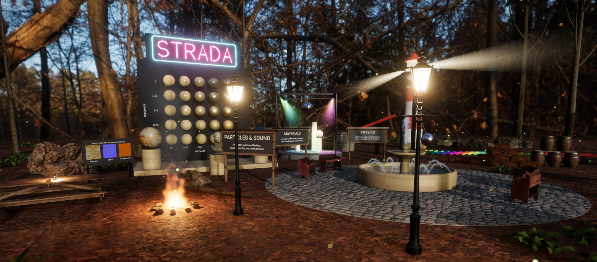

<sub>The Showcase sample as night falls, rendered by Strada's game player. Every screenshot on this page is one the engine
took of itself, with its own screenshot commands.</sub>

</div>

<br>

Strada is a cross-platform engine for 3D games, built to a production bar: every change ships with tests, every file
format users write is versioned and fuzzed, and CI builds and tests it on Windows, macOS and Linux.

- **An editor that agents can drive.** Every editor operation is one of 96 documented automation commands, served to AI
  agents as MCP tools. Agents build scenes, materials, prefabs and scripts, then play, test, debug and export the game,
  through the same undo history as a person at the keyboard.
- **Two ways to script.** C# on .NET 10, hosted in the engine with hot reload, and visual scripts: typed graphs with a
  real debugger (conditional breakpoints, stepping across graphs, values on the wires) that you can edit while the game
  runs.
- **A modern renderer.** Vulkan through NVRHI (MoltenVK on macOS): physically based materials, image-based lighting,
  PCSS soft shadows, GTAO, bloom, post-process volumes, particles, signed-distance text and a screen-space UI.
- **Everything else a game needs.** Jolt physics with joints and character controllers, miniaudio 3D sound, prefabs,
  glTF/FBX/OBJ import, a game player, and a one-command exporter for distributable games.

> [!NOTE]
> Strada is in active development and has no release yet. Build it from source: see [Quick start](#quick-start).

## The Showcase

`Projects/Showcase` puts every feature of the engine in an autumn forest clearing, laid out as exhibits around a
fountain. A camera tour opens it (and lets night fall for a while on the way); then fly around, throw balls, or press F
to walk.

<table>
  <tr>
    <td width="50%">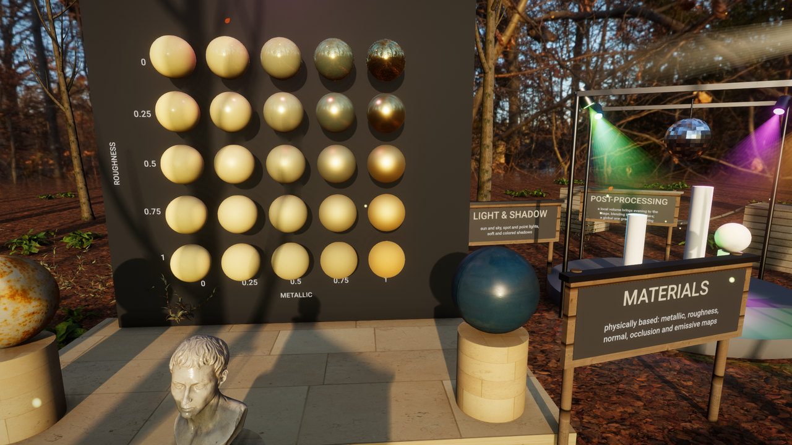</td>
    <td width="50%">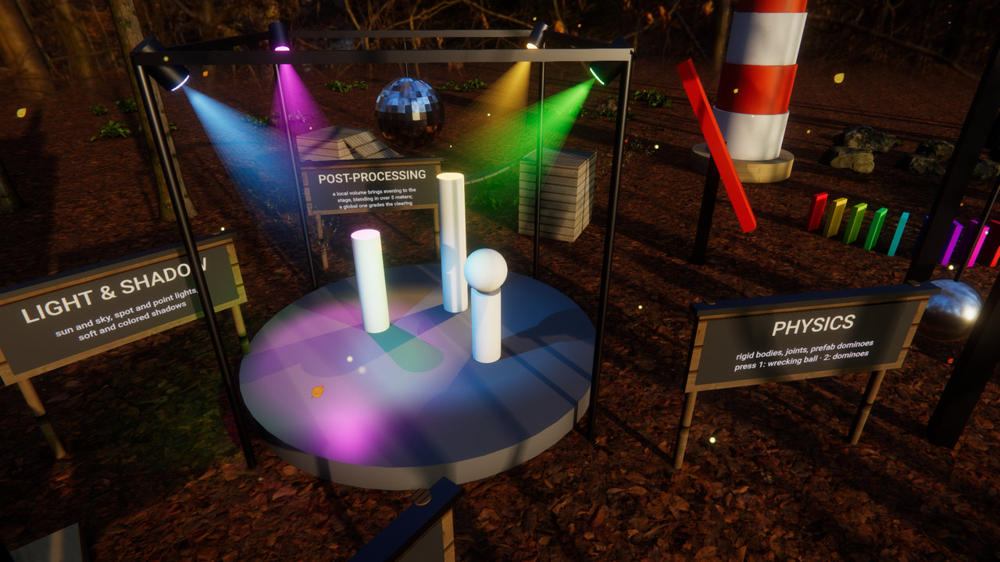</td>
  </tr>
  <tr>
    <td><b>Physically based materials.</b> A metallic and roughness sweep, Poly Haven texture sets with normal and
    occlusion maps, emissive neon that blooms.</td>
    <td><b>Lights and shadows.</b> Colored spot lights and their soft shadows, in an evening that a local post-process
    volume makes.</td>
  </tr>
  <tr>
    <td>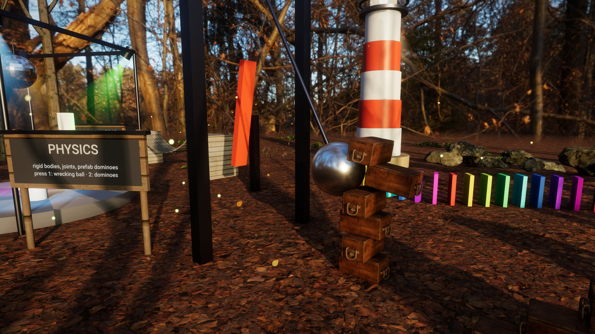</td>
    <td>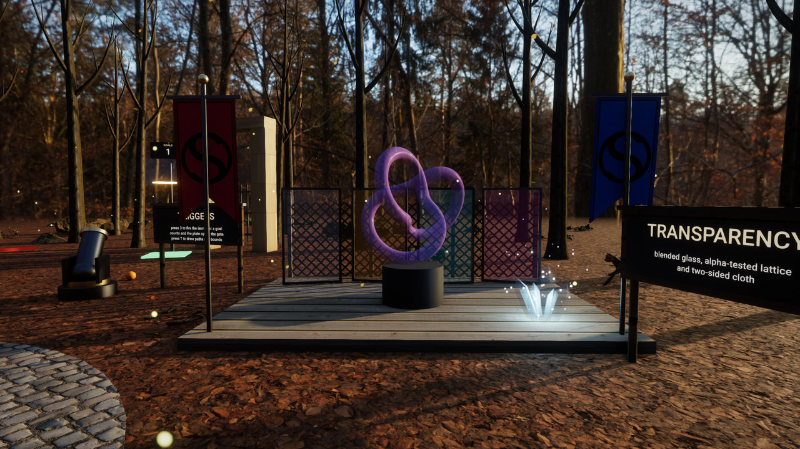</td>
  </tr>
  <tr>
    <td><b>Rigid bodies and joints.</b> A wrecking ball swings on a ball joint into a tower of crates; every domino
    behind it is a rigid body placed as a prefab.</td>
    <td><b>Transparency.</b> Blended glass, alpha-tested lattice and two-sided cloth, sorted and lit with the rest of
    the scene.</td>
  </tr>
  <tr>
    <td>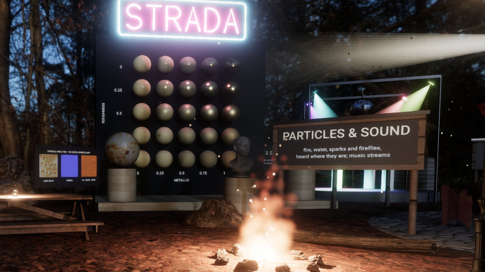</td>
    <td>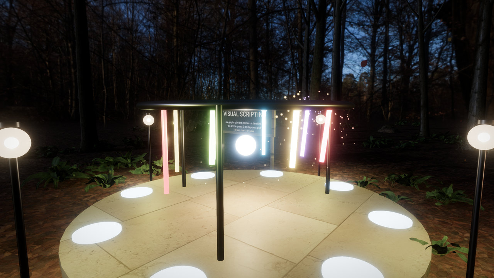</td>
  </tr>
  <tr>
    <td><b>Particles and sound.</b> Fire, smoke, sparks, water and fireflies, each heard where it is, over streamed
    music.</td>
    <td><b>Visual scripting in the scene.</b> In the Graph Garden, six graphs play the chimes to a score kept in a
    timeline; step on a pad to play along.</td>
  </tr>
  <tr>
    <td>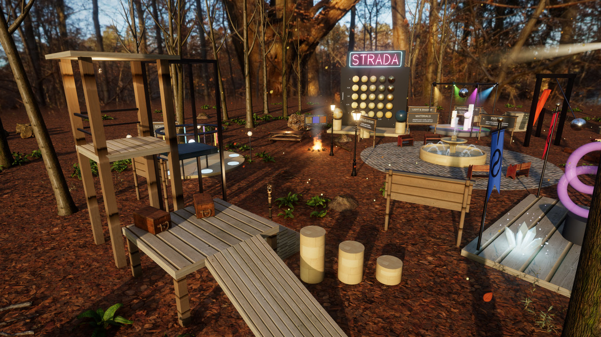</td>
    <td>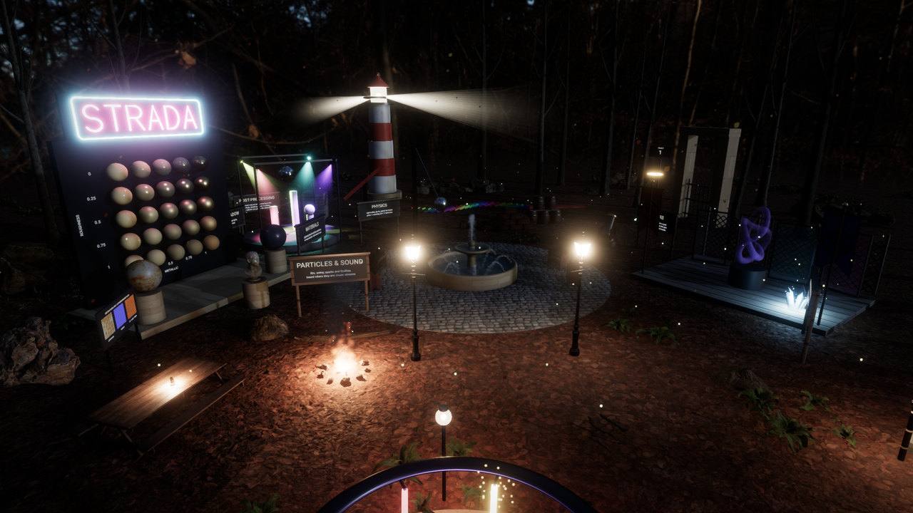</td>
  </tr>
  <tr>
    <td><b>Character controller.</b> Press F to walk: a ramp, stairs, posts to jump along, and a lift up the lookout
    tower.</td>
    <td><b>Day and night.</b> Press L for moonlight, lamps, firelight and neon, graded by a post-process volume of its
    own.</td>
  </tr>
</table>

## The editor

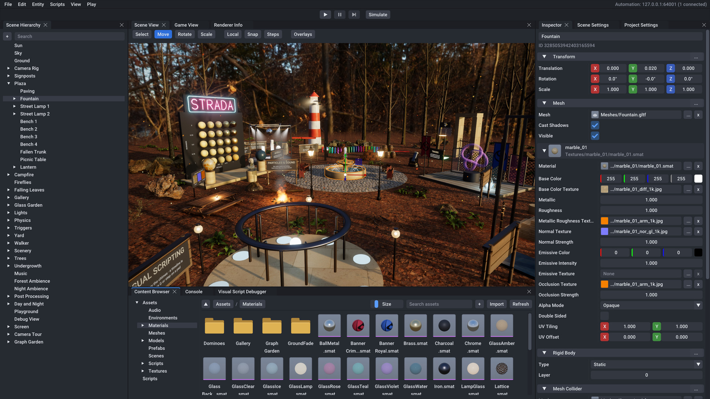

- **Docking, multi-viewport UI** with a scene view (move, rotate and scale gizmos, snapping, overlays for lights,
  colliders, joints, post-process volumes and UI canvases) and a game view, side by side or in tabs.
- **A generated inspector.** Every component's fields come from one registry, with a searchable Add Component menu,
  asset fields with previews, and every mesh's materials edited in place.
- **A content browser** with previews of textures, materials, meshes, fonts and sounds; drop files from the desktop to
  import them, models with their textures.
- **Undo and redo for everything**, including what agents do; play, pause and step, or Simulate for physics alone.
- **Build Game** exports a self-contained game folder for the host platform.

## Visual scripting

Graphs of nodes instead of code, beside C# or instead of it. Every public member of the scripting API is a node, and so
is every C# member you mark `[VisualNode]`. Graphs are typed, analyzed as you edit, and run on their own VM.

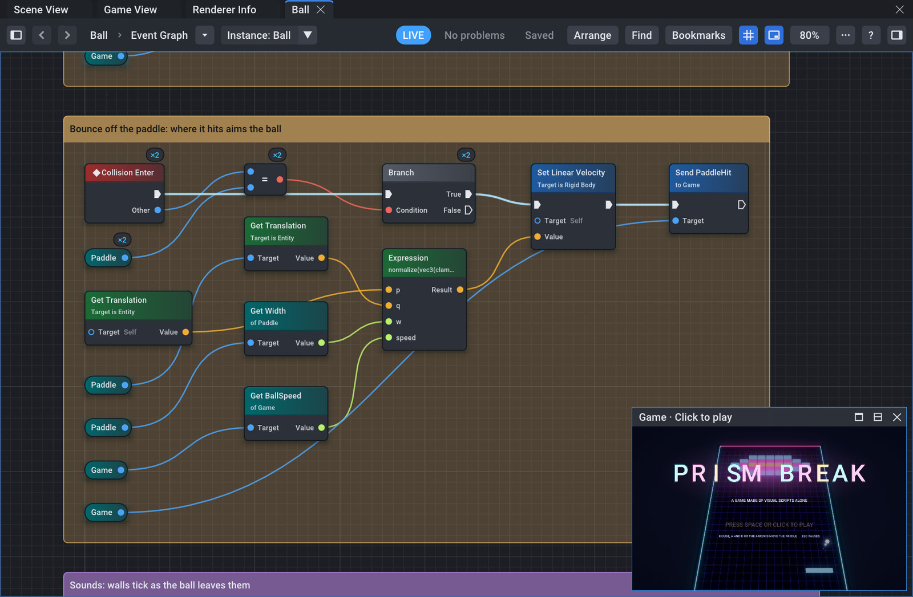

<sub>Prism Break's ball graph while the game plays: the flow lights up as it runs, counts show how often each node ran,
and the game plays in a corner of the canvas.</sub>

- **The whole language:** events, flow and waiting (`Delay`, `WaitUntil`), functions and graph libraries, formulas
  (`min(note + combo, 24)`), text and arrays, curve-keyed timelines with event tracks, and graphs that send, broadcast
  and read each other's variables.
- **Live editing:** change a graph while the game runs and the running game picks the edit up, with a receipt of what
  changed.
- **A debugger:** breakpoints with conditions and hit counts, break on errors, step into, over and out across graphs,
  run to a node, the stopped frame's values on the wires and in the Values tab, and every running instance.
- **Agents use it too:** they author, arrange, debug and fix graphs through MCP, each batch of edits one undoable step.

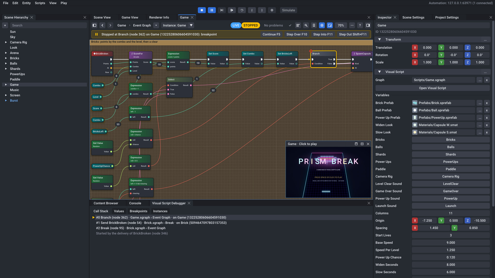

<sub>Stopped at a breakpoint in Prism Break: the call stack crosses graphs (a brick's graph sent BrickBroken to the game's
graph), values sit on the wires, and the inspector shows the graph's variables.</sub>

## Built for AI agents

The editor runs an automation server, and `strada mcp` serves its 96 commands as Model Context Protocol tools (plus
Poly Haven search and import, 102 tools in all). Claude Code and any other MCP client can then drive the editor you are
looking at, or a headless one. Every command has a JSON schema and an entry in [Docs/Automation.md](Docs/Automation.md),
every edit made through them is an undo step like any other, and the editor's tests fuzz them all, except the five that
replace the open project or build scripts, which have tests of their own.

Here an agent finds and fixes a bug in a graph that should spin an object but only shakes it, while the game is paused
(abridged from a session that the editor's tests replay, headless and through `strada mcp`):

```jsonc
→ graph.breakpoints { "graph": "asset://Scripts/Spinner.sgraph", "add": [{ "node": 8, "condition": "Angle > 33.5" }] }
→ play.advance      { "frames": 60 }
← { "framesRun": 24, "stopped": true, "stop": { "reason": "Breakpoint" } }
→ graph.values      { "graph": "asset://Scripts/Spinner.sgraph", "stop": 1 }
← { "variables": [{ "name": "Speed", "value": 90 }, { "name": "Angle", "value": 34.5 }] }
→ graph.step        { "kind": "Over" }
→ graph.values      { "graph": "asset://Scripts/Spinner.sgraph", "stop": 2 }
← { "variables": [{ "name": "Angle", "value": 0 }] }   // wrapped at 36: the formula says % 36, not % 360
→ graph.edit        { "graph": "asset://Scripts/Spinner.sgraph",
                      "operations": [{ "op": "SetFormula", "node": 7, "formula": "(angle + speed * dt) % 360" }] }
← { "changed": true, "live": { "edits": [{ "outcome": "Applied", "instances": 1 }] } }   // fixed while stopped
→ graph.continue    { }
```

This repository's `.mcp.json` registers `strada mcp` for agents working in the checkout, and the
[`strada-make-game`](.claude/skills/strada-make-game/SKILL.md) skill teaches them the workflow. The sample games were
made this way: Prism Break's thirteen graphs, Blocks and the Showcase were all authored by scripts that drive the
editor through the same tools.

## Sample projects

| | Project | What it is |
|:-:|---|---|
| 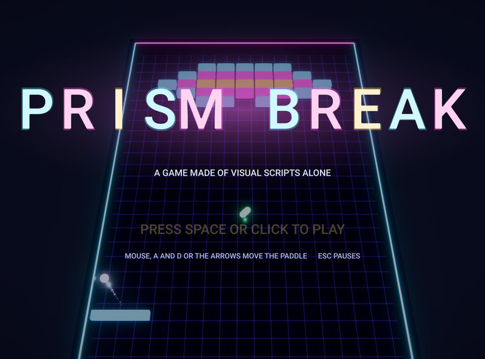 | **[Prism Break](Projects/PrismBreak)** | A neon brick breaker made of visual scripts alone: thirteen graphs, no C#. Its 29 test checks are graphs too. Open `Scripts/Game.sgraph` while it plays and watch it run. |
| 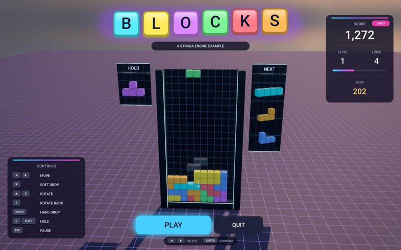 | **[Blocks](Projects/Blocks)** | A falling-blocks game in C#, with an attract mode, a HUD, hold and preview queues, music, debris and camera shake; 57 test checks. |
| 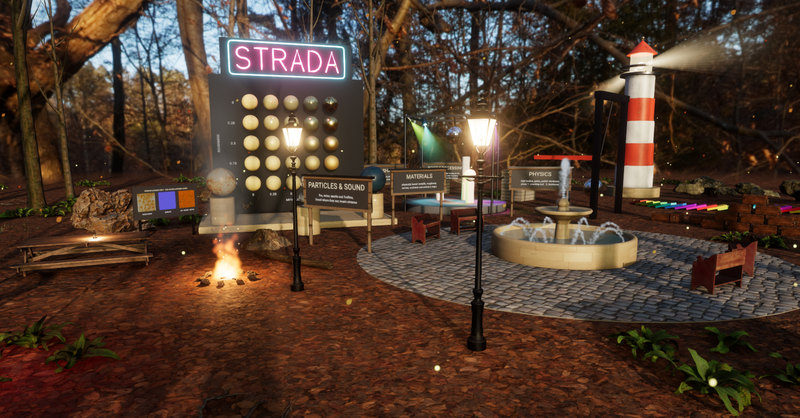 | **[Showcase](Projects/Showcase)** | Every feature of the engine in a forest clearing (above), with a camera tour, a HUD, day and night, and 68 test checks. |

Open a project's `.sproj` in the editor and press Play, or run it with the player:
`StradaRuntime --project Projects/PrismBreak/PrismBreak.sproj`. A fourth project,
[FeatureTest](Projects/FeatureTest), uses every component, the entire scripting API and every built-in node kind; CI
plays it and fails on any failed check.

## Features

<table>
<tr><td width="20%"><b>Rendering</b></td><td>
Vulkan 1.3 through NVRHI, MoltenVK on macOS. Forward PBR (GGX with multiple-scattering compensation),
image-based lighting from HDR environments (<code>strada hdri &lt;id&gt;</code> imports one from
<a href="https://polyhaven.com/hdris">Poly Haven</a>), cascaded PCSS soft shadows for the sun and shadow maps for spot
and point lights, GTAO, an HDR pipeline with bloom and ACES, AgX, PBR Neutral or Reinhard tonemapping, FXAA.
Post-process volumes (exposure, color grading, vignette, chromatic aberration, film grain) blend where the camera is.
Particles, signed-distance text and sprites, frustum and light culling, GPU timing. Shaders are HLSL, compiled at build
time.
</td></tr>
<tr><td><b>Scene and assets</b></td><td>
EnTT entities with 31 components, hierarchies, prefabs, JSON scenes. glTF/GLB, FBX and OBJ import with materials and
textures; HDR environments; WAV, FLAC, Ogg and MP3; TrueType fonts; built-in primitives.
</td></tr>
<tr><td><b>Physics</b></td><td>
Jolt Physics, authored through components and controlled from scripts: rigid bodies, box, sphere, capsule and mesh
colliders, triggers, layers, raycasts, hinge, ball, distance, slider and fixed joints, and character controllers that
walk, climb steps and slopes, jump and push things.
</td></tr>
<tr><td><b>Audio</b></td><td>
miniaudio with 3D spatialization and listeners; music and long ambience stream from their files.
</td></tr>
<tr><td><b>UI</b></td><td>
Screen-space HUDs and menus built from entities: canvases that fit any screen, anchored rectangles, images with rounded
corners, wrapped text, and buttons that scripts hear.
</td></tr>
<tr><td><b>Scripting</b></td><td>
C# on .NET 10, hosted in-process, with hot reload in the editor (<a href="Docs/Scripting.md">scripting guide</a>), and
visual scripts with a debugger and live editing (<a href="Docs/Scripting.md#visual-scripts">visual scripts</a>). The
two mix freely: graphs call C#, and C# sends events to graphs.
</td></tr>
<tr><td><b>Editor</b></td><td>
Docking and multi-viewport ImGui; scene and game views with gizmos, overlays and picking; hierarchy with create menus of
ready-made entities; generated inspector; content browser with previews; project and scene settings; undo and redo;
play, pause, step and simulate; a node editor for visual scripts with a debugger.
</td></tr>
<tr><td><b>Automation</b></td><td>
An automation server with 96 commands, the <code>strada</code> command-line tool and its MCP server
(<a href="Docs/Automation.md">automation reference</a>); Poly Haven HDRIs, models and texture sets searched and imported
by name.
</td></tr>
<tr><td><b>Player and export</b></td><td>
<code>StradaRuntime</code> plays projects and exported games, windowed, headless, or as test runs with a fixed time
step that exit with the number of failed checks. One command exports a self-contained game folder.
</td></tr>
</table>

## Quick start

| | Windows | macOS | Linux (Ubuntu 24.04+) |
|---|---|---|---|
| Compiler | Visual Studio 2022 17.10+ or 2026 (C++ workload) | Xcode 15+ | GCC 13+ or Clang 17+ |
| CMake and Ninja | bundled with Visual Studio | `brew install cmake ninja` | `apt install cmake ninja-build` |
| Other | Python 3.10+ | Python 3.10+ | Python 3.10+, `apt install pkg-config libwayland-dev libxkbcommon-dev xorg-dev libgtk-3-dev` |

All three need the [Vulkan SDK](https://vulkan.lunarg.com/) 1.4.x (the DXC shader compiler, and validation layers for
Debug builds), the [.NET 10 SDK](https://dotnet.microsoft.com/download/dotnet/10.0) (scripting, the `strada` tool and
the C# tests), and a GPU driver with Vulkan 1.3 to run the editor. Third-party libraries are downloaded by CMake,
pinned and verified by SHA256.

```sh
git clone https://github.com/anthony-sv/3d-game-engine.git strada
cd strada
python Tools/build.py --config release          # configure and build: build/<preset>/bin
python Projects/Showcase/Tools/FetchAssets.py   # once: the Showcase's Poly Haven assets (CC0, about 95 MB)
```

Then open a sample in the editor:

```sh
build/windows-release/bin/StradaEditor --project Projects/Showcase/Showcase.sproj    # Windows (PowerShell)
build/linux-gcc-release/bin/StradaEditor --project Projects/Showcase/Showcase.sproj  # Linux
build/macos-release/bin/StradaEditor --project Projects/Showcase/Showcase.sproj      # macOS
```

Press Play. In the Showcase, hold the right mouse button to look, move with WASD, click to throw a ball, press F to walk
(the mouse looks, Space jumps, Shift runs), L for night and C to replay the tour; the screen lists the other keys.

`python Tools/build.py --test` builds Debug and runs every test suite. [AGENTS.md](AGENTS.md) covers the presets,
options and the development workflow.

## Quality

- **More than 2,500 tests** in five suites: 1,866 C++ test cases (doctest) for the engine, the editor and the player,
  and 708 C# test methods (xUnit) for the scripting API and the `strada` tool.
- **Fuzzing.** Every file format users write is fuzzed (damaged documents are refused or repaired; what loads saves and
  loads again), and so are the automation commands, with parameters built from their schemas: each must answer once,
  never with an internal error, and undoing everything must restore the scene.
- **The GPU under test.** Renderer tests run with Vulkan validation enabled and fail on any message; golden images catch
  visual regressions. CI runs them on Mesa lavapipe.
- **The samples are tests.** CI plays FeatureTest, Showcase, Blocks and Prism Break through the player and requires
  every check to pass, and Prism Break's exported game too.
- **CI on three platforms:** MSVC, GCC and Clang with warnings as errors, Debug and Release, plus a format check.

## Repository layout

| Path | Contents |
|------|----------|
| `Strada/` | Engine static library |
| `StradaEditor/` | Editor (`StradaEditor --help` lists its options) |
| `StradaRuntime/` | Game player (`StradaRuntime --help` lists its options) |
| `Strada-ScriptCore/` | C# scripting API |
| `StradaTool/` | `strada`: command-line tool and MCP server for the editor (`strada --help`) |
| `Projects/` | `Showcase`, every feature in a forest clearing; `PrismBreak`, a game made of visual scripts alone; `Blocks`, a falling-blocks game in C#; and `FeatureTest`, which tests every feature |
| `Tests/` | Test suites |
| `cmake/` | Build system modules |
| `Tools/` | Build and formatting scripts |
| `Docs/` | Architecture and design documentation, the automation reference and the scripting guide |
| `.claude/skills/` | Development playbooks for AI agents |

## Documentation

| Document | What it covers |
|---|---|
| [Docs/Architecture.md](Docs/Architecture.md) | The architectural contract: modules, rendering, scene and ECS, physics, audio, scripting, editor, automation, runtime |
| [Docs/Scripting.md](Docs/Scripting.md) | Writing games in C# and in visual scripts, from a first script to debugging graphs and testing a game |
| [Docs/Automation.md](Docs/Automation.md) | The automation protocol, every command, the `strada` tool and its MCP server |
| [AGENTS.md](AGENTS.md) | The development guide for people and agents: building, style, testing and the commit process |

## Contributing

Read [AGENTS.md](AGENTS.md) first. In short: Hazel naming conventions, Allman braces, east const, tabs; every change
ships with tests; every commit is reviewed before it is made; CI must pass on all three platforms.

## Third-party software

Strada builds on Vulkan, NVRHI, EnTT, Jolt Physics, miniaudio, .NET, Dear ImGui, GLFW and others; see
[ThirdPartyNotices.md](ThirdPartyNotices.md) for every dependency and its license. The Showcase's environment, models
and textures are [Poly Haven](https://polyhaven.com) assets (CC0).
